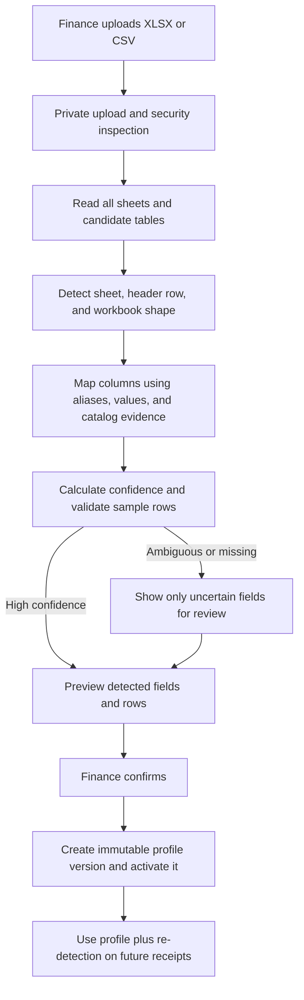

# 5G Router Automatic Excel Recognition Plan

## 1. Goal

Replace the manual **column mapping JSON** shown on the import-profile screen
with a safe, guided Excel upload flow.

The Finance Manager will upload the client's real workbook and the system will
automatically identify:

- the relevant worksheet;
- the header row, even when title or instruction rows appear above it;
- Arabic and English column names;
- serial number, barcode, SKU, product name, model, cost, sale prices,
  commission, currency, tax, condition, and notes;
- workbook-level values such as supplier code, receipt reference, invoice
  number, delivery-note number, and receipt date when they exist;
- the matching product in the organization's serialized product catalog;
- duplicate, missing, malformed, ambiguous, and previously imported serials.

The user will never type or edit JSON. JSON may remain an internal database/API
representation because it is suitable for storing an immutable mapping, but it
will not be exposed as a user input.

## 2. Current behavior and exact change

The current system already uploads XLSX/CSV files from the receipt-import
screen and produces a row preview. Its limitation is that it expects an active
profile whose `header_mapping` was manually entered as JSON on the **Import
Template Versions** screen.

The change will be:

1. Remove the JSON textarea from
   `ProductInventoryImportProfilesScreen.tsx`.
2. Replace it with a drag-and-drop/upload area for a representative XLSX or CSV
   file.
3. Analyze the file without creating inventory or a receipt.
4. Show the detected structure in a human-readable preview.
5. Automatically save and activate the profile when all required fields are
   confidently recognized.
6. If any field is ambiguous, show a simple column dropdown only for that
   field. The user still never sees JSON.
7. Reuse the same recognition engine during every receipt upload so a changed
   client file can be detected before the wrong profile is applied.

## 3. Target user experience

### 3.1 Create a template version

The new form will contain:

- template name;
- optional supplier selection;
- an **Upload sample Excel** area;
- optional approval/UAT note.

After upload, the screen will show progress stages:

1. Security check;
2. Reading workbook sheets;
3. Detecting the data table and headers;
4. Recognizing columns and commercial fields;
5. Matching products and validating sample rows;
6. Preparing the result.

### 3.2 Recognition result

The result screen will display:

- detected sheet name;
- detected header row;
- number of data rows and serials;
- detected workbook shape;
- every client column mapped to a clear Arabic field label;
- confidence badge for each field: **Confirmed**, **Needs review**, or
  **Unrecognized**;
- the first 20 normalized device rows;
- warnings and blocking errors with worksheet cell locations;
- product-match, pricing, and commission summaries.

The primary action will be:

- **Save and activate automatically** when recognition is safe; or
- **Review 1–N uncertain fields** when human confirmation is required.

There will be no generic mapping editor and no JSON fallback in the UI.

### 3.3 Normal receipt import

For future receipts, Finance uploads the workbook on the existing Excel import
screen. The system will:

1. calculate a layout fingerprint;
2. select the best matching approved profile;
3. independently re-detect the structure as a safety check;
4. parse and validate every device;
5. show the existing editable row preview;
6. block commitment until every blocking issue is corrected;
7. create the receipt draft only after Finance confirms the preview.

## 4. End-to-end flow

## 5. Recognition engine

### 5.1 Workbook discovery

The server will read every sheet instead of assuming the first sheet. For each
sheet it will inspect up to the first 100 rows and a bounded sample of data.

Each sheet receives a score based on:

- recognizable inventory headers;
- a serial-like high-uniqueness column;
- product identifiers such as SKU, barcode, name, or model;
- numeric price/cost columns;
- number of coherent data rows below the candidate header;
- penalties for cover sheets, summaries, totals, or mostly empty content.

The highest safe score wins. Close scores are shown as a sheet choice instead
of silently selecting the wrong table.

### 5.2 Header-row detection

Rows 1–100 are evaluated as possible headers. The score combines:

- normalized exact aliases;
- Arabic/English token matches;
- fuzzy header similarity;
- uniqueness of cells in the candidate row;
- compatibility of the next rows with the expected field types;
- required-field coverage.

This supports workbooks with a title, logo, supplier details, blank rows, or
instructions above the table.

### 5.3 Column recognition

Recognition is deterministic and explainable. It will combine four evidence
levels:

1. **Approved history:** exact header/layout matches from an existing profile.
2. **Header aliases:** canonical names and Arabic/English business synonyms.
3. **Header similarity:** token and fuzzy matching after Unicode normalization.
4. **Data evidence:** values below the header must behave like the proposed
   field.

A one-to-one assignment prevents two client columns from silently mapping to
the same canonical field.

| Canonical field | Main recognition evidence |
|---|---|
| Serial number | High uniqueness, text/alphanumeric identifiers, stable length, leading-zero awareness |
| Barcode | Mostly numeric identifiers, common 8–14 digit lengths, catalog barcode matches |
| Product SKU | Exact or normalized catalog SKU matches |
| Product name | Exact name, approved alias, then bounded fuzzy catalog match |
| Model | Catalog model matches and repeated product grouping |
| Unit cost | Positive decimal values and cost/purchase header vocabulary |
| Planned sale price | Positive decimal values and sale/retail vocabulary |
| Minimum/maximum price | Numeric range relationship around the planned price |
| Commission type | Values such as fixed/flat, percentage, none, مبلغ, نسبة |
| Commission value | Non-negative numeric values compatible with the detected type |
| Commission base | Net/gross and صافي/إجمالي categorical values |
| Currency | ISO codes or known currency labels/symbols, defaulting to organization currency only when absent |
| Condition | New/open-box/refurbished and Arabic equivalents |
| Notes | Free text not classified as a stronger field |

### 5.4 Confidence rules

Every mapping will have a stored score and explanation:

- `>= 0.92`: automatically confirmed;
- `0.75–0.91`: proposed but requires one-click review;
- `< 0.75`: unresolved and blocks profile activation if required.

Confidence cannot override structural validation. For example, a column named
"Serial" will not be accepted if its sample values are formulas, empty, or
clearly monetary values.

### 5.5 Supported workbook shapes

The first release should support these common client formats:

- one device per row;
- product/commercial values supplied once and blank on following serial rows;
  safe bounded forward-fill will apply within the same product group;
- repeated title/header rows inside long exports;
- separate sheets for products, cities, or batches, when their structures are
  compatible;
- several serial columns on one product row; these columns are expanded into
  one normalized device row per serial;
- Arabic, English, or mixed headers;
- extra unknown columns, retained in raw audit data but ignored for inventory.

Merged cells and subtotal rows will be recognized as layout elements and will
not become devices. Conflicting sheets or incompatible table shapes will
require review rather than being merged automatically.

## 6. Automatic workbook metadata

The engine will also look above and around the detected table for labeled
values such as:

- supplier name/code;
- invoice number;
- delivery-note number;
- receipt reference;
- receipt date;
- currency;
- ownership type;
- warehouse code/name.

Rules:

- a uniquely matched supplier or warehouse can be preselected;
- an absent warehouse uses the organization's configured default, visibly;
- an absent currency uses the organization's/profile default, visibly;
- conflicting supplier, warehouse, date, or currency evidence blocks automatic
  confirmation;
- the system never invents a cost, sale price, or commission. Missing financial
  fields may use an approved catalog/profile default only when that source is
  displayed and Finance confirms it.

## 7. Product matching

Product matching will preserve the current strong order:

1. exact SKU;
2. exact barcode;
3. exact normalized product name;
4. approved organization alias;
5. bounded fuzzy name match, narrowed by model.

An ambiguous product is never silently selected. Finance will see the candidate
products and select one. The confirmed alias can optionally be stored for
future imports in the same organization.

## 8. API design

### 8.1 Analyze sample workbook

`POST /api/sales/inventory/import-profiles/analyze`

- Authorization: Admin or Finance Manager.
- Request: `multipart/form-data` containing the file, supplier if selected,
  template name, and command/request IDs.
- Response: analysis ID, detected sheet/header/shape, field proposals,
  confidence explanations, metadata proposals, sample rows, and errors.

### 8.2 Confirm detected profile

`POST /api/sales/inventory/import-profiles/{analysisId}/confirm`

- Accepts the selected proposals and only the user's explicit corrections.
- Revalidates the analysis server-side.
- Creates a new immutable profile version through an atomic database command.
- Deactivates the previous version and activates the new one in the same
  transaction.
- Is idempotent by organization and command ID.

### 8.3 Receipt preview integration

The existing
`POST /api/sales/inventory/receipts/{receiptId}/excel-preview` endpoint will use
the recognition engine before parsing:

- exact fingerprint profile match;
- compatible profile match;
- automatic recognition fallback;
- blocking review response if required fields are still uncertain.

It will no longer fail merely because no manually created active profile
exists.

## 9. Database changes

Create a forward-only migration after `schema_v147`.

### 9.1 Analysis table

Add `product_inventory_import_analyses` with:

- organization, actor, supplier, command, and request IDs;
- private managed sample-file reference and SHA-256;
- status: `analyzing`, `needs_review`, `ready`, `confirmed`, `failed`, `expired`;
- detected sheet, header row, workbook shape, and layout fingerprint;
- detected mapping and per-field confidence/explanations;
- detected metadata and sample statistics;
- blocking errors and warnings;
- expiry, confirmation, and audit timestamps;
- tenant-scoped unique/idempotency constraints.

Direct browser writes remain blocked. Only service commands can create or
confirm analyses.

### 9.2 Profile additions

Extend `product_inventory_import_profiles` with:

- `recognition_mode` (`automatic` or `reviewed`);
- `layout_fingerprint`;
- `source_analysis_id`;
- mapping-confidence snapshot;
- detected workbook-shape version;
- sample-file hash and approval evidence.

The internal `header_mapping` remains immutable audit data. It is generated by
the recognition engine, not typed by a user.

### 9.3 Auditability

Every receipt source will retain:

- file hash and private storage path;
- profile and profile version used;
- recognition-engine version;
- detected and corrected mappings;
- confidence snapshot;
- exact sheet/header/row source;
- actor and confirmation timestamps.

This allows the same file to be reproduced and explains why every column was
mapped.

## 10. Code changes

### Frontend

- Replace JSON editing in
  `src/components/product-inventory/ProductInventoryImportProfilesScreen.tsx`.
- Add a reusable workbook upload/drop zone.
- Add recognition progress, mapping cards, uncertain-field selectors, metadata
  review, and sample-row preview.
- Update `ProductInventoryImportScreen.tsx` to display the selected profile,
  detected layout, and any layout-change warning.
- Keep the interface RTL, mobile usable, keyboard accessible, and fully
  Arabic-labeled.

### Server and parsing

- Extend `workbook-server.ts` to enumerate/read all sheets safely.
- Add `workbook-recognition.ts` for sheet scoring, header detection, field
  scoring, shape detection, fingerprints, and explanations.
- Reuse the existing normalization, catalog matching, row validation, duplicate
  detection, formula protection, and commercial validation in `workbook.ts`.
- Add profile analyze/confirm routes and service methods.
- Integrate automatic recognition into the existing Excel preview route.
- Version the recognition algorithm so historical imports remain reproducible.

### Database and contracts

- Add the new migration, manifest entry, schema checksum, command functions,
  RLS/service grants, indexes, and cleanup policy for expired analyses.
- Extend product-inventory types and automated hardening verification.

## 11. Security and safety controls

- Accept XLSX and CSV only; continue rejecting legacy XLS and macro-enabled
  XLSM files.
- Verify extension, MIME, and file signature; malware-scan before parsing.
- Preserve the current 10 MB and 10,000-row limits, plus sheet/column/cell and
  decompression-ratio limits against workbook zip bombs.
- Keep sample files in private storage with organization-scoped paths.
- Escape spreadsheet formulas in exports and reject formula-like identifiers or
  commercial inputs.
- Never evaluate formulas, macros, links, or embedded objects.
- Enforce organization-scoped database relations and service-only mutations.
- Redact raw cell contents from normal application logs.
- Expire abandoned analyses and remove their private sample files through the
  managed retention workflow.

## 12. Error behavior

Errors must identify the exact problem and location, for example:

- `Sheet "Devices", cell F14: serial number is empty.`
- `Columns C and D both look like serial numbers; choose the correct column.`
- `Sheet "Summary" does not contain device-level rows.`
- `Row 82: serial 001234 already exists in confirmed stock.`
- `Sale price is outside the detected minimum/maximum range.`
- `Supplier code conflicts with the supplier selected by Finance.`

No partial profile, receipt, stock unit, movement, or commercial term will be
created after a failed analysis or confirmation.

## 13. Testing plan

### Unit tests

- Arabic/English header normalization and aliases;
- fuzzy header scores and one-to-one assignment;
- header rows after titles/blank rows;
- serial versus barcode and price-column inference;
- leading-zero serial preservation;
- row-per-device, continuation rows, repeated headers, and serial-column shapes;
- sheet scoring and ambiguous-sheet behavior;
- layout fingerprint stability;
- confidence thresholds and explanations;
- missing financial values and default-source labeling.

### Database/integration tests

- Finance access and unauthorized denial;
- cross-tenant analysis/profile rejection;
- private file metadata and retention;
- concurrent confirmation produces one profile version;
- idempotent analysis and confirmation replay;
- previous active profile deactivates atomically;
- no-profile receipt import succeeds through automatic recognition;
- layout change triggers review instead of applying a stale mapping;
- rollback on storage, outbox, or database-command failure.

### UAT workbook set

Test at least:

- canonical system template;
- the client's current real workbook;
- Arabic-only headers;
- English-only headers;
- title rows and merged cells;
- multiple sheets including a summary sheet;
- blank continuation rows;
- multiple serial columns;
- unknown extra columns;
- duplicated serials and numeric serials with lost leading zeros;
- missing prices, invalid commissions, conflicting currency, and unknown
  products;
- 10,000-row boundary workbook.

## 14. Delivery phases

### Phase 1 — Recognition engine

- all-sheet reader;
- sheet/header/column/shape detection;
- confidence and explanations;
- deterministic tests using representative fixtures.

### Phase 2 — Upload-based profile creation

- analysis/confirmation database commands and API routes;
- private sample storage;
- replace the JSON UI with upload, preview, and limited uncertainty review;
- immutable automatic profile versions.

### Phase 3 — Runtime receipt integration

- fingerprint-based profile selection;
- per-file re-detection and layout-change protection;
- automatic metadata proposals;
- existing editable device preview and atomic receipt preparation.

### Phase 4 — Hardening and rollout

- concurrency, tenant, RLS, file-security, rollback, and large-file tests;
- monitoring for failed/expired analyses and frequent low-confidence layouts;
- staging UAT using client workbooks;
- controlled Finance pilot and sign-off.

Each phase should be committed and pushed independently after its tests pass.

## 15. Acceptance criteria

The feature is complete when:

- no screen asks a user to enter JSON;
- Finance can create a template version by uploading an Excel sample;
- the system detects the correct sheet and header row for all approved UAT
  workbooks;
- required columns are automatically recognized or specifically highlighted;
- at least 95% of agreed client workbook layouts require no manual mapping;
- every uncertain financial or identifier field requires explicit review;
- the preview explains the source and confidence of every detected field;
- a changed workbook layout cannot silently use an incompatible old mapping;
- duplicate serials and tenant/catalog conflicts are blocked before commitment;
- profile activation and receipt preparation are atomic and idempotent;
- the original file, generated mapping, corrections, profile version, and actor
  remain fully auditable;
- database, unit, security, build, and client UAT gates all pass.

## 16. Product decision

The preferred implementation is a deterministic, organization-scoped
recognition engine rather than sending financial workbooks to an external AI
service. It is faster, explainable, reproducible, and keeps serial and pricing
data inside the system. Approved corrections become aliases/profile evidence,
so recognition improves for the client's future files without turning a wrong
guess into an automatic financial decision.
