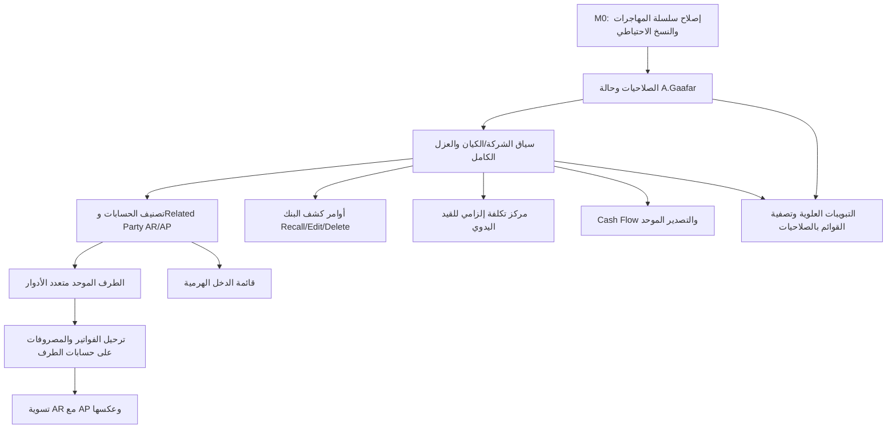

# خطة التنفيذ التفصيلية لتعديلات قسم المحاسبة

> الحالة: Proposed — جاهزة لمراجعة صاحب المنتج والمدير المالي والفريق الهندسي قبل التنفيذ
>
> تاريخ التحليل: 2026-08-17
>
> النطاق: التعديلات العشرة التي تم تسليمها في المحادثة، مع تحليل كامل للترابط بينها وبين قسم المحاسبة الحالي
>
> خط الأساس: الفرع main عند المراجعة، مع الحفاظ على جميع التغييرات والملفات الحالية
>
> نوع التسليم الحالي: خطة فقط؛ لا يتضمن هذا الملف تنفيذًا وظيفيًا أو تغييرًا في قاعدة البيانات

---

## 1. الملخص التنفيذي

المطلوب ليس مجموعة تعديلات شكلية منفصلة. سبعة من التعديلات العشرة تعتمد مباشرة على ثلاثة أسس مشتركة يجب تنفيذها أولًا:

1. تفعيل الكيان القانوني/الشركة كحد أمني ومحاسبي حقيقي في جميع القيود والحسابات والأطراف والبنوك والتقارير، وليس كفلتر واجهة فقط.
2. توحيد العميل والمورد في سجل طرف محاسبي واحد متعدد الأدوار، مع حسابات AR/AP قابلة للاختيار وآلية تسوية حقيقية.
3. نقل العمليات الحساسة إلى أوامر ذرية، مقيّدة بالإصدار، قابلة لإعادة المحاولة بأمان، ومسجلة في سجل التدقيق والأحداث.

يوجد في المشروع أساس مهم يمكن البناء عليه:

- جدول الحسابات يحتوي بالفعل على type وsubtype وnormal_balance وparent_id.
- توجد حقول statement_group وcontrol_type وis_posting_account في مخطط لاحق، لكنها غير موصولة بصورة كاملة بواجهة الحسابات أو أوامر الحفظ.
- توجد جداول الكيانات القانونية والدفاتر ونطاقات المستخدمين، لكنها غير مطبقة على معظم عمليات القراءة والكتابة والتقارير.
- يوجد جدول accounting_parties وحسابا ar_account_id وap_account_id، لكنه غير مستخدم في شاشات العملاء والموردين ولا يسمح بدور عميل ومورد معًا بشكل سليم.
- يوجد نظام بنكي حديث تحت banking_*، لكنه يفتقد أوامر Recall/Edit/Delete الآمنة.
- تقرير التدفقات النقدية يعيد القيم المطلوبة بالفعل، لكن مكان عرضها وحساب الرصيد الافتتاحي يحتاجان إلى تصحيح.

أهم نتيجة تشخيصية: حساب A.Gaafar مُعدّ في بيانات التهيئة كـ finance_manager. رسالة الخطأ الظاهرة تطابق دالة accounting_save_customer التي تقارن حالة الملف الشخصي بالقيمة Active بحساسية لحالة الأحرف، بينما بيانات التهيئة تكتب active. لذلك الإجراء الصحيح هو فحص البيانات ثم إصلاح شرط التحقق وتوحيد حالة الحساب، وليس ترقية المستخدم عشوائيًا.

أهم مخاطر التنفيذ:

- إظهار محدد الشركة قبل تطبيق العزل على الخادم سيعطي إحساسًا زائفًا بالعزل وقد يخلط بيانات شركات مختلفة.
- فرض مركز التكلفة NOT NULL على كل سطور القيود سيكسر قيودًا آلية حالية لا تحمل مركز تكلفة.
- يوجد نموذجان للبنوك وثلاثة تمثيلات للأطراف؛ التنفيذ على النموذج الخطأ سيؤدي إلى split-brain.
- سلسلة المهاجرات غير متسقة حاليًا: manifest ينتهي عند v165، وملف v166 موجود خارج manifest، وملف schema-version ما زال عند v160. يجب إصلاح هذا قبل إضافة أي migration جديد.

---

## 2. القرارات المعمارية المعتمدة في هذه الخطة

هذه القرارات تمنع تنفيذ حلول مؤقتة متعارضة:

| المجال | القرار |
|---|---|
| مفهوم الشركة | استخدام accounting_legal_entities، وعدم استخدام sales_companies لأنها تمثل شركات/ناقلات المبيعات وليست كيانات قانونية محاسبية |
| نموذج البنك | اعتماد banking_* وواجهات /banking الحالية لهذا النطاق؛ جعل accounting_bank_* القديم read-only ثم وضع خطة إهمال واضحة |
| نموذج الطرف | اعتماد accounting_parties كسجل الهوية المحاسبية الرئيسي، وإضافة accounting_party_roles لدعم customer وvendor معًا |
| التوافق القديم | إبقاء accounting_customers وaccounting_vendors كواجهتي توافق وروابط انتقالية إلى الطرف الموحد حتى اكتمال ترحيل المستهلكين |
| مصدر AP في الإصدار الأول | استخدام المصروف المعتمد المرتبط بمورد كفاتورة/مستند دائن حالي، بعد إضافة رقم فاتورة المورد وتاريخ الاستحقاق والرصيد المتبقي؛ لا يلزم بناء دورة مشتريات كاملة |
| تسوية العميل/المورد | تسوية بلا حركة نقدية: Dr AP / Cr AR بقيمة المبلغ المطابق، مع دعم كامل/جزئي وعكس التسوية |
| مركز التكلفة | إلزامي على كل سطر في القيد اليدوي عند اختيار الحساب، في المسودة والإرسال؛ لا يطبق كـ NOT NULL عالمي على القيود الآلية في هذه المرحلة |
| العملات في التسوية | الإصدار الأول يسمح فقط بنفس العملة والكيان القانوني؛ العملات المختلفة أو الشركات المختلفة تُرفض وتنتقل لاحقًا لمسار FX/Intercompany |
| تصنيف قائمة الدخل | statement_group هو المصدر الرئيسي، وsubtype fallback مؤقت أثناء الترحيل؛ لا يتم التخمين من رقم الحساب فقط |
| التصدير | واجهة تصدير موحدة من الخادم لكل تقرير، وتدعم CSV وXLSX وPDF الحقيقي، باستخدام نفس بيانات وفلاتر التقرير المعروض |
| الحذف المحاسبي | لا حذف مادي لأي مستند تمت تسويته أو اعتماده؛ الحذف في كشف البنك Soft Delete/Archive وبشروط |

إذا أراد صاحب المنتج تغيير أحد هذه القرارات، يجب تعديله قبل بدء المهاجرات لأن أثره يمتد إلى البيانات والواجهات والاختبارات.

---

## 3. مصفوفة المتطلبات العشرة

| الرمز | المطلوب | الوضع الحالي | النتيجة المستهدفة |
|---|---|---|---|
| R1 | خانة تفصيل الحساب قبل Debit/Credit | type وnormal_balance ظاهران؛ subtype موجود في DB/API وغير ظاهر في الواجهة | Dropdown تصنيف فرعي مرتبط بنوع الحساب، محفوظ ومتحقق منه ويظهر في الدليل |
| R2 | Recall/Edit/Delete لكشف البنك | القائمة تعرض View فقط | قائمة إجراءات محكومة بالحالة والصلاحية، بأوامر ذرية وتدقيق وSoft Delete |
| R3 | تمكين A.Gaafar كمدير مالي/حل الخطأ | بيانات التهيئة تعطيه finance_manager؛ RPC يرفض active بسبب مقارنة Active | تشخيص البيانات، إصلاح التحقق case-insensitive، توحيد الحالة، ورسالة عربية قابلة للتصرف |
| R4 | الطرف عميل ومورد وتسوية فاتورتين | عملاء وموردون منفصلون؛ لا توجد AR/AP netting | طرف واحد بدورين، مستندات مفتوحة، تسوية كاملة/جزئية، قيد Dr AP / Cr AR، وعكس |
| R5 | Tabs علوية مثل Odoo | Sidebar طويلة ولا توجد مساحة محاسبية علوية مشتركة | شريط تبويبات/قوائم علوية موحد للمحاسبة والبنوك، RTL ومتجاوب ومحكوم بالصلاحيات |
| R6 | Related Party + AR/AP dropdown | AR/AP افتراضية على مستوى المنظمة؛ حقول party غير موصولة | حسابات Related Party لكل كيان، واختيار AR/AP للطرف بواسطة المدير المالي فقط |
| R7 | Opening/Net/Closing أسفل Cash Flow + Export لكل التقارير | القيم أعلى التقرير؛ opening فيه حد تاريخي مشكوك؛ التصدير متفرق | ملخص ختامي صحيح أسفل التقرير، ومصدّر موحد داخل كل تقرير |
| R8 | اختيار الشركة قرب اسم المستخدم | كيانات قانونية موجودة بلا Provider/Selector وبلا عزل شامل | محدد شركة موثوق، يرشح كل البيانات ويختم القيود والأرقام والدفتر بالكيان المختار |
| R9 | مركز التكلفة Mandatory عند اختيار الحساب | اختياري في UI/API/RPC | إلزامي لكل سطر قيد يدوي، مع تحقق ثلاثي UI/API/DB |
| R10 | إعادة تصميم قائمة الدخل بالكامل | تقرير مسطح يعرض مفاتيح وحقول تقنية | قائمة دخل هرمية قابلة للطي، بمجاميع وصيغ محاسبية وتصدير مطابق |

---

## 4. نتيجة تحليل الوضع الحالي

### 4.1 طبقات التطبيق

| الطبقة | الملفات/المكونات الرئيسية | ملاحظة |
|---|---|---|
| واجهات المحاسبة | src/components/accounting/AccountingScreens.tsx | ملف كبير يجمع الحسابات والأطراف والقيود والتقارير؛ يجب تفكيكه تدريجيًا |
| صفحات المحاسبة | src/app/(app)/accounting/** | أغلبها wrappers رفيعة حول AccountingScreens |
| صفحات البنك | src/app/(app)/banking/** | منفصلة عن مساحة المحاسبة رغم اعتمادها عليها |
| API المحاسبة | src/app/api/accounting/[...segments]/route.ts | Dispatcher كبير جدًا، وبعض ترتيب فروعه يجعل accounts/search غير قابل للوصول |
| API البنك | src/app/api/banking/[...segments]/route.ts | كتابات مباشرة غير ذرية وغير versioned |
| خدمات العميل | src/lib/services/accounting.ts وsrc/lib/services/banking.ts | لا تحمل سياق الكيان في كل الطلبات ولا تدعم Blob export بصورة صحيحة |
| الأنواع | src/types/accounting.ts | يحتوي أجزاء من النماذج المتقدمة، لكنها غير مستعملة بالكامل |
| التقارير | src/lib/accounting/reports.ts وsrc/lib/accounting/reports/** | خليط بين تقارير قديمة مسطحة وتقارير منظمة أحدث |
| الصلاحيات | src/lib/accounting/permissions.ts | صلاحيات عامة؛ جدول الصلاحيات التفصيلي موجود لكنه غير مطبق فعليًا |
| سياق الكيان | src/lib/server/accounting/context.ts | موجود لكنه لا يُستخدم في المسارات التشغيلية، وبه fallbacks يجب جعلها fail-closed |

### 4.2 قواعد البيانات ذات الصلة

| الملف | ما يمكن إعادة استخدامه | الفجوة |
|---|---|---|
| db/schema_v37_accounting_module.sql | الحسابات، القيود، العملاء، الموردون، الفواتير، المصروفات، المدفوعات، الإعدادات | معظم المفاتيح والقيود على مستوى organization فقط |
| db/schema_v63_atomic_accounting_journals.sql | أوامر القيد والحفظ والترحيل والعكس والعدادات | لا legal_entity/book ولا إلزام مركز تكلفة |
| db/schema_v64_atomic_accounting_documents.sql | أوامر الفاتورة والمصروف والدفع | تستخدم AR/AP الافتراضية للمنظمة ولا تدعم party-specific accounts أو netting |
| db/schema_v66_accounting_controls.sql | تقرير مطابقة المصدر مع دفتر الأستاذ | ليس تسوية عميل/مورد |
| db/schema_v93_atomic_finance_team.sql | تغيير دور فريق المالية بأمر مدقق | المسار الصحيح إن أثبت التشخيص أن دور المستخدم غير صحيح |
| db/schema_v98_atomic_sales_accounting_customer_link.sql | حفظ العميل وربطه بالمبيعات | يحتوي سبب خطأ A.Gaafar: مقارنة Active بشكل case-sensitive |
| db/schema_v107_atomic_accounting_master_data.sql | أوامر ذرية للحسابات والموردين ومراكز التكلفة | لا يحفظ حقول v113 مثل statement_group/control_type/is_posting_account |
| db/schema_v112_accounting_legal_entities.sql | كيانات وفروع ودفاتر ونطاقات مستخدمين وحقول legal_entity_id | التنفيذ التشغيلي لا يستخدمها؛ backfill يتوقف مبكرًا إذا وجد default entity |
| db/schema_v113_accounting_dimensions_and_coa.sql | statement_group وcontrol_type وسياسات الأبعاد | لا توجد آلية إنفاذ في حفظ/ترحيل القيد |
| db/schema_v115_accounting_treasury.sql | نموذج بنكي قديم موسع | غير مستخدم في الشاشات الحالية |
| db/schema_v117_accounting_ar_ap_party.sql | party وAR/AP وpayment allocations | party_type مفرد؛ allocations مرتبطة بالدفع ولا تنفذ netting |
| db/schema_v121_accounting_reporting_delivery.sql | schedules/runs/formats | لا يوجد pipeline تصدير فعلي |
| db/schema_v163_customer_vendor_permissions.sql | جدول صلاحيات تفصيلي | غير مطبق على CRUD ويمكن للمحاسب حاليًا تعديل المنح عبر المسار العام |
| db/schema_v165_banking_module.sql | الجداول المستخدمة فعليًا في /banking | بلا كيان/إصدار/أرشفة/تدقيق أو أوامر ذرية |

### 4.3 فجوات حرجة يجب ألا تُرحّل إلى الحل الجديد

- getUserAllowedEntities يعيد جميع كيانات المنظمة عند عدم وجود scope؛ هذا fail-open ويجب تغييره.
- resolveAccountingEntityContext يرجع fallback عند إرسال كيان غير مسموح صراحة؛ المطلوب 403.
- الحسابات والقيود والتقارير الأساسية تكتفي بفلتر organization_id.
- عداد المستندات unique على المنظمة والفترة والبادئة، وليس على الكيان/الدفتر.
- accounting_settings سجل واحد لكل منظمة، رغم أن الحسابات الافتراضية يجب أن تختلف باختلاف الكيان/الدفتر.
- accounting_backfill_default_entity لا يعالج سجلات NULL الجديدة إذا كان الكيان الافتراضي موجودًا مسبقًا.
- الحسابات الآلية للفواتير والمصروفات والرواتب والاستهلاك والمخزون لا تمرر الكيان بصورة موحدة.
- مسار permissions/grant وpermissions/revoke يمر تحت manage العام؛ يجب قفله قبل الاعتماد على الصلاحيات التفصيلية.
- CSV الحالي قابل لمشكلة Spreadsheet Formula Injection ولا يمثل البنية الهرمية للتقارير.
- النظام يحتوي كلمات مرور تشغيلية صريحة في سكربت تهيئة متتبع؛ يجب تدويرها ونقلها إلى أسرار بيئية دون ذكرها في الوثائق.

---

## 5. البنية المستهدفة وترتيب الاعتماديات

القاعدة: لا يتم إطلاق محدد الشركة أو التسوية أو التقارير الجديدة قبل اكتمال entity scoping على الخادم واجتياز اختبارات العزل.

---

## 6. الأساس المشترك قبل تنفيذ الشاشات

### 6.1 إصلاح سلسلة المهاجرات — بوابة M0

الوضع الذي كشفه الفحص:

- db/migrations.manifest.json ينتهي عند schema_v165_banking_module.
- db/schema_v166_manual_deduction_entries.sql موجود لكنه غير مسجل ولا مستبعد.
- src/lib/schema-version.json ما زال يشير إلى schema_v160.
- node scripts/verify-migrations.mjs يفشل بسبب النقطتين السابقتين.

الإجراء المطلوب قبل إنشاء migration محاسبي جديد:

1. تحديد هل v161–v166 مطبقة فعليًا على كل بيئة.
2. تسجيل v166 في manifest أو اتخاذ قرار ترحيل صحيح يحافظ على append-only history.
3. تحديث schema-version إلى رأس manifest مع checksum الصحيح.
4. تشغيل verify-migrations واختبار سلسلة المهاجرات على PostgreSQL مؤقت.
5. بعد نجاح ذلك فقط، تخصيص أرقام المهاجرات الجديدة ابتداءً من الرقم التالي المتاح. لا يعتمد هذا الملف أرقامًا نهائية قبل إصلاح السلسلة.

معيار القبول:

- npm script الخاص بالتحقق من المهاجرات ينجح.
- readiness يقارن بآخر migration حقيقي.
- لا يوجد ملف schema_v*.sql خارج manifest أو exclusions.

### 6.2 سياق الشركة/الكيان القانوني

إنشاء عقد موحد لكل طلب مالي:

| الحقل | المصدر | قاعدة الأمان |
|---|---|---|
| organizationId | جلسة المستخدم/tenant context | لا يقبل من body |
| legalEntityId | X-Accounting-Entity-Id أو route parameter | يجب أن يكون مطلوبًا ومسموحًا ونشطًا؛ الطلب الصريح غير المسموح = 403 |
| bookId | الدفتر الافتراضي النشط للكيان أو اختيار مسموح | لا يسمح بكيان بلا دفتر فعال في عمليات الترحيل |
| branchId | اختياري حسب العملية ونطاق المستخدم | يتحقق من نفس الكيان |
| userId/role/capabilities | الجلسة والخادم | لا يعتمد على UI |
| functionalCurrency | الكيان/الدفتر | لا يقبل من العميل كحقيقة محاسبية |

التغييرات:

- تعديل resolveAccountingEntityContext ليكون fail-closed.
- عدم إرجاع كل الكيانات عندما لا توجد scopes؛ بدلاً من ذلك يمنح scope صريح أثناء provisioning أو يرفض الوصول.
- احترام effective_from/effective_to وcapability_group.
- فصل ensureDefaultEntity عن وظيفة idempotent تعيد فحص وربط السجلات القديمة ومستخدمي المالية الجدد.
- تمرير legalEntityId وbookId إلى كل queries وRPC payload/hash.
- تضمين الكيان في جميع مفاتيح cache وإعادة التحميل عند التبديل.
- منع تبديل الكيان أثناء وجود نموذج محاسبي dirty إلا بعد تأكيد المستخدم.

الجداول/القيود المطلوب مراجعتها للكيان:

- accounting_accounts
- accounting_cost_centers
- accounting_journal_entries وaccounting_journal_lines عبر الرأس
- accounting_customers وaccounting_vendors وaccounting_parties
- accounting_invoices وaccounting_expenses وaccounting_payments
- accounting_settings أو بديل entity/book-scoped
- accounting_periods
- banking_accounts وbanking_statements وخطوطها وجلسات التسوية
- جميع جداول open items وparty nettings الجديدة
- materialized/reporting objects مثل mv_account_balances وfinancial_transactions

استراتيجية NOT NULL:

1. إضافة/استخدام الحقول nullable.
2. backfill إلى الكيان الافتراضي مع تقرير حالات الاستثناء.
3. dual-read/dual-write مؤقتًا.
4. مطابقة Trial Balance وAR/AP/Cash قبل وبعد الترحيل.
5. جعل legal_entity_id NOT NULL في الجداول التشغيلية الحرجة.
6. إضافة فحوص same-organization + same-entity داخل RPC أو composite constraints حيث يمكن.

### 6.3 الإعدادات والترقيم

- تحويل الحسابات الافتراضية من سجل واحد لكل organization إلى إعدادات لكل legal_entity/book.
- إضافة legal_entity_id وbook_id إلى accounting_document_counters ومفاتيح uniqueness.
- توحيد next_accounting_document_number مع accounting_next_journal_number أو إهمال واحدة بوضوح؛ لا تترك وظيفتين متنافستين.
- كل قيد عكسي يرث legal_entity_id وbook_id وbranch_id من القيد الأصلي.
- uniqueness لأرقام الفواتير والمصروفات/فواتير المورد والقيود وكشوف البنك يكون وفق سياسة الكيان والدفتر.
- إضافة partial unique: كيان افتراضي واحد لكل منظمة، ودفتر افتراضي واحد لكل كيان.

### 6.4 نموذج الصلاحيات المستهدف

إنشاء capabilities خادمية واضحة بدل الاعتماد على manage العام:

| Capability | Finance Manager | Accountant | Finance Viewer | Admin/HR Admin |
|---|---:|---:|---:|---:|
| accounting:read | نعم | نعم | نعم | وفق سياسة المنتج، لا تمنح ضمنيًا |
| reports:export | نعم | نعم | نعم إن كان يستطيع مشاهدة التقرير | لا تمنح ضمنيًا |
| journals:prepare | نعم | نعم | لا | لا |
| journals:post | نعم | لا | لا | لا |
| master_data:edit_contacts | نعم | حسب منح صريح | لا | لا |
| master_data:manage_coa | نعم | حسب قرار المدير المالي | لا | لا |
| control_accounts:assign | نعم | لا | لا | لا |
| party_netting:prepare | نعم | نعم | لا | لا |
| party_netting:approve | نعم مع منع self-approval إن فُعّل maker-checker | لا | لا | لا |
| bank_statement:edit | نعم | نعم في imported | لا | لا |
| bank_statement:recall_approved | نعم فقط | لا | لا | لا |
| bank_statement:archive | نعم | imported/zero-match فقط حسب السياسة | لا | لا |
| permissions:manage | نعم | لا | لا | Admin/HR عبر مسار فريق المالية فقط |

التنفيذ:

- جعل API هو الحد النهائي للصلاحيات.
- توصيل accounting_role_permissions فعليًا أو إزالة الواجهة المضللة.
- قفل grant/revoke على settings/permissions:manage.
- السماح للمحاسب بتعديل بيانات الاتصال إذا مُنح ذلك، مع منع تغيير ar_account_id/ap_account_id في API وRPC.
- إضافة /api/accounting/permissions/me ليعرض capabilities المحسوبة من الخادم، لا من قائمة ثابتة في الواجهة.

### 6.5 نمط الأوامر والتدقيق

كل عملية مالية جديدة أو حساسة تحمل:

- command_id / idempotency key.
- request_id.
- expected_version.
- actor_user_id مشتق من الجلسة.
- organization_id وlegal_entity_id وbook_id مشتقة/متحققة في الخادم.
- payload hash لمنع إعادة استخدام المفتاح بحمولة مختلفة.
- قفل SELECT ... FOR UPDATE للسجلات ذات الرصيد/الحالة.
- سجل operational_audit_logs.
- business event وevent_outbox وفق نمط v96/v101.
- رد 409/40001 عند تعارض الإصدار.
- منع browser direct mutation للجداول authoritative.

---

## 7. R1 — إضافة التصنيف الفرعي للحساب قبل Debit/Credit

### 7.1 الهدف الوظيفي

في نافذة إضافة/تعديل الحساب يكون الترتيب:

1. نوع الحساب الرئيسي: أصل، التزام، حقوق ملكية، إيراد، مصروف.
2. التصنيف الفرعي: مثل نقدية، بنك، ذمم مدينة، طرف ذو علاقة، تكلفة إيراد، مصروف تشغيلي.
3. الرصيد الطبيعي: Debit أو Credit.

الخانة الجديدة هي subtype وليست نسخة ثانية من type.

### 7.2 قاموس التصنيف المقترح

| type | subtype المسموحة مبدئيًا | statement_group الافتراضي |
|---|---|---|
| asset | cash, bank, receivable, related_party_receivable, inventory, prepaid, current_asset, fixed_asset, other_asset | لا تدخل قائمة الدخل |
| liability | payable, related_party_payable, accrual, tax_payable, current_liability, long_term_liability, other_liability | لا تدخل قائمة الدخل |
| equity | capital, retained_earnings, reserves, current_year_result | لا تدخل قائمة الدخل |
| revenue | sales_revenue, commission_revenue, service_revenue, other_income | revenue أو other_income |
| expense | cost_of_revenue, operating_expense, depreciation_expense, finance_cost, other_expense | cost_of_revenue أو operating_expense أو other_expense |

هذا القاموس يحتاج sign-off من المدير المالي قبل seed/backfill. يجب عدم تغيير type لحساب مستخدم فقط لتغيير مكانه في التقرير؛ يستخدم statement_group لهذا الغرض.

### 7.3 تغييرات البيانات والخادم

- توسيع أمر execute_accounting_master_command لحفظ والتحقق من:
  - subtype
  - statement_group
  - control_type
  - is_posting_account
  - legal_entity_id
- التحقق أن subtype مسموح للـ type المختار.
- default normal balance:
  - asset/expense = debit
  - liability/equity/revenue = credit
  - يسمح باستثناء contra account فقط بصلاحية مدير مالي وسبب مدقق.
- الحفاظ على منع تغيير type/normal_balance للحسابات النظامية أو المستخدمة.
- إصلاح ترتيب route حتى يصبح accounts/search قابلًا للوصول.
- إرجاع subtype وstatement_group وcontrol_type في أنواع API.

### 7.4 تغييرات الواجهة

ملفات أساسية:

- src/components/accounting/AccountingScreens.tsx مؤقتًا، ثم نقل AccountDialog إلى مكون مستقل.
- src/types/accounting.ts.
- src/lib/services/accounting.ts.
- src/components/accounting/AccountCombobox.tsx عند استخدام التصنيفات في الفلترة.

سلوك الواجهة:

- Dropdown تابع للنوع الرئيسي.
- عند تغيير type تُمسح قيمة subtype غير المتوافقة وتظهر رسالة.
- الرصيد الطبيعي يُملأ تلقائيًا مع السماح بالتعديل حسب الصلاحية.
- إظهار التصنيف الفرعي في جدول دليل الحسابات.
- ترجمة عربية/إنجليزية مركزية للنوع والتصنيف بدل عرض القيم الخام.

### 7.5 معايير القبول

- لا يمكن حفظ subtype غير متوافق حتى باستدعاء API مباشر.
- يظهر التصنيف في الإنشاء والتعديل والقائمة والتصدير.
- الحساب المستخدم لا يغيّر type بصورة تكسر قيوده السابقة.
- related_party_receivable لا يقبل إلا type=asset، وrelated_party_payable لا يقبل إلا type=liability.
- اختبارات التحويل بين الأنواع والتصنيفات والرصيد الطبيعي ناجحة.

---

## 8. R2 — Recall/Edit/Delete لكشوف البنك

### 8.1 النموذج التشغيلي

اعتماد banking_statements الحالي مع state machine واضحة:

| الحالة | المعنى | الإجراءات المسموحة |
|---|---|---|
| imported | تم الاستيراد ولم تبدأ المطابقة | View, Edit, Start, Archive/Delete |
| in_progress | توجد مطابقة/استبعاد أو جلسة مفتوحة | View, Continue, Recall |
| reconciled | اكتملت المطابقة | View؛ Recall بواسطة Finance Manager وفق الشروط |
| archived/cancelled | ملغي مع حفظ الأثر | View audit فقط؛ لا تعديل |

### 8.2 تعريف الإجراءات

Edit:

- تعديل metadata مثل التاريخ/الفترة/الأرصدة/اسم الملف فقط إذا كان الكشف imported ولا توجد matches.
- إعادة التحقق من period_start <= period_end، ورصيد البداية والنهاية، وعدد السطور.
- تعديل سطور مستوردة يتطلب إعادة parsing/validation داخل نفس الأمر، وليس تحديثًا مباشرًا متفرقًا.

Recall:

- من in_progress إلى imported: يفك الروابط النشطة atomically، يعيد match_status إلى unmatched حيث يلزم، ويلغي جلسة المسودة، مع سبب.
- من reconciled/approved: Finance Manager فقط، سبب إلزامي، maker-checker إن كانت الجلسة معتمدة، ولا يحذف قيدًا مرحلًا؛ ينشئ revision/reversal مناسبًا.
- لا يعني Recall حذف الدليل أو الملف الأصلي.

Delete:

- التنفيذ الافتراضي Soft Delete/Archive.
- يسمح فقط لـ imported مع zero active matches وzero approved reconciliation.
- يخزن deleted_at/deleted_by/delete_reason/version.
- لا تظهر السجلات المؤرشفة في القائمة الافتراضية، لكنها تبقى للتدقيق.
- Hard delete مسموح فقط لصف صفري لم يدخل أي معالجة، وفي مهمة صيانة إدارية منفصلة، وليس من الواجهة العادية.

### 8.3 تغييرات قاعدة البيانات

إضافة إلى banking_accounts/statements/lines/reconciliations حسب الحاجة:

- legal_entity_id وbook_id.
- version.
- updated_at وupdated_by.
- recalled_at/recalled_by/recall_reason.
- archived_at/archived_by/archive_reason أو status archived.
- content_hash لمنع استيراد الملف مرتين.
- command/audit metadata.
- preparation/approval actors لمنع self-approval.

إضافة أمر service-role مثل execute_banking_statement_command يدعم:

- update_metadata
- recall
- archive
- restore إن اعتمدها المنتج
- start_reconciliation
- complete_reconciliation
- approve_reconciliation

الأمر يتحقق من:

- ملكية الحساب البنكي للمنظمة والكيان.
- أن GL account المرتبط بنك/نقدية ونشط وفي نفس الكيان.
- أن journal line المرشح posted وغير مستخدم في match نشط ويتبع نفس الحساب/الكيان.
- zero difference قبل complete/approve.
- expected_version وidempotency.

### 8.4 API والخدمات

مسارات مقترحة:

| Method | Route | الغرض |
|---|---|---|
| PATCH | /api/banking/statements/:id | تعديل الكشف بشروط |
| POST | /api/banking/statements/:id/recall | Recall مع reason وexpected_version |
| DELETE | /api/banking/statements/:id | Archive مع reason وexpected_version |
| POST | /api/banking/reconciliations/:id/complete | إكمال الإعداد |
| POST | /api/banking/reconciliations/:id/approve | اعتماد المدير المالي |

تحديث src/lib/services/banking.ts بإرجاع أخطاء 409/403/422 واضحة.

### 8.5 الواجهة

- تحويل زر View إلى زر أساسي مع Action menu: View, Edit, Recall, Delete/Archive.
- إخفاء/تعطيل كل إجراء بناءً على state + capabilities الواردة من الخادم.
- Dialog تأكيد يوضح أثر Recall وDelete، وسبب إلزامي.
- عرض loading لكل صف ومنع النقر المكرر.
- تحديث optimistic مع expected_version ثم إعادة جلب السجل.
- ترجمة imported/in_progress/reconciled بدل القيم الخام.

### 8.6 معايير القبول

- لا يستطيع المحاسب Recall كشف معتمد.
- لا يمكن حذف كشف به match واحد حتى باستدعاء API مباشر.
- إعادة command_id نفسه لا تكرر فك المطابقات أو الأحداث.
- تعارض نسختين يعيد 409 ولا يفقد التعديل الأحدث.
- كل Recall/Archive ظاهر في audit log مع الفاعل والسبب.
- الكشف المؤرشف لا يؤثر في التقارير أو شاشة العمل، مع بقاء الأدلة.

---

## 9. R3 — حل صلاحية A.Gaafar

### 9.1 التشخيص قبل أي تعديل

تنفيذ فحص read-only في البيئة المستهدفة:

1. auth user موجود ونشط.
2. يوجد profile واحد مرتبط بنفس org.
3. account_status بعد lower/trim يساوي active.
4. يوجد org_members واحد في نفس المنظمة.
5. role يساوي finance_manager أو accountant حسب المطلوب.
6. المنظمة والاشتراك/ميزة المحاسبة نشطان.
7. لا توجد هوية موظف معلقة أو تعارض organization context.
8. scopes القانونية موجودة للكيانات التي سيعمل عليها.

لا يُكتب اسم المستخدم أو بريده داخل migration خاص.

### 9.2 إصلاح السبب الجذري

- استبدال شرط profile.account_status = 'Active' داخل accounting_save_customer بشرط fail-closed موحد:
  lower(btrim(coalesce(profile.account_status, ''))) = 'active'
- البحث عن كل RPC مالية قديمة تطبق مقارنة case-sensitive وتصحيحها في migration أمامي واحد.
- توحيد البيانات الحالية إلى قيم canonical، وإضافة helper/constraint أو domain policy يمنع تكرار الانحراف.
- مواءمة tenant guard وRPC guard بحيث لا يمر الطلب في الأول ثم يُرفض في الثاني لنفس السبب.
- ترجمة الخطأ إلى رسالة توضح للمسؤول هل المشكلة: دور، حالة حساب، منظمة، نطاق شركة، أم ميزة غير مفعلة.

إذا كشف الفحص أن الدور فعلاً خاطئ:

- يستخدم Admin/HR Admin مسار فريق المالية الحالي الذي ينفذ execute_finance_team_command.
- يسجل السبب والإصدار والفاعل ويحدث profile/employee/membership والأحداث.
- لا يسمح للمدير المالي بترقية نفسه أو الآخرين خارج سياسة النظام.

### 9.3 تحسينات أمنية مرتبطة

- تحديث team API لاستخدام requireTenantContext المركزي.
- تدوير أي أسرار تشغيلية مخزنة في ملفات التهيئة ونقلها إلى متغيرات بيئية/مدير أسرار.
- عدم عرض معلومات حساسة في سجل الخطأ أو الخطة.
- إضافة diagnostics إدارية تعرض الدور الفعال وحالة الملف ونطاقات الكيانات دون كشف أسرار.

### 9.4 معايير القبول

- مستخدم finance_manager بحالة active lowercase يستطيع إضافة عميل.
- المستخدم inactive/suspended يُرفض في outer guard وRPC بنفس الدلالة.
- المستخدم accountant يستطيع ما تسمح به capability فقط.
- لا يحدث أي تغيير تلقائي لدور A.Gaafar إذا كانت المشكلة حالة الأحرف.
- اختبار regression يعيد إنتاج الحالة القديمة ثم يثبت الإصلاح.

---

## 10. R4 وR6 — طرف واحد كعميل ومورد، Related Party، واختيار AR/AP والتسوية

هذان المتطلبان يجب تنفيذهما كمسار واحد؛ إضافة dropdown AR/AP بلا توحيد الطرف أو بلا تغيير الترحيل المحاسبي لن يكون لها أثر حقيقي.

### 10.1 نموذج الطرف المستهدف

accounting_parties يحتفظ بالهوية المشتركة:

- الاسم العربي والإنجليزي.
- الرقم الضريبي والسجل التجاري.
- بيانات الاتصال والعنوان والبنك.
- is_related_party ونوع العلاقة عند الحاجة.
- legal_entity_id أو ملف مالي مستقل لكل كيان.
- version وcreated/updated metadata.

إضافة جدول accounting_party_roles:

| الحقل | القاعدة |
|---|---|
| party_id | الطرف الموحد |
| role | customer أو vendor، ويمكن وجود الصفين معًا |
| status | active/inactive |
| effective dates | اختيارية للتاريخ |
| unique | party_id + role |

إضافة accounting_party_financial_profiles أو توسيع party بصورة منضبطة:

| الحقل | الغرض |
|---|---|
| organization_id | tenant boundary |
| legal_entity_id | شركة الملف المالي |
| party_id | الطرف |
| ar_account_id | حساب الذمم المدينة |
| ap_account_id | حساب الذمم الدائنة |
| payment_terms_days | شروط السداد |
| credit_limit | حد الائتمان |
| currency_code | عملة التعامل الافتراضية |
| version | optimistic concurrency |
| updated_by/reason | تدقيق تغيير الحسابات |

يفضل financial profile منفصل لأن نفس الطرف قد يتعامل مع أكثر من شركة وبحسابات مختلفة.

### 10.2 التوافق مع العملاء والموردين الحاليين

خطة الترحيل:

1. إنشاء party لكل customer وvendor حالي.
2. المطابقة المحتملة بالرقم الضريبي/السجل التجاري تُخرج تقرير اقتراحات فقط؛ لا دمج تلقائي إذا كانت الهوية غير مؤكدة.
3. عند اعتماد الدمج، يرتبط linked_customer_id وlinked_vendor_id بالطرف نفسه.
4. إنشاء role customer و/أو vendor.
5. إضافة party_id إلى الفواتير والمصروفات والمدفوعات والمصادر الجديدة.
6. إبقاء صفحات /accounting/customers و/accounting/vendors كـ filtered views لنفس party master.
7. أي إنشاء جديد يولد الطرف والدور وصف التوافق القديم atomically خلال فترة الانتقال.
8. بعد ترحيل كل المستهلكين، يمنع الإنشاء المباشر المنفصل خارج command.

### 10.3 حسابات AR/AP وRelated Party

إضافة حسابات لكل كيان ودفتر عبر seed idempotent:

- Accounts Receivable — Trade.
- Accounts Receivable — Related Parties.
- Accounts Receivable — Other، إذا اعتمده المدير المالي.
- Accounts Payable — Trade.
- Accounts Payable — Related Parties.
- Accounts Payable — Other، إذا اعتمده المدير المالي.

الأكواد لا تُثبت في الكود. مثال AR الظاهر في المرجع يمكن اعتماده فقط بعد فحص تعارض الأكواد لكل كيان. يحدد المدير المالي الأكواد في ملف mapping قبل migration.

قواعد dropdown:

| الحقل | الحسابات المؤهلة |
|---|---|
| Account Receivable | active + posting + نفس الكيان + type=asset + subtype ضمن receivable/related_party_receivable + control_type=customer |
| Account Payable | active + posting + نفس الكيان + type=liability + subtype ضمن payable/related_party_payable + control_type=vendor |

قواعد إضافية:

- إذا is_related_party=true تظهر حسابات related party وتكون هي الافتراضي المقترح.
- إذا لم يكن الطرف ذو علاقة، لا يختار related-party account إلا Finance Manager مع reason.
- Finance Manager وحده يغيّر AR/AP.
- تغيير الحساب لا يغيّر القيود التاريخية؛ المستند النهائي يخزن account snapshot/id المستخدم وقت الترحيل.
- الحسابات المستخدمة لا تُعطل قبل تحويل الأطراف المفتوحة أو اعتماد استثناء.

### 10.4 استخدام حساب الطرف في الترحيل

تعديل أوامر الفواتير والمصروفات والمدفوعات:

- Issue customer invoice:
  - Dr party AR account.
  - Cr revenue/VAT accounts.
- Approve vendor expense/bill دون دفع فوري:
  - Dr expense/input VAT.
  - Cr party AP account.
- Customer receipt:
  - Dr cash/bank.
  - Cr AR account المخزن على open item، لا الحساب الحالي للطرف إذا تغير لاحقًا.
- Vendor payment:
  - Dr AP account المخزن على open item.
  - Cr cash/bank.

يسمح fallback إلى entity default AR/AP للسجلات القديمة فقط أثناء migration، مع metric وتحذير. لا يسمح به للمستندات الجديدة بعد اكتمال backfill.

### 10.5 إكمال مستند AP الحالي

لأن النظام لا يملك Vendor Bill مستقلاً مكتملًا، يوسع accounting_expenses المرتبط بمورد ليصبح مستند AP صالحًا للتسوية:

- supplier_invoice_no.
- invoice_date أو استخدام expense_date مع تسمية واضحة.
- due_date.
- original_amount/total_amount.
- settled_amount.
- outstanding_amount.
- currency_code.
- party_id.
- ap_account_id snapshot.
- legal_entity_id/book_id.
- document_kind = expense أو vendor_bill عند الحاجة.

الحالة:

- draft/pending_approval لا تدخل التسوية.
- approved/partially_settled تدخل التسوية.
- settled لا تعرض إلا في التاريخ.
- paid نقديًا بالكامل لا تدخل netting.
- cancelled/reversed لا تدخل.

المنتج المستلم من مورد:

- عند وجود supplier invoice في product receipt، يجب ملء accounting_vendor_id/party_id وإنشاء أو ربط open AP item.
- عند عدم وجود فاتورة يبقى GRNI ولا يدخل التسوية حتى وصول مستند المورد.

### 10.6 نموذج الـ Open Items

إضافة accounting_open_items ليكون مصدر الرصيد المفتوح بدل استنتاجه كل مرة من حالات مختلفة:

| الحقل | الوصف |
|---|---|
| id | معرف العنصر |
| organization_id/legal_entity_id/book_id | النطاق |
| party_id | الطرف |
| side | receivable أو payable |
| source_type | customer_invoice, vendor_expense, vendor_bill, credit_note, debit_note, nontrade |
| source_id | معرف المستند |
| document_no/document_date/due_date | snapshot |
| account_id | حساب AR/AP المستخدم |
| currency_code | العملة |
| original_amount | قيمة المستند |
| settled_amount | ما سُدد/سُوي |
| outstanding_amount | المتبقي |
| status | open/partially_settled/settled/reversed/cancelled |
| version | قفل تفاؤلي |

قيود أساسية:

- unique source_type + source_id + side.
- original_amount >= settled_amount >= 0.
- outstanding = original - settled عبر RPC/constraint policy.
- الحساب والطرف والمصدر في نفس المنظمة والكيان.
- لا تعديل مباشر من browser.

### 10.7 نموذج تسوية AR/AP

إضافة رأس accounting_party_nettings:

| الحقل | الوصف |
|---|---|
| id/netting_no | معرف ورقم التسوية |
| organization_id/legal_entity_id/book_id | النطاق |
| party_id | نفس الطرف صاحب جانبي AR/AP |
| netting_date | تاريخ التسوية ضمن فترة مفتوحة |
| currency_code | عملة واحدة في الإصدار الأول |
| total_amount | مجموع التخصيصات |
| status | draft/prepared/posted/reversed/cancelled |
| journal_entry_id | قيد Dr AP / Cr AR |
| reversal_journal_entry_id | قيد العكس |
| reference/reason/notes | دليل التسوية |
| prepared_by/approved_by | maker-checker |
| version | concurrency |

إضافة accounting_party_netting_lines:

- netting_id.
- open_item_id.
- side receivable/payable.
- allocated_amount.
- account_id snapshot.
- source_type/source_id/document_no snapshot.

القيد:

- مجموع خطوط receivable = مجموع خطوط payable = netting total.
- يمكن many-to-many.
- لا يسمح لنفس open item بتخصيص يتجاوز outstanding حتى مع عمليتين متزامنتين.

### 10.8 سير التسوية

1. اختيار الطرف الذي يحمل دوري Customer وVendor في نفس الكيان.
2. تحميل AR open items وAP open items المؤهلة.
3. تحديد الفواتير من الجانبين.
4. يقترح النظام مبلغ min(total selected AR, total selected AP).
5. يسمح بتوزيع يدوي لا يتجاوز المتبقي.
6. يعرض Preview:
   - Dr حساب/حسابات AP.
   - Cr حساب/حسابات AR.
   - الرصيد المتبقي لكل مستند.
7. المحاسب يحفظ Prepared.
8. Finance Manager يراجع ويعتمد/يرحل.
9. الأمر الذري يقفل open items، يعيد التحقق، ينشئ القيد ويرحله، ثم يحدث الأرصدة والحالات.
10. تظهر روابط التسوية والقيد على الطرف والفواتير.

لا ينشأ customer receipt أو vendor payment لأن العملية لا تحتوي نقدية.

### 10.9 العكس والإلغاء

- Draft/Prepared يمكن Cancel بدون أثر GL وفق الصلاحية.
- Posted لا يُعدل ولا يُحذف.
- Reverse ينشئ accounting_reverse_journal، ويعيد نفس allocations إلى open items atomically.
- يمنع العكس إذا تغيرت الأرصدة بطريقة تجعل الاستعادة غير صالحة، إلا عبر تسلسل عكس أحدث التسويات أولًا أو command مدروس.
- يخزن السبب والمرفقات ويرسل event.

### 10.10 API المقترح

| Method | Route | Capability |
|---|---|---|
| GET | /api/accounting/parties | accounting:read |
| POST | /api/accounting/parties | master_data:edit_contacts |
| PATCH | /api/accounting/parties/:id | حسب الحقول |
| PATCH | /api/accounting/parties/:id/accounts | control_accounts:assign |
| GET | /api/accounting/parties/:id/open-items | accounting:read |
| POST | /api/accounting/party-nettings | party_netting:prepare |
| PATCH | /api/accounting/party-nettings/:id | party_netting:prepare |
| POST | /api/accounting/party-nettings/:id/post | party_netting:approve |
| POST | /api/accounting/party-nettings/:id/reverse | party_netting:approve |

كل route يتطلب legal entity صريحًا ويعيد 403/409/422 بصورة مميزة.

### 10.11 الواجهات

إنشاء/تفكيك المكونات:

- CounterpartyList.
- CounterpartyForm.
- PartyRoleBadges.
- PartyFinancialProfile.
- ControlAccountSelect.
- PartyOpenItemsTable.
- PartyNettingWorkbench.
- NettingJournalPreview.
- NettingHistory.

تفاصيل CounterpartyForm:

- checkboxes: عميل، مورد.
- يمنع إلغاء role إذا توجد open items.
- حقلا AR/AP يظهران حسب الدور.
- غير المدير المالي يرى الحسابات read-only.
- تبويبات: بيانات عامة، أدوار، حسابات محاسبية، فواتير مفتوحة، تسويات، سجل تدقيق.

### 10.12 معايير القبول

- يمكن لطرف واحد أن يظهر في العملاء والموردين دون تكرار هويته.
- لا يمكن إنشاء حساب AR من نوع liability أو AP من نوع asset.
- تغيير حساب الطرف لا يعيد كتابة قيود قديمة.
- تسوية 100 AR مع 60 AP تنتج قيدًا 60، ويبقى AR=40 وAP=0.
- تسوية many-to-many متوازنة وتمنع over-allocation في التزامن.
- لا يسمح بتسوية طرفين أو شركتين أو عملتين مختلفتين.
- العكس يعيد الأرصدة والحالات وينشئ قيدًا عكسيًا فقط.
- لا تظهر حركة نقدية في التسوية.
- AR/AP aging يطابق مجموع open items بعد كل عملية.

---

## 11. R5 — التبويبات العلوية للمحاسبة

### 11.1 التصميم

إنشاء AccountingWorkspaceNav يظهر عند المسارات /accounting و/banking:

| المجموعة | المسارات المقترحة |
|---|---|
| لوحة التحكم | Accounting dashboard, KPI dashboard |
| العملاء | الأطراف/العملاء، الفواتير، التحصيلات، تسوية AR/AP |
| الموردون | الموردون، فواتير/مصروفات المورد، المدفوعات |
| المحاسبة | القيود، دليل الحسابات، مراكز التكلفة، أنواع اليومية |
| البنوك | الحسابات البنكية، الكشوف، المطابقة |
| التقارير | قائمة الدخل، الميزانية، التدفقات، الأستاذ، المراجعة، التحليلات |
| الإعدادات | الشركات/الدفاتر/النطاقات، إعدادات الحسابات، الفريق والصلاحيات |

### 11.2 التنفيذ

- ملف manifest واحد يحتوي label/icon/path/capability/children.
- يستخدمه top nav وSidebar والبحث، بدل قوائم متكررة.
- يثبت في app shell تحت Header حتى يشمل /banking.
- النقر على المجموعة يفتح dropdown؛ المسار الرئيسي يمكن فتحه من أول عنصر أو زر واضح.
- active indicator على المجموعة والعنصر.
- RTL alignment ودعم LTR مستقبلًا.
- keyboard navigation وaria-expanded وaria-current وfocus restoration.
- responsive: شريط قابل للتمرير أو زر More على الجوال.
- أثناء rollout تبقى روابط Sidebar ثم تختصر إلى مدخل محاسبة واحد بعد UAT.

### 11.3 معايير القبول

- لا يرى المستخدم عنصرًا لا يملك صلاحية فتحه.
- الوصول المباشر للمسار يبقى محميًا من الخادم.
- كل مسارات accounting وbanking الحالية قابلة للوصول من التبويبات.
- يعمل التنقل بلوحة المفاتيح وRTL والجوال.
- لا توجد نسختان متعارضتان من تعريف route labels.

---

## 12. R7 — التدفقات النقدية والتصدير الموحد

### 12.1 تصحيح قائمة التدفقات النقدية

الوضع الحالي:

- getCashFlowStatement يعيد opening_cash وnet_change وclosing_cash.
- الواجهة تعرضها كبطاقات في أعلى التقرير.
- حساب opening يستخدم dateTo=dateFrom، وقد يضم حركة أول يوم بدل أن يكون قبل بداية الفترة.

التنفيذ:

1. تعديل query ledger لدعم exclusive date boundary أو استخدام اليوم السابق بأمان timezone-independent.
2. حساب Opening Cash من رصيد حسابات cash/bank حتى ما قبل date_from.
3. حساب Net Cash Change من الحركات الفعلية في حسابات النقد/البنك داخل الفترة، مع توزيع مقابل الحركة إلى operating/investing/financing.
4. منع عدّ تحويل داخلي Cash-to-Bank كصافي تدفق خارجي.
5. حساب Closing Cash من GL حتى date_to.
6. فرض معادلة:
   Opening Cash + Net Cash Change = Closing Cash
7. عند وجود فرق، يعيد التقرير reconciliation warning ولا يخفيه.
8. نقل ملخص القيم إلى أسفل التقرير بعد الأقسام الثلاثة، بالترتيب:
   - النقدية أول الفترة.
   - صافي التغير/صافي التدفق النقدي.
   - النقدية آخر الفترة.

### 12.2 سجل تقارير موحد

إنشاء Report Registry يعرّف لكل تقرير:

- id.
- title_ar/title_en.
- capability.
- supported formats.
- parameter schema.
- server data loader.
- export serializer.
- columns/sections/totals.
- filename pattern.

التقارير التي يجب تغطيتها، بناءً على الصفحات الحالية:

- Trial Balance.
- General Ledger.
- Income Statement.
- Balance Sheet.
- Cash Flow.
- AR Aging.
- AP Aging.
- VAT.
- Payroll Cost.
- Employee Advances.
- Expenses.
- Reconciliation.
- Sales Revenue.
- Comparative.
- Cost Center P&L.
- Report Dashboard.
- Revenue Analysis.
- Expense Analysis.
- Payroll Analysis.
- Cash Position وأي تقرير يظهر في index الحالي.

### 12.3 API التصدير

مسار موحد:

- GET /api/accounting/reports/:reportId/export?format=csv|xlsx|pdf&date_from=...&date_to=...

أو POST فقط عندما تكون الفلاتر مركبة، مع قراءة الفلاتر من body بصورة متسقة. لا يبقى الوضع الحالي الذي يرسل التواريخ في body بينما الخادم يقرأ query.

قواعد:

- ينفذ نفس report loader ونفس legal entity والعملة والفلاتر المستخدمة في العرض.
- Content-Type وContent-Disposition صحيحان.
- service client يتعامل مع Blob ولا يحاول JSON.parse.
- CSV: UTF-8 BOM، عناوين عربية، quoting صحيح، neutralization للخلايا التي تبدأ بعد trim بـ = أو + أو - أو @.
- XLSX: workbook حقيقي، RTL sheet، تنسيق العملة والتاريخ، تجميد العناوين ومجاميع واضحة.
- PDF: ملف PDF فعلي بخط عربي مضمّن، header يحتوي الشركة والفترة والعملة ووقت الإنشاء.
- لا تصدير UUID أو account_id أو normal_balance أو مفاتيح تقنية إلا في تقرير تقني مصرح.
- row/size limits؛ التقارير الكبيرة تتحول لاحقًا إلى async report run.
- تسجيل actor/report/entity/filters/format/row_count في audit.

### 12.4 الواجهة

- استبدال ExportCsvButton بـ ReportExportMenu مشترك.
- يظهر داخل header كل تقرير، كما طلب المستخدم.
- يعرض CSV/XLSX/PDF حسب registry.
- يحتفظ بالفلاتر الحالية، ويعطل أثناء التحميل، ويظهر رسالة نجاح/فشل.
- اسم الملف يتضمن التقرير والكيان والفترة.

### 12.5 معايير القبول

- ملخص Cash Flow في آخر جزء من الصفحة وليس أعلاها.
- Opening لا يحتوي معاملات تاريخ البداية.
- معادلة الافتتاحي + الصافي = الختامي صحيحة حتى السنت.
- كل صفحة تقرير لها Export داخل التقرير.
- التصدير يطابق القيم والأقسام الظاهرة لنفس الشركة والفترة.
- finance_viewer الذي يملك report view يستطيع التصدير إذا كانت السياسة reports:export تمنحه ذلك.
- اختبار CSV injection ينجح.

---

## 13. R8 — محدد الشركة قرب اسم المستخدم

### 13.1 مكونات الواجهة

إنشاء AccountingEntityProvider:

- يجلب الكيانات النشطة المسموحة فقط.
- يختار الكيان الافتراضي المسموح.
- يحفظ الاختيار لكل user + organization في session/local storage كراحة UX فقط.
- يعرض legalEntityId/bookId/currency/locale.
- يضيف header إلى كل طلب محاسبي/بنكي.
- يمسح بيانات الكيان السابق ويعيد refetch عند التبديل.

إنشاء AccountingEntitySwitcher داخل Header قرب هوية المستخدم:

- اسم/كود الشركة.
- مؤشر العملة أو الدفتر عند الحاجة.
- searchable dropdown عند كثرة الشركات.
- لا يظهر إذا كان المستخدم غير مالي أو يملك كيانًا واحدًا، إلا كاسم read-only.
- يحذر عند وجود نموذج dirty.

### 13.2 أثر الاختيار

بعد اختيار الشركة:

- القيد الجديد يظهر اسم الشركة read-only ويحفظ legal_entity_id/book_id.
- AccountCombobox يعرض حسابات الشركة فقط.
- Cost Center يعرض مراكز الشركة فقط.
- العملاء/الموردون يعرضون ملفات الشركة فقط.
- البنك والكشوف يعرضان حسابات الشركة فقط.
- أرقام القيود والفواتير والمصروفات تُولد داخل نطاق الشركة/الدفتر.
- التقارير والتصدير يقرآن نفس الشركة.
- deep link إلى سجل شركة أخرى يعيد 403 أو 404 ولا يعرضه لحظة ثم يخفيه.

### 13.3 تغييرات الخادم

- middleware/helper مالي يقرأ X-Accounting-Entity-Id بعد tenant auth.
- explicit unauthorized selection = 403، دون fallback.
- missing entity في write = 422 بعد فترة الانتقال.
- كل getRecord يتحقق من organization_id + legal_entity_id.
- كل reference id في payload يتحقق من نفس الكيان.
- كل RPC ينشئ/يحفظ الكيان من context المتحقق، لا من قيمة client غير موثوقة.

### 13.4 معايير القبول

- مستخدم scope شركة A لا يستطيع رؤية/تعديل/تصدير شركة B بأي route.
- تبديل الشركة يغير الحسابات والأرقام والتقارير دون reload كامل.
- لا تبقى rows من الشركة السابقة أثناء loading.
- قيد الشركة A لا يقبل حسابًا أو مركز تكلفة من B.
- عكس القيد يحتفظ بالشركة والدفتر.
- اختبار concurrent numbering يثبت عدم التصادم بين الشركات.

---

## 14. R9 — مركز التكلفة إلزامي في القيد اليدوي

### 14.1 نطاق التنفيذ

المطلوب ينطبق الآن على شاشة القيد اليدوي:

- عند اختيار account_id في أي سطر يصبح cost_center_id إلزاميًا.
- لا يسمح Save Draft ولا Send for Approval إذا نقص مركز تكلفة.
- لا يتم جعل accounting_journal_lines.cost_center_id NOT NULL عالميًا في هذه المرحلة.

سبب الاستثناء العالمي:

- قيود الفاتورة الحالية لا تحمل مركز تكلفة على كل سطور AR/VAT.
- قيد المصروف لا يحمل مركزًا على VAT.
- الرواتب والاستهلاك وEOSB والمخزون ومصادر آلية أخرى قد ترسل NULL.

إذا قرر المدير المالي لاحقًا أن كل حسابات P&L فقط تتطلب مركز تكلفة في كل مصدر، تستخدم accounting_dimension_policies ويتم تحديث كل posting producer قبل تفعيل المنع.

### 14.2 مستويات التحقق

UI:

- label: مركز التكلفة *.
- placeholder: اختر مركز التكلفة.
- inline error لكل سطر.
- aria-invalid وaria-describedby.
- التركيز على أول سطر ناقص.
- لا يكتفي بتعطيل الزر؛ يعرض سببًا.

API:

- validateJournalLines يقبل context/sourceModule ويشترط cost_center_id للـ manual.
- يتحقق أن المركز active وفي نفس المنظمة والكيان.
- يستخدم نفس validator في create وedit.

DB/RPC:

- accounting_save_journal يرفض manual line بدون cost_center_id حتى لو تجاوز العميل UI/API.
- accounting_post_journal يعيد فحص القاعدة لمنع ترحيل draft قديم ناقص.
- القيد العكسي ينسخ cost center من الخط الأصلي.
- لا تقبل FK من مركز تابع لكيان مختلف.

### 14.3 التعامل مع البيانات القديمة

- تقرير drafts اليدوية التي تحتوي مراكز ناقصة.
- منع ترحيلها حتى يكملها المستخدم.
- لا تعديل قيود posted تاريخية.
- إذا لزم تحليل تاريخي، يصدر تقرير data quality وليس backfill تخميني.

### 14.4 معايير القبول

- اختيار حساب دون مركز تكلفة يمنع المسودة والإرسال.
- حذف account من السطر يمكن أن يمسح/يتجاهل المركز وفق UX واضح.
- المركز المعطل أو من شركة أخرى مرفوض من API وRPC.
- القيود الآلية الحالية تستمر ما لم تطبق عليها dimension policy صريحة.
- تعديل القيد والعكس يحافظان على المراكز.

---

## 15. R10 — إعادة تصميم قائمة الدخل

### 15.1 عقد التقرير المستهدف

بدل الاستجابة المسطحة الحالية، يعيد الخادم View Model محاسبيًا:

| الترتيب | القسم | الصيغة |
|---:|---|---|
| 1 | Revenue | مجموع حسابات revenue |
| 2 | Less: Cost of Revenue | مجموع cost_of_revenue |
| 3 | Gross Profit | Revenue - Cost of Revenue |
| 4 | Less: Operating Expenses | مجموع operating_expense |
| 5 | Operating Income / (Loss) | Gross Profit - Operating Expenses |
| 6 | Plus: Other Income | مجموع other_income |
| 7 | Less: Other Expenses | مجموع other_expense |
| 8 | Net Profit / (Loss) | Operating Income + Other Income - Other Expenses |

كل قسم:

- id وlabel_ar/label_en.
- rows مرتبة حسب sort_order ثم account code.
- كل row: account_id للاستخدام الداخلي فقط، code، localized name، amount، optional children.
- total.
- expanded_by_default.

لا تعرض الواجهة:

- UUID.
- account_type الخام.
- normal_balance.
- debit/credit كأعمدة تقنية في قائمة الدخل.

### 15.2 تصنيف الحسابات

القيم المقيدة لـ statement_group:

- revenue.
- cost_of_revenue.
- operating_expense.
- other_income.
- other_expense.
- excluded_from_income_statement عند الحاجة.

الترحيل:

1. revenue accounts الحالية → revenue مبدئيًا، مع مراجعة other income.
2. expense accounts لا تُصنف تلقائيًا بين cost of revenue وoperating/other من رقمها فقط.
3. إنشاء workbook/mapping يراجعه المدير المالي.
4. backfill مع تقرير unmapped accounts.
5. التقرير في وضع preflight يعرض Unmapped Accounts بوضوح ولا يدفنها.
6. بعد sign-off، يمنع تفعيل الحساب revenue/expense دون statement_group صالح.

الحسابات الأب:

- تستخدم للعرض الهرمي فقط إذا is_posting_account=false.
- الرصيد يأتي من الأبناء لتجنب double counting.
- الحساب المرحل يظهر كصف نهائي.

### 15.3 الحساب المحاسبي

- يعتمد فقط على posted/reversed وفق سياسة دفتر الأستاذ الحالية وبنفس معالجة العكس في بقية التقارير.
- يستخدم legal entity/book/date filter.
- يستخدم exact decimal/rounding.
- يراعي normal balance لعرض القيم الموجبة بصورة محاسبية.
- يحافظ على net profit المتوافق مع dashboard وcomparative reports.
- يضيف reconciliation: مجموع أقسام P&L = حركة حسابات revenue/expense في Trial Balance.

### 15.4 الواجهة

إنشاء IncomeStatementReport مستقل بدل AccountingReportPage العام:

- FinancialStatementSection قابل للفتح/الطي.
- رؤوس الأقسام أزرار حقيقية مع aria-expanded/controls.
- الأكواد والأرقام LTR/tabular داخل صفحة RTL.
- المجاميع الرئيسية دائمًا ظاهرة.
- الخسائر/القيم السالبة بتنسيق موحد، مثل الأقواس أو اللون المعتمد.
- فتح الأقسام الرئيسية افتراضيًا مع حفظ تفضيل الجلسة إن لزم.
- Drill-down اختياري من الحساب إلى General Ledger بنفس الفلاتر والكيان.
- ReportExportMenu يستخدم نفس View Model.

### 15.5 المستهلكون المتأثرون

- src/lib/accounting/reports.ts: getProfitLoss.
- src/app/api/accounting/[...segments]/route.ts.
- src/app/(app)/accounting/reports/profit-loss/page.tsx.
- AccountingReportPage/ReportRenderer؛ لا يستخدمان لهذا التقرير بعد التغيير.
- comparative profit/loss.
- accounting dashboard/KPI الذي يقرأ totalRevenue/totalExpenses/netProfit.
- CSV/XLSX/PDF serializers.
- أي budget variance أو management report يعتمد على تصنيف expense/revenue.

يُوفر adapter مؤقت للحقول القديمة أثناء تحديث المستهلكين، ثم يحذف بعد الاختبارات.

### 15.6 معايير القبول

- الأقسام تظهر بالترتيب والصيغ المذكورة.
- لا تظهر حقول تقنية أو مفاتيح إنجليزية خام.
- كل subtotal وGross/Operating/Net يعاد حسابه ويطابق GL.
- الحساب غير المصنف يظهر كاستثناء واضح قبل sign-off ولا يختفي.
- Collapse/Expand يعمل بلوحة المفاتيح وRTL.
- التصدير يطابق نفس الهرم والمجاميع.

---

## 16. خطة العقود البرمجية وواجهات API

### 16.1 تقسيم الـ API الكبير

مع الحفاظ على URLs الحالية، ينقل التنفيذ تدريجيًا من route.ts الكبير إلى وحدات خادمية:

- src/lib/server/accounting/context.ts
- src/lib/server/accounting/permissions.ts
- src/lib/server/accounting/chart-of-accounts.ts
- src/lib/server/accounting/parties.ts
- src/lib/server/accounting/open-items.ts
- src/lib/server/accounting/party-nettings.ts
- src/lib/server/accounting/journals.ts
- src/lib/server/accounting/reports.ts
- src/lib/server/accounting/report-exports.ts
- src/lib/server/banking/statements.ts
- src/lib/server/banking/reconciliation.ts

route.ts يصبح dispatcher يقوم بـ:

1. tenant authentication.
2. entity context resolution.
3. capability authorization.
4. request validation.
5. استدعاء domain handler.
6. تحويل أخطاء domain إلى HTTP status موحد.

### 16.2 شكل الأخطاء

| HTTP | الكود | مثال |
|---:|---|---|
| 400 | invalid_request | قيمة أو صيغة غير صحيحة |
| 401 | unauthenticated | جلسة غير صالحة |
| 403 | forbidden أو entity_scope_denied | دور/شركة غير مسموحة |
| 404 | not_found | السجل غير موجود داخل النطاق |
| 409 | version_conflict أو idempotency_conflict | نسخة قديمة/مفتاح أعيد بحمولة مختلفة |
| 422 | accounting_rule_violation | فترة مغلقة، مركز ناقص، حساب غير مؤهل، رصيد غير كاف |

الاستجابة تتضمن message_ar وmessage_en وfieldErrors عند الحاجة، ولا تكشف تفاصيل SQL.

### 16.3 توافق الخدمات

- إضافة entity header داخل apiFetch المالي مركزيًا.
- جعل API client يفرق بين JSON وBlob.
- إلغاء أي spread مباشر لـ request body إلى جداول service-role.
- إنشاء schemas typed لكل command.
- منع القراءة العامة عبر listTable/getRecord ما لم تستقبل scope إلزاميًا.
- إبقاء adapters للمسارات القديمة خلال release واحد على الأقل مع telemetry.

---

## 17. خطة الملفات

### 17.1 ملفات حالية ستتغير

| الملف | التغيير الرئيسي |
|---|---|
| src/components/accounting/AccountingScreens.tsx | استخراج الحسابات والأطراف والقيود والتقارير إلى مكونات؛ توصيل subtype ومركز التكلفة |
| src/components/accounting/AccountingPrimitives.tsx | استبدال ExportCsvButton بعقد مشترك أو إهماله |
| src/components/accounting/AccountCombobox.tsx | entity filter وARIA combobox صحيح وفلترة control accounts |
| src/components/layout/Header.tsx | محدد الشركة قرب المستخدم |
| src/components/layout/Sidebar.tsx | الاعتماد على finance navigation manifest |
| src/app/(app)/layout.tsx | تركيب Finance workspace nav/provider |
| src/app/(app)/banking/statements/page.tsx | Action menu وdialogs والحالات |
| src/app/(app)/accounting/reports/cash-flow/page.tsx | نقل الملخص للأسفل والتصدير |
| src/app/(app)/accounting/reports/profit-loss/page.tsx | مكون قائمة دخل مخصص |
| src/app/api/accounting/[...segments]/route.ts | entity/capability enforcement وتقسيم handlers وإصلاح search/export |
| src/app/api/banking/[...segments]/route.ts | استبدال الكتابات المباشرة بأوامر |
| src/app/api/accounting/team/route.ts | tenant guard وتشخيص/إدارة آمنة |
| src/lib/services/accounting.ts | entity headers وأنواع party/netting والتصدير Blob |
| src/lib/services/banking.ts | update/recall/archive والإصدارات |
| src/lib/accounting/permissions.ts | capabilities فعلية وتوصيل جدول الصلاحيات |
| src/lib/accounting/validation.ts | مركز التكلفة وسياق الكيان |
| src/lib/accounting/posting.ts | legal entity/book/branch في عقد القيد |
| src/lib/server/accounting/context.ts | fail-closed scopes/effective dates/book |
| src/lib/accounting/reports.ts | عقد قائمة الدخل الجديد وتحديث المستهلكين |
| src/lib/accounting/reports/core/ledger-query.ts | entity/book filter وحد تاريخ exclusive |
| src/lib/accounting/reports/statements/cash-flow.ts | تصحيح opening/net/closing |
| src/types/accounting.ts | توسيع account/party/open item/netting/entity/report types |
| scripts/verify-accounting-module.mjs | قواعد تحقق جديدة أو استبدال string checks باختبارات حقيقية |
| scripts/test-database-migrations.mjs | سيناريوهات DB والأمان والتزامن الجديدة |

### 17.2 ملفات/مكونات جديدة مقترحة

- src/components/accounting/navigation/AccountingWorkspaceNav.tsx
- src/components/accounting/navigation/finance-navigation.ts
- src/providers/AccountingEntityProvider.tsx
- src/components/accounting/entities/AccountingEntitySwitcher.tsx
- src/components/accounting/accounts/AccountDialog.tsx
- src/components/accounting/parties/CounterpartyForm.tsx
- src/components/accounting/parties/PartyFinancialProfile.tsx
- src/components/accounting/parties/ControlAccountSelect.tsx
- src/components/accounting/netting/PartyNettingWorkbench.tsx
- src/components/accounting/netting/NettingJournalPreview.tsx
- src/components/accounting/reports/IncomeStatementReport.tsx
- src/components/accounting/reports/FinancialStatementSection.tsx
- src/components/accounting/reports/ReportExportMenu.tsx
- src/lib/accounting/reports/registry.ts
- src/lib/accounting/reports/export/serializers/**
- src/lib/server/accounting/parties.ts
- src/lib/server/accounting/party-nettings.ts
- src/lib/server/accounting/report-exports.ts
- src/lib/server/banking/statements.ts
- اختبارات unit/component/integration بحسب بنية الاختبار التي ستعتمد في المشروع

### 17.3 مهاجرات منطقية جديدة

لا تسند أرقامًا قبل بوابة M0. الأسماء المنطقية:

1. accounting_identity_status_and_permissions_hardening
2. accounting_entity_scope_enforcement
3. accounting_entity_settings_numbering_and_backfill
4. accounting_coa_classification_and_related_party_accounts
5. accounting_unified_party_roles_and_financial_profiles
6. accounting_open_items_and_party_netting
7. banking_statement_command_lifecycle
8. accounting_manual_journal_cost_center_policy
9. accounting_income_statement_mapping_and_reporting_support
10. accounting_report_export_audit إذا احتاج schema منفصلًا

يفضل عدة migrations صغيرة مترابطة وقابلة للاختبار، لا migration ضخمة واحدة.

---

## 18. خطة ترحيل البيانات

### 18.1 مرحلة الجرد

إنشاء تقارير read-only قبل أي backfill:

- عدد السجلات NULL legal_entity_id بكل جدول.
- عدد مستخدمي المالية بلا scopes أو بدفتر غير موجود.
- الحسابات المستخدمة بلا subtype/statement_group/control_type.
- حسابات revenue/expense غير المصنفة.
- العملاء والموردون المتشابهون بالضريبة/السجل.
- فواتير العملاء ذات balance_due غير متوافق مع المدفوعات.
- مصروفات المورد المعتمدة/المدفوعة جزئيًا بلا outstanding واضح.
- كشوف البنك وحالات المطابقة/الجلسات.
- قيود يدوية draft بلا مركز تكلفة.
- الحسابات/مراكز التكلفة المرتبطة بكيان مختلف عن المستند، إن وجدت.

### 18.2 Backfill الكيان

1. التأكد من default legal entity وdefault book لكل منظمة.
2. ربط كل مستخدم مالي بـ explicit user scope.
3. تعبئة legal_entity_id من المصدر الأقوى:
   - مصدر تشغيلي معروف.
   - إعداد/دفتر معروف.
   - default entity كحل أخير موثق.
4. منع الكتابات الجديدة NULL.
5. مطابقة المجاميع.
6. تفعيل NOT NULL والقيود المركبة.

### 18.3 Backfill الطرف

1. party مستقل لكل سجل legacy.
2. اقتراح merge candidates.
3. مراجعة بشرية للـ related parties والدمج.
4. إنشاء roles.
5. إنشاء financial profile وحساب AR/AP افتراضي.
6. إضافة party_id للمستندات.
7. إنشاء open items من:
   - issued/partially paid customer invoices.
   - approved/unpaid or partially paid vendor expenses.
8. مطابقة open items مع GL control accounts وaging.

### 18.4 Backfill قائمة الدخل

- تصدير حسابات P&L الحالية إلى mapping sheet.
- اعتماد statement_group وsort_order وparent.
- تحميل mapping مع validation/preview.
- عدم تفعيل التقرير النهائي قبل وصول unmapped active-posting P&L accounts إلى صفر أو اعتماد exception معلن.

### 18.5 Backfill البنك

- إضافة legal_entity_id من bank account/linked GL.
- إضافة version=1.
- اشتقاق الحالات الحالية بحذر.
- لا تغير match evidence الموجودة.
- أي سجل غامض يدخل exception queue ولا يُعاد تصنيفه تلقائيًا.

---

## 19. خطة الاختبارات

### 19.1 Unit tests

- mapping من type إلى subtype والقيم المسموحة.
- default normal balance والاستثناءات.
- income statement formulas والتجميع الهرمي وعدم double count.
- cash-flow exclusive opening date والمعادلة.
- validateJournalLines للقيد اليدوي ومركز التكلفة.
- netting allocation/residual math، full/partial/many-to-many.
- report export flatteners والتنسيق وCSV formula neutralization.
- entity selection persistence دون اعتباره مصدر أمان.
- permissions/capability resolution.

### 19.2 Database migration/integration tests

- A.Gaafar-like user: finance_manager + lowercase active ينجح.
- inactive/suspended/mismatched org يُرفض.
- scope صالح/منتهي/ملغي/view_only/branch_only.
- explicit unauthorized entity لا يعمل fallback.
- cross-organization وcross-entity foreign IDs مرفوضة.
- concurrent numbering مستقل لكل entity/book.
- حساب subtype/control غير صالح مرفوض.
- AR/AP account selection من النوع الخاطئ مرفوض.
- إنشاء الطرف متعدد الدور وتوافق legacy.
- open item balances بعد issue/payment/netting/reverse.
- netting idempotent، versioned، row-locked، ولا يسمح over-allocation.
- netting طرف/عملة/كيان مختلف مرفوض.
- bank update/recall/archive state machine.
- bank concurrent matching لا يعيد استخدام journal line.
- bank approval requires zero difference ومنع self-approval.
- manual journal draft/post بلا cost center مرفوض.
- auto-posted journal غير المشمول لا ينكسر.
- report totals معزولة لكل كيان.

### 19.3 API tests

- role/capability matrix لكل route جديد.
- entity header required/invalid/unauthorized.
- Account search يصل فعليًا ويُرشح بالكيان.
- تغيير party contact مسموح حسب capability، وتغيير AR/AP مرفوض لغير FM.
- stale version يعيد 409.
- إعادة idempotency key بحمولة مختلفة تعيد conflict.
- export يحترم نفس filters/entity ويعيد MIME/filename صحيحين.
- blob handling ولا JSON parse للملف.
- archive/recall reasons required.

### 19.4 Component/UI tests

- dependent subtype select.
- control account dropdown filtering.
- dual-role party form.
- netting preview/residuals/errors.
- bank action visibility والdialogs/loading.
- manual journal inline cost center errors.
- entity switch مع dirty form.
- income statement expand/collapse/accessibility.
- ReportExportMenu في كل التقارير.
- RTL/responsive/top navigation keyboard.

### 19.5 E2E/UAT

سيناريوهات إلزامية:

1. A.Gaafar يسجل الدخول ويضيف عميلًا دون تغيير دوره.
2. Finance Manager ينشئ Related Party AR/AP ويعينهما لطرف عميل/مورد.
3. إصدار فاتورة عميل واعتماد فاتورة مورد لنفس الطرف.
4. تسوية كاملة ثم جزئية والتحقق من GL وAR/AP aging.
5. عكس التسوية والتحقق من استعادة الأرصدة.
6. اختيار شركتين وإنشاء قيود متشابهة بأرقام وحسابات معزولة.
7. محاولة الوصول لسجل شركة أخرى عبر URL/API ورفضها.
8. حفظ قيد يدوي بلا مركز تكلفة ورفضه، ثم نجاحه بعد الاختيار.
9. استيراد كشف، تعديله، بدء المطابقة، Recall، ثم Archive وفق الحالة.
10. فتح قائمة الدخل ومراجعة الأقسام والمجاميع ثم تصدير CSV/XLSX/PDF.
11. فتح Cash Flow والتأكد أن الملخص في الأسفل ويطابق GL.
12. التحقق على desktop/mobile وبالكيبورد وفي RTL.

---

## 20. مراحل التنفيذ

### المرحلة 0 — Preflight وحماية خط الأساس

المخرجات:

- إصلاح manifest/schema-version.
- نسخة احتياطية وبيانات baseline.
- characterization tests للتدفقات الحالية.
- تقارير data audit.
- اعتماد taxonomies، أكواد Related Party، ونطاق مركز التكلفة.

بوابة الخروج:

- migration verification أخضر.
- لا أسرار تشغيلية صريحة متبقية دون خطة تدوير.
- المدير المالي اعتمد account/statement mapping.

### المرحلة 1 — الهوية والصلاحيات

المخرجات:

- إصلاح account_status في RPCs.
- تشخيص/حل A.Gaafar.
- capabilities وربط role permissions.
- قفل permission management.
- hardening لـ finance team API.

بوابة الخروج:

- role/status regression suite ناجحة.
- لا مسار UI أو API يمنح صلاحية أوسع من الخادم.

### المرحلة 2 — الكيان القانوني والعزل

المخرجات:

- fail-closed accounting context.
- entity-aware reads/writes/posting/reports.
- entity-scoped settings/numbering.
- backfill/scopes/NOT NULL تدريجي.
- Provider + Selector خلف feature flag.

بوابة الخروج:

- اختبارات cross-entity كلها مرفوضة.
- Trial Balance قبل/بعد متطابق.
- لا سجل تشغيلي جديد NULL entity.

### المرحلة 3 — دليل الحسابات وRelated Party

المخرجات:

- subtype UI/API/RPC.
- statement_group/control_type/is_posting_account.
- account search.
- Related Party AR/AP seed per entity.
- mapping واعتماد قائمة الدخل.

بوابة الخروج:

- account taxonomy مكتملة.
- لا حساب P&L نشط غير مصنف، أو توجد exceptions معتمدة.

### المرحلة 4 — الطرف الموحد وOpen Items

المخرجات:

- party roles وfinancial profiles.
- legacy compatibility.
- AR/AP selectors.
- party-specific posting.
- AP document extension.
- open item backfill ومطابقة aging/GL.

بوابة الخروج:

- كل مستند جديد يحمل party/entity/control account snapshot.
- فرق AR/AP subledger مع GL = صفر أو استثناء معتمد.

### المرحلة 5 — تسوية AR/AP

المخرجات:

- netting tables/commands/API/UI.
- partial/full/many-to-many.
- posting/reversal/audit/outbox.
- product supplier linkage عندما توجد فاتورة.

بوابة الخروج:

- concurrency/idempotency/reversal suite ناجحة.
- لا cash movement في netting.

### المرحلة 6 — أوامر كشف البنك

المخرجات:

- version/entity/audit fields.
- update/recall/archive commands.
- state-aware actions.
- match integrity and maker-checker.

بوابة الخروج:

- لا direct authoritative bank writes من browser route.
- كل انتقال حالة مدقق وقابل لإعادة المحاولة.

### المرحلة 7 — القيد اليدوي ومركز التكلفة

المخرجات:

- shared validation UI/API/RPC.
- data-quality handling للدرافت القديم.
- entity-filtered cost centers.

بوابة الخروج:

- لا حفظ أو ترحيل manual line بلا center.
- كل auto-posting regression ناجح.

### المرحلة 8 — التقارير والتصدير

المخرجات:

- Income Statement جديد.
- Cash Flow corrected/bottom summary.
- Report Registry.
- CSV/XLSX/PDF لكل تقرير.
- تحديث dashboard/comparative consumers.

بوابة الخروج:

- التقارير تطابق TB/GL لكل كيان.
- exports تطابق الشاشة وتنجح اختبارات الأمان والعربية.

### المرحلة 9 — التنقل والتلميع والإطلاق

المخرجات:

- top tabs/dropdowns.
- sidebar consolidation.
- RTL/accessibility/responsive.
- E2E/UAT.
- observability/runbook.

بوابة الخروج:

- موافقة المدير المالي وصاحب المنتج.
- canary ناجح قبل التعميم.

---

## 21. الإطلاق والمراقبة والرجوع

### 21.1 استراتيجية الإطلاق

- Feature flags مستقلة:
  - accounting_entity_context.
  - unified_counterparties.
  - party_netting.
  - banking_statement_commands.
  - structured_income_statement.
  - universal_report_export.
- تطبيق على بيئة staging ببيانات منزوعة الحساسية.
- Canary على منظمة/كيان واحد.
- dual-read أو shadow comparison للتقارير خلال الانتقال.
- عدم حذف الجداول/الأعمدة القديمة في نفس release.

### 21.2 مؤشرات المراقبة

- entity_scope_denied count.
- missing_entity_context count.
- NULL legal_entity write attempts.
- version_conflict وidempotency_conflict.
- party open-items vs AR/AP GL variance.
- income statement vs trial balance variance.
- cash-flow reconciliation difference.
- bank unmatched/multiply-matched lines.
- Recall/Archive frequency and actors.
- export failures/size/duration.
- unmapped P&L account count.
- manual journal missing cost center rejections.
- outbox delivery lag.

### 21.3 Rollback

لأن المهاجرات additive:

- إيقاف feature flag.
- إعادة الواجهة إلى المسارات القديمة.
- إبقاء البيانات الجديدة دون حذف.
- منع أوامر جديدة مع استمرار القراءة والتدقيق.
- لا rollback عبر DROP أو تعديل القيود المرحّلة.
- إذا فشل report الجديد، يستخدم القديم read-only مؤقتًا مع تحذير، بشرط بقاء entity isolation.
- إذا فشل netting بعد posting، يستخدم reversal command؛ لا تعديل يدوي للأرصدة.

---

## 22. مخاطر التنفيذ ومعالجتها

| الخطر | الاحتمال/الأثر | المعالجة |
|---|---|---|
| محدد شركة شكلي دون عزل | مرتفع/حرج | منع إطلاق UI قبل اختبارات entity server enforcement |
| Split-brain بين banking_* وaccounting_bank_* | مرتفع/مرتفع | اختيار banking_* رسميًا، إيقاف الكتابة للنموذج القديم، وثيقة deprecation |
| تكرار الطرف بين customer/vendor/party | مرتفع/مرتفع | party canonical + roles + compatibility facade + dedupe review |
| فرض مركز تكلفة عالمي يكسر الترحيل الآلي | مرتفع/مرتفع | manual-only الآن؛ dimension policies لاحقًا بعد تحديث producers |
| تصنيف P&L خاطئ | متوسط/حرج | mapping معتمد، unmapped report، لا تخمين من الكود |
| تسوية تتجاوز الرصيد بسبب التزامن | متوسط/حرج | row locks + version + allocation constraints + idempotency |
| تغيير حساب الطرف يؤثر تاريخيًا | متوسط/مرتفع | account snapshot على open item/document/journal |
| Recall يحذف دليلًا مرحلاً | متوسط/حرج | soft lifecycle، reversal، FM-only للمعتمد، audit |
| انحراف سلسلة المهاجرات | قائم/حرج | بوابة M0 قبل أي schema change |
| تصدير يسرب شركة أخرى | متوسط/حرج | server-side loader نفسه، entity context، API tests |
| CSV formula injection | قائم/مرتفع | neutralization واختبارات أمنية |
| تراكم NULL entity بعد backfill القديم | قائم/مرتفع | recurring reconcile command + منع writes الجديدة |
| أكواد Related Party متعارضة | متوسط/متوسط | configurable mapping وفحص uniqueness قبل seed |
| مستند AP غير كافٍ للتسوية | قائم/مرتفع | توسيع expense/vendor bill fields + open item canonical |

---

## 23. قرارات مطلوبة قبل بدء التنفيذ

هذه ليست أسئلة توقف إعداد الخطة، لكنها نقاط sign-off قبل كتابة المهاجرات:

1. أكواد وأسماء حسابات Trade/Related Party/Other AR وAP لكل كيان.
2. mapping حسابات المصروفات بين Cost of Revenue وOperating Expense وOther Expense.
3. هل يسمح Accountant بإدارة حسابات COA، أم Finance Manager فقط؟
4. تأكيد أن إلزام مركز التكلفة خاص بالقيد اليدوي الآن؛ التوسيع لكل P&L system postings مرحلة منفصلة.
5. اعتماد اعتبار Vendor-linked approved expense هو مستند AP في هذا الإصدار، بدل بناء Procurement/Vendor Bill كامل.
6. هل Finance Manager يمكنه تجهيز واعتماد نفس netting، أم maker-checker إلزامي؟
7. هل Recall للكشف reconciled يعيد فتحه فقط أم ينشئ revision رسميًا؛ التوصية revision + reason.
8. سياسة reports:export للـ finance_viewer.
9. هل CSV/XLSX/PDF كلها مطلوبة من أول release؛ الخطة توصي بذلك لأن المستخدم طلب export لكل التقارير ولم يحدد الصيغة.
10. هل related party flag يحتاج أنواع علاقة محددة لأغراض الإفصاح.

---

## 24. ما هو خارج النطاق الحالي

- بناء دورة مشتريات كاملة: Purchase Requisition/PO/GRN/Three-way Match.
- تسوية متعددة العملات مع FX gain/loss.
- Netting مباشر بين شركتين؛ هذا يحتاج Intercompany due-to/due-from.
- حذف مادي لقيود أو مستندات مالية مرحّلة.
- إعادة تصنيف تاريخي تلقائي للحسابات دون اعتماد المدير المالي.
- فرض مركز تكلفة على كل القيود الآلية قبل مراجعة كل producer.
- استبدال البنية المحاسبية الحالية بالكامل أو تغيير Supabase/Postgres/Next.js.

---

## 25. تعريف الإنجاز النهائي

يعتبر نطاق التعديلات مكتملًا فقط عندما:

- كل متطلب R1–R10 يطابق معايير القبول الواردة هنا.
- كل write مالي يحمل organization + legal entity + actor + version + idempotency.
- لا يوجد direct mutation للجداول authoritative من browser.
- الحسابات والأطراف والبنوك والتقارير معزولة بالشركة على الخادم.
- A.Gaafar يعمل وفق دوره الصحيح دون special-case.
- AR/AP party netting يرحل ويعكس ويطابق open items وGL.
- bank actions تحفظ الدليل وتلتزم بالحالات والصلاحيات.
- القيد اليدوي لا يُحفظ بلا مركز تكلفة.
- Income Statement وCash Flow يطابقان Trial Balance/GL.
- كل تقرير يملك تصديرًا داخليًا آمنًا ومتسقًا.
- اختبارات unit/DB/API/component/E2E والأمان والتزامن ناجحة.
- migration verification وreadiness ناجحان.
- لا فروق غير مفسرة في Trial Balance أو AR/AP أو Cash reconciliation بعد backfill.
- وثيقة التشغيل وUAT وخطة rollback محدثة.
- المدير المالي وصاحب المنتج يوقعان UAT قبل التفعيل العام.

---

## 26. قائمة التنفيذ المختصرة

- [ ] إصلاح manifest/schema-version ونجاح migration verification.
- [ ] أخذ baseline ونسخة احتياطية وتقارير data audit.
- [ ] إصلاح account-status guard وتشخيص A.Gaafar.
- [ ] قفل الصلاحيات التفصيلية وFinance Team API.
- [ ] تفعيل entity context fail-closed على كل المحاسبة والبنك.
- [ ] backfill legal entities/scopes/settings/numbering.
- [ ] إضافة subtype/statement_group/control_type إلى دورة الحساب الكاملة.
- [ ] إنشاء Related Party AR/AP per entity.
- [ ] توحيد الطرف وإضافة customer/vendor roles.
- [ ] توصيل party-specific AR/AP بالترحيل.
- [ ] إنشاء open items وترحيل الأرصدة المفتوحة.
- [ ] تنفيذ AR/AP netting والعكس.
- [ ] تنفيذ bank edit/recall/archive commands.
- [ ] فرض cost center للقيد اليدوي.
- [ ] بناء Income Statement الهرمي.
- [ ] تصحيح Cash Flow ونقل الملخص للأسفل.
- [ ] إضافة Report Registry والتصدير لكل التقارير.
- [ ] إضافة company selector وtop accounting tabs.
- [ ] تشغيل اختبارات العزل والتزامن والمطابقة والأمان.
- [ ] Canary ثم UAT ثم التفعيل العام.
