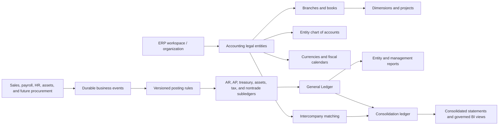
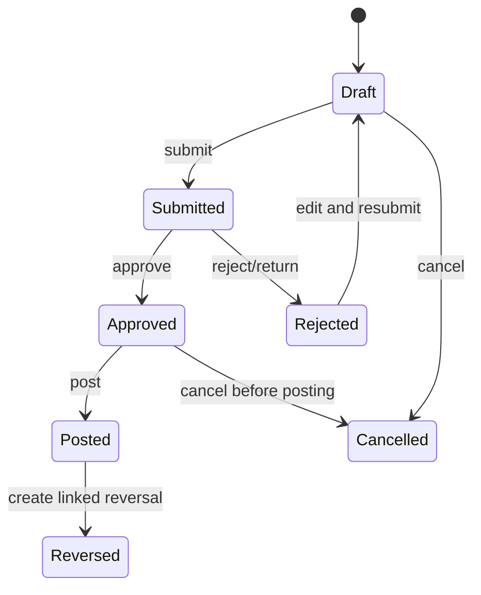

# Accounting Sector ERP Requirements - Detailed Implementation Plan

> Status: Proposed - ready for accounting, engineering, and compliance review
>
> Prepared: 2026-07-23
>
> Source: `/Users/yusuf-cmd/ERP System Requirements.pdf`
>
> Repository baseline: migrations through `schema_v111_managed_recruitment_forms`
>
> Delivery strategy: additive upgrade of the existing accounting module; no destructive rewrite

---

## 0. Executive summary

The repository already has a meaningful finance foundation:

- A hierarchical chart of accounts with Arabic and English account names.
- Draft, approval-pending, posted, reversed, and cancelled journal states.
- Balanced-journal validation and database protection for posted entries and lines.
- Versioned, idempotent, service-owned commands for journals, invoices, expenses, payments, budgets, periods, and accounting master data.
- Customer invoices, expenses, payments, vendors, customers, cost centers, tax rates, and accounting periods.
- Auto-posting for sales, payroll, advances, assets, depreciation, commissions, EOSB, and related operational flows.
- Trial balance, general ledger, profit and loss, balance sheet, cash flow, aging, budget variance, cash position, reconciliation, and management reports.
- Durable audit events and outbox publication for important accounting changes.

The accounting-sector document is nevertheless a major target-state expansion, not a small set of screen edits. The largest missing capabilities are:

1. Multiple legal companies and branches inside one ERP workspace.
2. Independent books, currencies, fiscal calendars, sequences, and access scopes per legal company.
3. Generalized financial dimensions, validation combinations, allocations, projects, and profit centers.
4. Full journal approval states, recurring/reversing journals, opening-balance imports, accruals, prepayments, deferred revenue, and formal close checklists.
5. Treasury masters, cash boxes, wallets, POS settlements, bank statements, and bank reconciliation.
6. A finance-grade fixed-asset register with three depreciation methods and disposal/write-off workflows.
7. Complete AR, AP, and nontrade subledgers with open-item allocation, credit/debit notes, advances, payment proposals, and statements.
8. Budget versions, transfers, supplementary budgets, commitment control, and project accounting.
9. Full VAT rule handling and production-grade ZATCA e-invoicing integration.
10. Consolidation, currency translation, intercompany matching, eliminations, governed reporting views, real Excel/PDF exports, scheduled delivery, drill-down, and bilingual reporting.

### Recommended architecture

Keep `organizations` as the SaaS tenant/workspace boundary and introduce `accounting_legal_entities` beneath it. This is preferable to treating every company as a separate `organization` because the current platform enforces a single normal organization membership per user. A legal-entity layer allows one user to access several companies while retaining one secure tenant boundary.

The current `sales_companies` table represents sales/carrier relationships and must not be reused as a legal-company master.

### Delivery estimate

For a production-grade implementation of the complete brief:

- MVP controlled multi-entity GL: 14-18 calendar weeks.
- Full scope in this plan: 32-40 calendar weeks with parallel delivery lanes.
- Suggested team: 2 backend/data engineers, 2 frontend/full-stack engineers, 1 QA automation engineer, 0.5-1 DevOps/data engineer, and continuous accounting/compliance ownership.
- ZATCA onboarding, accounting sign-off, and procurement dependencies can extend the calendar without necessarily increasing engineering effort.

These estimates assume the team preserves the existing command, audit, RLS, and event patterns rather than rebuilding the module.

---

## 1. Scope and interpretation

### 1.1 In scope

- General Ledger, chart of accounts, fiscal periods, journals, approvals, posting, reversal, and close.
- Multi-company, multi-branch, multi-currency, intercompany, and consolidation.
- Cash, bank, wallet, POS, custody, petty cash, settlement, and bank reconciliation.
- Fixed assets and automated depreciation.
- Accounts receivable, accounts payable, nontrade receivables/payables, advances, and settlements.
- Budgets, dimensions, allocations, cost centers, projects, profitability, and optional commitment control.
- VAT, ZATCA readiness/integration, document retention, auditability, and approvals.
- Financial, management, treasury, tax, subledger, and consolidated reporting.
- Arabic and English user interfaces, labels, master data, and exported reports.
- Imports for opening balances, master data, bank statements, budgets, and historical transactions.
- Governed API/reporting views suitable for Power BI or a data warehouse.

### 1.2 Explicitly out of scope unless separately approved

- Building a full procurement module with requisitions, purchase orders, and goods receipts. This plan provides the accounting integration contract and three-way-match readiness; a procurement product remains a separate project.
- Replacing the existing HR, payroll, sales, asset-custody, or authentication modules.
- Replacing Supabase/Postgres or the Next.js application.
- Choosing statutory accounting policies on behalf of the firm. Currency translation, depreciation conventions, approval thresholds, and tax mappings require accounting sign-off.
- Acting as the legal or tax authority. ZATCA and VAT implementation must be verified by the firm's tax adviser before production.

### 1.3 Non-negotiable implementation principles

- A posted financial transaction is never physically deleted.
- Corrections use reversal, credit/debit adjustment, or a controlled replacement transaction.
- Every mutation is organization-scoped, legal-entity-scoped, versioned, idempotent, and audited.
- Every posted journal balances in functional currency; foreign-currency journals also balance in transaction currency where applicable.
- One journal belongs to exactly one legal entity. Intercompany transactions create linked journals, not a single cross-company journal.
- Legal-entity books are never changed by consolidation. Translation and elimination entries live in a separate consolidation ledger.
- Operational modules publish durable business events; configurable posting rules transform those events into journals.
- Browser sessions do not directly mutate authoritative finance tables.
- Maker-checker controls prevent a user from approving or posting their own controlled transaction.
- Historical reports are reproducible from immutable postings, stored exchange rates, mapping versions, and report parameters.
- Financial calculations use Postgres `numeric` or an exact decimal library, not JavaScript binary floating-point arithmetic.
- All finance screens and reports support Arabic/RTL and English/LTR.

---

## 2. Verified current-state audit

### 2.1 Existing database foundation

Primary accounting migrations already present:

| Migration | Existing capability |
|---|---|
| `db/schema_v37_accounting_module.sql` | Accounts, cost centers, journals, lines, vendors, customers, tax rates, invoices, expenses, payments, settings, periods, attachments, and source-posting links |
| `db/schema_v38_accounting_hardening.sql` | Posted-entry and posted-line immutability, reference validation, and reversal uniqueness |
| `db/schema_v39_accounting_completion.sql` | Payment counterpart/cost-center fields and sales-account mappings |
| `db/schema_v40_accounting_audit_fixes.sql` | Finance-only database guards and finalized-document protections |
| `db/schema_v43_financial_reporting.sql` | Budgets, budget lines, cash-flow classification, reporting indexes, balance materialized view, and unified transaction view |
| `db/schema_v44_auto_financial_flows.sql` and `v45` | Auto-posting configuration, asset depreciation fields, GOSI, EOSB, and operational accounting links |
| `db/schema_v63_atomic_accounting_journals.sql` | Idempotent journal commands, optimistic versioning, race-free numbering, posting, and reversal |
| `db/schema_v64_atomic_accounting_documents.sql` | Atomic invoices, expenses, payments, payroll settlement, and period close |
| `db/schema_v66_accounting_controls.sql` | Versioned budgets, approval, period reopen, and source-to-ledger reconciliation |
| `db/schema_v75_atomic_asset_custody.sql` and `v76` | Asset custody integrity and atomic monthly straight-line depreciation |
| `db/schema_v93_atomic_finance_team.sql` | Finance-team command workflow |
| `db/schema_v96_durable_accounting_journal_events.sql` | Durable journal lifecycle events |
| `db/schema_v101_durable_accounting_record_events.sql` | Durable record-change events |
| `db/schema_v107_atomic_accounting_master_data.sql` | Versioned and idempotent account, cost-center, vendor, settings, and journal-cancel commands |
| `db/schema_v110_atomic_eosb_accrual.sql` | Atomic EOSB accrual publication |

### 2.2 Existing application foundation

- API dispatcher: `src/app/api/accounting/[...segments]/route.ts`.
- Client API wrapper: `src/lib/services/accounting.ts`.
- Main types: `src/types/accounting.ts`.
- Posting services: `src/lib/accounting/posting.ts`, `posting-engine.ts`, `auto-posting.ts`, and `templates/*`.
- Reporting engine: `src/lib/accounting/reports.ts` and `src/lib/accounting/reports/**`.
- Main accounting UI: `src/components/accounting/AccountingScreens.tsx`.
- Navigation: `src/components/layout/Sidebar.tsx`.
- Finance authorization: `src/lib/accounting/permissions.ts`, `src/lib/server/tenant-context.ts`, and `src/lib/rbac.ts`.
- Accounting verification: `scripts/verify-accounting-module.mjs`.
- Migration integration tests: `scripts/test-database-migrations.mjs`.

### 2.3 Requirement gap matrix

Legend:

- Existing: materially implemented.
- Partial: reusable foundation exists but does not satisfy the full requirement.
- Missing: no authoritative implementation was found.

| Requirement area | Status | Current evidence | Required change |
|---|---|---|---|
| Posted-record immutability | Existing | Posted journal/line guards and reversal commands | Extend the same invariant to all new subledgers, tax documents, treasury records, assets, and consolidation entries |
| Traceability and audit | Partial | Source module/id, audit logs, business events, and outbox | Add canonical source links, approval history, mapping version, entity/branch, attachment evidence, and UI drill-down |
| Separation of duties | Partial | Finance manager posts; accountant manages; viewer reads | Add maker-checker, per-action capabilities, approval thresholds, company/branch/dimension scope, and no-self-approval |
| Arabic and English | Partial | Master names support both; UI is largely hard-coded Arabic/RTL | Add accounting i18n dictionaries, user locale, LTR/RTL switching, translated exports, and bilingual statement mappings |
| Multi-company | Missing | One accounting book per `organization_id`; normal users have one organization membership | Add legal entities beneath the workspace and legal-entity context throughout finance |
| Branch hierarchy | Partial | HR locations and cost-center type `branch` exist | Add accounting branches with hierarchy, entity ownership, location links, permissions, sequences, and reports |
| Shared master data | Missing | Customers/vendors/accounts are organization-wide | Add workspace party/templates plus entity-specific financial profiles and mappings |
| Multi-currency | Partial | Journals/documents have a currency code but no exchange-rate accounting | Add currency/rate masters, transaction and functional amounts, revaluation, translation, and FX gain/loss |
| Intercompany and consolidation | Missing | No matching, due-to/due-from, elimination, or consolidated ledger objects | Add linked intercompany documents/journals, reconciliation, consolidation runs, translations, and eliminations |
| Chart of accounts | Partial | Parent, type, normal balance, Arabic/English names | Add levels, posting/header flag, control type, manual-post flag, statement group, entity/template ownership, and dimension policy |
| Financial dimensions | Partial | Cost center plus employee/department/location columns | Add generalized dimension types/values, hierarchies, combinations, validation rules, allocation rules, projects, and profit centers |
| Journal header and workflow | Partial | Entry date, description, source, notes, lines, and basic states | Add document date, posting date, reference, branch, exchange rate, explicit submitted/approved/rejected states, and approval steps |
| Recurring/reversing journals | Partial | Manual reversal exists | Add recurring templates/schedules/runs and scheduled future auto-reversal |
| Opening balances | Missing | No controlled opening-balance import | Add staged import, validation, subledger reconciliation, posting, and immutable batch evidence |
| Period close | Partial | Open/closed/locked plus close/reopen commands | Add soft/hard close, checklists, close tasks, override rules, sequential reopen, and close-status reporting |
| Accruals/prepayments/deferred revenue | Missing | No schedules or recognition engine | Add schedule templates, recognition lines, periodic runs, amendment, termination, and catch-up |
| Treasury masters | Missing | Default cash/bank GL accounts and generic payments exist | Add cash box/bank/wallet/POS/custody masters by entity, branch, and currency |
| Bank reconciliation | Missing | Current "reconciliation" checks sources against ledger, not bank statements | Add statement imports, bank lines, matching engine, sessions, matches, adjustments, and reconciliation close |
| Cash position | Partial | Ledger-derived cash-position report exists | Reconcile book, bank, wallet, custody, uncleared, and forecast positions |
| Fixed assets | Partial | HR asset inventory, capitalization, and straight-line monthly batch | Add finance asset register, categories/books, finance statuses, declining/double-declining methods, transfers, suspension, disposal, and roll-forward |
| Accounts receivable | Partial | Customers, invoices, receipts, allocations by invoice, aging | Add credit limits, terms, debit/credit notes, advances, write-offs, collection cases, open items, statements, and exposure |
| Accounts payable | Partial | Vendors, expenses, vendor payments, aging | Add purchase invoices, notes, advances, open items, payment proposals, approvals, withholding attributes, and three-way-match contract |
| Nontrade receivables/payables | Partial | Employee advances and financial balances cover a narrow case | Add generic nontrade party/open-item workflows and reconciliation |
| Budgeting | Partial | Annual header, monthly account/cost-center lines, approval, variance | Add original/revised/forecast/scenario versions, transfers, supplements, control modes, workflow, and drill-down |
| Projects and commitments | Missing | Project-like cost-center type only | Add project master, project budgets/status/profitability, source mappings, and optional commitment ledger |
| VAT | Partial | Simple percentage tax rates and VAT report | Add tax-code categories, effective dates, recoverability, reverse charge/import handling, tax rules, tax transactions, return periods, and GL reconciliation |
| ZATCA | Partial placeholder | Invoice `qr_code_data` and `zatca_status` only | Add compliant XML generation, UUID/hash/QR/signature chain, onboarding credentials, reporting/clearance adapter, retries, evidence, and monitoring |
| Core financial reports | Partial | Trial balance, GL, balance sheet, P&L, and cash flow exist | Add changes in equity, mapping versions, entity/branch/dimension filtering, hierarchy, drill-down, and reproducibility |
| Subledger/treasury/compliance reports | Partial | Aging, advances, asset-related outputs, VAT, and integrity reconciliation | Add statements, full asset register/depreciation, bank reconciliation, liquidity forecast, posting log, close status, and tax returns |
| Consolidated reporting | Missing | No consolidation engine | Add group trial balance/statements, currency translation, intercompany matching, eliminations, adjustments, and audit trail |
| Excel/PDF export | Partial | CSV works; "Excel" is CSV-compatible text; PDF is HTML generation and is not wired into export routing | Generate real XLSX and rendered PDF for every supported report with Arabic fonts and bilingual labels |
| Scheduled delivery and BI | Missing | No finance report schedules or governed finance views | Add report schedules/runs/delivery, reporting views, API contracts, and service-account controls |
| Import templates | Missing | No finance import framework | Add staged templates, row validation, preview, approve/post, error workbook, and batch audit |

---

## 3. Target architecture

### 3.1 Domain relationship



### 3.2 Bounded server modules

The existing accounting catch-all route is already large. Preserve current URLs, but make the route a thin dispatcher into feature modules:

```text
src/lib/server/accounting/
  context.ts
  entities.ts
  currencies.ts
  chart-of-accounts.ts
  dimensions.ts
  journals.ts
  periods.ts
  schedules.ts
  treasury.ts
  bank-reconciliation.ts
  assets.ts
  receivables.ts
  payables.ts
  nontrade.ts
  budgeting.ts
  projects.ts
  tax.ts
  zatca.ts
  intercompany.ts
  consolidation.ts
  reporting.ts
  imports.ts
```

Related pure domain logic belongs under `src/lib/accounting/<domain>/`. Database mutations continue to use service-role RPC commands with explicit actor, request, command, entity, and expected-version parameters.

### 3.3 Legal-entity context

Every finance request resolves:

```ts
type AccountingContext = {
  organizationId: string;
  legalEntityId: string;
  branchId?: string;
  userId: string;
  baseRole: "finance_manager" | "accountant" | "finance_viewer";
  capabilities: string[];
  allowedBranchIds: string[];
  allowedDimensionValueIds: string[];
  functionalCurrency: string;
  fiscalCalendarId: string;
  locale: "ar" | "en";
  timezone: string;
};
```

The legal entity comes from an explicit header or route context and is checked against `accounting_user_scopes`. The server must never accept a legal-entity ID without independently validating organization ownership and user scope.

### 3.4 Financial amount model

For every monetary line:

- `transaction_currency_code`
- `transaction_debit` / `transaction_credit`
- `functional_currency_code`
- `exchange_rate`
- `functional_debit` / `functional_credit`
- `rate_type`, `rate_date`, and `exchange_rate_id`

Use `numeric(20,6)` for rates and high-precision source values, and `numeric(20,2)` or the currency's configured minor-unit scale for booked amounts. API types should serialize money and rates as decimal strings. Round only at defined accounting boundaries.

---

## 4. Database and migration plan

### 4.1 Migration rules

- Continue forward-only migrations after v111. If another migration lands first, renumber these proposed files.
- Add nullable columns first, backfill, validate, and only then enforce `NOT NULL`.
- Never rewrite historical rows without recording the migration batch and before/after counts.
- Create organization and legal-entity composite foreign keys where practical.
- Include `organization_id` on every tenant table even where it can be inferred, enabling defensive RLS and efficient filtering.
- Use `version`, `created_by`, `updated_by`, `created_at`, and `updated_at` on mutable masters.
- Use command tables and durable events for authoritative changes.
- Add `is_active` or state transitions instead of deleting referenced master data.
- Update `db/migrations.manifest.json`, `src/lib/schema-version.json`, generated database types, migration verification, and rollback notes with each migration.

### 4.2 Proposed migration sequence

| Proposed migration | Main purpose | Primary objects |
|---|---|---|
| `schema_v112_accounting_legal_entities.sql` | Legal companies, branches, books, user scopes, calendars, and currencies | `accounting_legal_entities`, `accounting_branches`, `accounting_books`, `accounting_user_scopes`, `accounting_fiscal_calendars`, extended periods, currencies, exchange rates |
| `schema_v113_accounting_dimensions_and_coa.sql` | Entity COA, statement mapping, generalized dimensions, and allocations | Account extensions, account templates, dimension types/values/policies/combinations, line dimensions, allocation rules/runs |
| `schema_v114_accounting_gl_workflows.sql` | Full journal lifecycle, approvals, recurring journals, schedules, imports, and close | Journal extensions, approval requests/steps, recurring schedules/runs, recognition schedules, opening-balance batches, close checklists |
| `schema_v115_accounting_treasury.sql` | Cash/bank/wallet/POS/custody and bank reconciliation | Treasury accounts/transactions/transfers, statement imports/lines, reconciliation sessions/matches/rules |
| `schema_v116_accounting_assets.sql` | Finance asset register and depreciation books | Asset categories/assets/books/events, depreciation runs/lines, disposal/write-off data |
| `schema_v117_accounting_subledgers.sql` | Parties, AR, AP, nontrade, open items, settlements, and proposals | Parties and profiles, AR/AP documents and lines, open items, allocations, payment proposals, nontrade items |
| `schema_v118_accounting_budget_projects.sql` | Budget versions, transfers, controls, commitments, and projects | Budget-version extensions, transfers, supplements, control policies, commitments, projects |
| `schema_v119_accounting_tax_zatca.sql` | VAT engine, returns, tax evidence, and ZATCA document lifecycle | Tax codes/rules/transactions/periods/returns, e-invoice documents, integration attempts, certificate references |
| `schema_v120_accounting_intercompany_consolidation.sql` | Intercompany and consolidated books | IC relationships/documents/matches, groups/members/runs, translated balances, elimination rules/entries |
| `schema_v121_accounting_reporting_delivery.sql` | Reporting mappings, schedules, governed views, and import framework | Report mappings/schedules/runs/deliveries, governed views, import batches/rows/errors |

### 4.3 v112 - legal entities, branches, books, calendars, and currencies

#### New masters

`accounting_legal_entities`

- Workspace/organization owner.
- Code, Arabic/English legal name, trade name.
- Commercial registration, VAT/TIN, country, address.
- Functional currency and fiscal calendar.
- Status: `draft`, `active`, `suspended`, `closed`.
- Consolidation parent/group metadata.
- Defaults for document language, timezone, and number formatting.

`accounting_branches`

- Legal entity, code, Arabic/English name.
- Parent branch for hierarchy.
- Optional link to existing `locations`.
- Tax/registration overrides where legally applicable.
- Default cost center, cash box, and reporting status.

`accounting_books`

- Legal entity, book type (`statutory`, `management`, `tax`, `consolidation_adjustment`).
- Functional currency, calendar, accounting basis, and status.
- Normal operations initially post to the statutory book; additional books are opt-in.

`accounting_user_scopes`

- User, legal entity, optional branch, optional dimension scope.
- Capability group and effective dates.
- Deny/allow status with audit evidence.

`accounting_fiscal_calendars` and extended `accounting_periods`

- Calendar definition, fiscal-year naming, period number, quarter, adjustment-period flag.
- Entity/book ownership.
- Status: `open`, `soft_closed`, `hard_closed`.
- Closed/reopened actor, reason, request, approval, and timestamps.

`accounting_currencies` and `accounting_exchange_rates`

- ISO code, minor units, active status.
- Rate date, from/to currency, rate type (`spot`, `average`, `closing`, `historical`), source, and approval.
- Unique approved rate per date/type/pair.

#### Existing-table extension

Add `legal_entity_id`, and where relevant `branch_id`, `book_id`, and functional-currency fields to all accounting masters and transactions. Initially nullable, then backfill to a generated default entity for each organization.

Change unique keys from organization-only to legal-entity-aware keys, for example:

- Accounts: `(organization_id, legal_entity_id, code)`.
- Journal numbers: `(organization_id, legal_entity_id, book_id, entry_no)`.
- Document counters: `(organization_id, legal_entity_id, branch_id, document_type, period_key, prefix)`.
- Periods: `(organization_id, legal_entity_id, book_id, start_date, end_date)`.

#### Acceptance criteria

- An authorized user can switch among allowed legal entities without changing workspace login.
- A user cannot query or mutate an unassigned entity by changing a URL, query parameter, or header.
- Two entities may use the same account code and document prefix without collision.
- Each entity has independent periods, counters, currencies, settings, bank accounts, and tax identity.
- Existing rows remain visible under the automatically created default entity.

### 4.4 v113 - chart of accounts, dimensions, and allocations

#### Account extensions

Extend `accounting_accounts` with:

- `level`, `path`, and `sort_order`.
- `statement_group_id` and reporting-sign convention.
- `is_posting_account`.
- `control_type`: `none`, `customer`, `vendor`, `asset`, `bank`, `cash`, `employee`, `tax`.
- `manual_posting_allowed`.
- `dimension_policy_id`.
- `effective_from`, `effective_to`.
- `account_template_id`.

Rules:

- Header accounts cannot receive journal lines.
- Inactive or out-of-date accounts cannot receive new postings.
- Control accounts are posted only by their subledger unless an approved override rule applies.
- Parent and child must belong to the same organization/legal entity.
- Cycles are prohibited.

#### Controlled account sharing

Add `accounting_account_templates` and template lines at workspace level. Creating an entity chart copies or links a versioned template while keeping balances separate. Template updates produce a preview and explicit apply operation; they never silently alter entity books.

#### Generalized dimensions

Add:

- `accounting_dimension_types`: branch, cost center, profit center, department, region, project, contract, product/service line, employee, location, and custom.
- `accounting_dimension_values`: code, bilingual names, hierarchy, effective dates, and optional link to an operational record.
- `accounting_dimension_policies`: which dimensions are required, optional, or blocked for an account.
- `accounting_dimension_combinations`: allowed/blocked combinations and effective dates.
- `accounting_journal_line_dimensions`: normalized dimensions per journal line.

Keep legacy `cost_center_id`, `employee_id`, `department_id`, and `location_id` during transition. Dual-write them into normalized dimension rows, reconcile, then make the normalized model authoritative.

#### Allocations

Add:

- `accounting_allocation_rules`: source account/dimensions, target dimensions, method (`percentage`, `fixed`, `driver`), frequency, and effective dates.
- `accounting_allocation_rule_lines`: targets and weights.
- `accounting_allocation_runs`: period, source balance, rule version, journal, actor, and state.
- `accounting_allocation_driver_values`: driver values such as headcount or floor area.

Allocation runs create auditable journals and are reversible as a batch.

### 4.5 v114 - GL workflows, approvals, schedules, imports, and close

#### Journal header extensions

- Separate `document_date` and `posting_date`; migrate `entry_date` to posting date.
- External/internal reference number.
- Legal entity, branch, and book.
- Transaction currency, functional currency, exchange rate, and rate reference.
- Attachment bundle and source-document link.
- `auto_reverse_on`, recurrence source, approval policy/version, and risk flags.
- Explicit states: `draft`, `submitted`, `approved`, `posted`, `rejected`, `cancelled`, `reversed`.

Backfill current `pending_approval` to `submitted`. Preserve posted/reversed/cancelled states.

#### Approval engine

Add:

- `accounting_approval_policies`: document type, thresholds, currency, source, branch/entity, and effective dates.
- `accounting_approval_requests`: target, policy version, current step, state.
- `accounting_approval_steps`: required capability/approver count and order.
- `accounting_approval_decisions`: approve/reject/return, actor, reason, timestamp, and evidence.

Controls:

- Creator cannot approve or post their own controlled transaction.
- A changed submitted/approved transaction returns to draft or rejected and requires resubmission.
- Large, manual, unusual, period-end, control-account, or override journals can require additional levels.
- Auto-posted operational events use an approved posting-rule version and configurable preapproval policy.

#### Recurring and reversing journals

Add:

- `accounting_recurring_journal_templates`.
- `accounting_recurring_journal_lines`.
- `accounting_recurring_schedules`.
- `accounting_recurring_runs`.

The scheduler generates a new draft or submitted journal per due date using the template version active for that date. A unique schedule/date key prevents duplication.

An approved journal with `auto_reverse_on` creates exactly one reversal on the target open date. If the target period is closed, the run enters an exception queue.

#### Accruals, prepayments, and deferred revenue

Add:

- `accounting_recognition_schedules`.
- `accounting_recognition_schedule_lines`.
- `accounting_recognition_runs`.
- `accounting_recognition_amendments`.

Supported patterns:

- Straight-line monthly recognition.
- Custom amount/percentage by period.
- Start/end changes, suspension, termination, catch-up, and remaining-balance adjustment.

Every schedule retains original amount, recognized amount, remaining amount, source document, amendment history, and generated journals.

#### Opening balances and imports

Add staged import batches and rows for:

- Opening trial balance.
- Customer/vendor open items.
- Asset register and accumulated depreciation.
- Bank/cash opening positions.
- Historical journals.

Workflow: upload -> scan/hash -> parse -> validate -> preview -> approve -> post -> reconcile -> lock batch. Invalid rows produce a downloadable error workbook and never partially post.

#### Period close

Add:

- `accounting_close_checklist_templates`.
- `accounting_close_runs`.
- `accounting_close_tasks`.
- `accounting_close_exceptions`.

Default checklist:

1. All journal batches resolved.
2. AR/AP subledgers reconcile to control accounts.
3. Bank accounts reconciled.
4. Cash/custody counts and settlements complete.
5. Depreciation posted.
6. Accrual, prepayment, and deferred schedules run.
7. Payroll, advances, commissions, EOSB, and sales sources reconcile.
8. VAT reconciliation has no unexplained variance.
9. Intercompany matches resolved or approved as exceptions.
10. Trial balance balances and management review is attached.

Soft close blocks normal posting but permits explicitly authorized close adjustments. Hard close blocks all posting. Reopen requires finance-manager approval, a reason, and reverse chronological order.

### 4.6 v115 - treasury and bank reconciliation

#### Treasury masters and transactions

`accounting_treasury_accounts`

- Type: cash box, bank account, petty cash, wallet, POS clearing, employee custody.
- Legal entity, branch, currency, GL account, custodian/owner, bank/IBAN metadata, balance limits, status.

`accounting_treasury_transactions`

- Type: cash receipt, cash payment, bank receipt, bank payment, transfer, bank charge, return, custody issue, custody settlement, refund, or additional payment.
- Source party/document, value date, posting date, amount/currency/rate, treasury accounts, status, approval, attachments, and journal.

`accounting_treasury_transfers`

- One business transfer links withdrawal and receipt legs.
- Handles charges, value-date differences, and FX gain/loss.
- Both entity-local legs post atomically; intercompany transfers use the intercompany workflow.

#### Bank statement and reconciliation

Add:

- `accounting_bank_statement_imports`.
- `accounting_bank_statement_lines`.
- `accounting_bank_reconciliation_sessions`.
- `accounting_bank_reconciliation_matches`.
- `accounting_bank_matching_rules`.
- `accounting_bank_reconciliation_adjustments`.

Matching supports:

- Exact amount/reference/date.
- Configurable date tolerance.
- One bank line to many book entries.
- Many bank lines to one book entry.
- Manual match with reason.
- Bank charges, interest, returned payments, and timing differences.

A closed reconciliation stores opening balance, statement closing balance, book balance, outstanding deposits/payments, adjustments, variance, approver, and evidence. It cannot be edited after close; corrections use reopen with approval.

### 4.7 v116 - fixed assets

Do not use HR custody records as the sole accounting asset register. Introduce a finance register that can optionally link to `asset_inventory`.

#### Core objects

- `accounting_asset_categories`: default useful life, method, frequency, cost/accumulated-depreciation/expense/disposal accounts.
- `accounting_assets`: number, bilingual name, entity, branch, department, custodian, location, supplier, invoice, dates, cost, VAT, residual value, status, and source inventory ID.
- `accounting_asset_books`: useful life, start date, frequency, method, rate, accumulated depreciation, and net book value.
- `accounting_asset_events`: capitalization, transfer, change, suspend, resume, impairment, disposal, write-off, and correction.
- `accounting_asset_depreciation_runs` and lines: run-level idempotency with per-asset calculation evidence.

#### Methods

- Straight line.
- Declining balance.
- Double declining balance, capped so the asset never depreciates below residual value.

#### Status flow

`under_construction -> active -> suspended -> active -> disposed|written_off|fully_depreciated`

Every capitalization, depreciation, impairment, disposal, and write-off links to an immutable journal. Changes to useful life, residual value, or method are prospective unless accounting explicitly approves a catch-up adjustment.

Existing `asset_inventory` records with purchase price become candidates for migration; they are not silently converted until accounting confirms category, capitalization date, accounts, and opening accumulated depreciation.

### 4.8 v117 - parties, AR, AP, and nontrade

#### Shared party model

Add:

- `accounting_parties`: workspace-level common identity, contacts, registrations, and type flags.
- `accounting_party_entity_profiles`: entity-specific customer/vendor/nontrade status, currency, terms, credit limit, tax, withholding, control account, and bank details.

Backfill existing customers and vendors. Keep current customer/vendor APIs as compatibility facades until the UI and operational integrations move to parties.

#### Accounts receivable

Add generic AR documents and lines with types:

- Invoice.
- Debit note.
- Credit note.
- Customer advance.
- Write-off.
- Opening item.

Add:

- Credit-limit and overdue checks.
- Payment terms and calculated due dates.
- Open-item ledger.
- Receipt allocation and unallocation.
- Customer statement and collection activity.
- Credit exposure including unallocated advances.
- Controlled write-off approval.

#### Accounts payable

Add AP documents and lines with types:

- Purchase invoice.
- Vendor debit note.
- Vendor credit note.
- Vendor advance.
- Opening item.

Add:

- Due-date calculation and withholding attributes.
- Open-item allocation.
- Payment proposals grouped by due date, vendor, bank, currency, or priority.
- Proposal approval and payment-batch generation.
- Vendor statement and due-date analysis.
- Optional PO/receipt references and match status.

#### Three-way-match readiness

Define a stable integration contract:

```text
purchase_order_id
purchase_order_line_id
goods_receipt_id
goods_receipt_line_id
ordered_quantity / received_quantity / invoiced_quantity
ordered_price / invoiced_price
quantity_tolerance / price_tolerance
match_status / exception_reason
```

The AP invoice can store and validate these references when a procurement module exists. This phase does not create the procurement workflow itself.

#### Nontrade

`accounting_nontrade_items` supports employee, government, shareholder, intercompany, and miscellaneous counterparties. It uses the same open-item, allocation, aging, approval, and journal controls as AR/AP without pretending the party is a sales customer or purchasing vendor.

### 4.9 v118 - budgets, cost control, projects, and commitments

Evolve current budgets instead of discarding them:

- Budget header: entity, book, fiscal year, workflow state.
- Budget versions: `original`, `revised`, `forecast`, `scenario`.
- Lines: account, period, branch, and any approved financial dimensions.
- Budget transfers: source, target, amount, reason, approval, and version impact.
- Supplementary budgets: approved additions with evidence.
- Control policies: advisory, warn, or block by account/dimension and tolerance.

Backfill each existing budget as an `original` version.

Add `accounting_projects`:

- Code, bilingual name, entity, customer/contract, manager, dates, status.
- Revenue/cost accounts, default dimensions, budget, billing model, and completion data.
- Actual, committed, budget, forecast, margin, and variance measures.

Add optional `accounting_commitments` sourced from approved requisitions or purchase orders. Commitments reduce available budget and are relieved by receipt/invoice events. If procurement is unavailable, the table and API remain disabled behind a feature flag.

### 4.10 v119 - VAT and ZATCA

#### VAT engine

Replace a rate-only model with:

- `accounting_tax_codes`: standard, zero-rated, exempt, out-of-scope, import, reverse-charge, withholding as applicable.
- Effective dates, rate, recoverability percentage, input/output tax accounts, and reporting boxes.
- `accounting_tax_rules`: entity, party, item/service, transaction type, place of supply, and priority.
- `accounting_tax_transactions`: immutable tax fact per source line and posted journal.
- `accounting_tax_periods` and `accounting_vat_returns`.
- Return adjustments, reconciliation items, approvals, and filing evidence.

VAT return preparation must reconcile:

1. Source tax lines.
2. Tax control accounts in the GL.
3. Adjustments and prior-period corrections.
4. Return boxes.

Unexplained differences block final approval.

#### ZATCA e-invoicing

The current `qr_code_data` and `zatca_status` fields are placeholders only. Add:

- `accounting_einvoice_documents`: invoice UUID, document type, sequence, previous-invoice hash, invoice hash, XML storage reference, QR payload, signing result, environment, and lifecycle state.
- `accounting_einvoice_credentials`: reference to secret-manager material, certificate metadata, device/solution-unit identity, expiry, and environment. Never store private keys or secrets as plaintext database values.
- `accounting_einvoice_attempts`: request/response metadata, endpoint version, status, error codes, retry state, and timestamps.
- `accounting_einvoice_validation_results`: schema, business-rule, signature, and compliance checks.

Implement a provider adapter under `src/lib/accounting/zatca/`:

1. Build the tax invoice from authoritative posted source data.
2. Generate compliant XML and identifiers.
3. Validate locally against the pinned ZATCA artifacts.
4. Sign/hash/encode required security data.
5. Submit using the required reporting or clearance workflow.
6. Store the immutable request evidence and official response.
7. Retry only replay-safe failures; route business validation failures to an exception queue.
8. Expose certificate expiry, rejected documents, and delayed submissions on a compliance dashboard.

Pin a specific version of the official specifications in the implementation ADR and update it only through a tested compliance change. Official sources to use during implementation:

- [ZATCA simplified technical guide](https://zatca.gov.sa/en/E-Invoicing/SystemsDevelopers/Pages/Simplified-technical-guide.aspx)
- [ZATCA e-invoice specifications](https://www.zatca.gov.sa/en/e-invoicing/systemsdevelopers/pages/e-invoice-specifications.aspx)
- [ZATCA security requirements](https://zatca.gov.sa/en/e-invoicing/systemsdevelopers/pages/security-requirements.aspx)
- [ZATCA VAT Implementing Regulations](https://zatca.gov.sa/en/RulesRegulations/Taxes/Pages/VATImplementingRegulations.aspx)

Compliance sign-off is required before enabling production submission.

### 4.11 v120 - intercompany and consolidation

#### Intercompany

Add:

- `accounting_intercompany_relationships`: entity pairs, due-to/due-from accounts, AR/AP party mappings, currency policy, and approval.
- `accounting_intercompany_documents`: business transaction shared ID and entity-local document links.
- `accounting_intercompany_matches`: receivable/payable/journal pairing, amount/date/currency variance, and status.
- `accounting_intercompany_reconciliation_runs`.

Posting creates separate balanced journals in each legal entity and links them with one intercompany transaction ID. Partial failures must roll back the whole command or remain in a clearly recoverable pending state with no one-sided posted result.

#### Consolidation

Add:

- `accounting_consolidation_groups` and members.
- `accounting_consolidation_runs`.
- `accounting_consolidation_account_mappings`.
- `accounting_consolidation_translated_balances`.
- `accounting_elimination_rules`.
- `accounting_elimination_entries`.
- `accounting_consolidation_adjustments`.

Run sequence:

1. Freeze source entity/book/period versions.
2. Validate entity trial balances.
3. Map local accounts to group statement lines.
4. Translate balances using approved rate policies.
5. Match intercompany balances and transactions.
6. Generate proposed eliminations.
7. Review/approve eliminations and manual consolidation adjustments.
8. Publish the consolidated trial balance and statements.

Translation policy for closing, average, and historical rates must be configurable and approved by accounting. Currency translation reserve treatment must not be hard-coded without sign-off.

### 4.12 v121 - reporting, delivery, governed views, and imports

Add:

- `accounting_statement_definitions`, groups, lines, formulas, mappings, versions, and bilingual labels.
- `accounting_report_schedules`, runs, parameters, recipients, and delivery results.
- `accounting_import_batches`, files, rows, validation errors, approvals, and posting result.
- Governed entity-, branch-, and group-scoped reporting views.

Reporting definitions are versioned so a prior-period report can be regenerated using the mapping effective at publication time.

---

## 5. Posting engine and integration plan

### 5.1 Posting Engine v2

Refactor the current template registry into versioned database-driven posting-rule headers with code-owned calculators:

```text
business event
  -> event contract validation
  -> legal entity and branch resolution
  -> posting rule selection by source/type/effective date
  -> account and dimension resolution
  -> currency conversion
  -> subledger transaction
  -> balanced journal command
  -> audit event and outbox publication
```

Each posting result stores:

- Business event ID/version and source record/version.
- Posting rule ID/version.
- Legal entity, branch, and book.
- Tax rule version.
- Exchange-rate record.
- Generated subledger record and journal.
- Actor/system identity and request/command IDs.

### 5.2 Operational event coverage

| Source event | Target subledger | Illustrative posting |
|---|---|---|
| Sales invoice issued | AR and tax | Dr customer control; Cr revenue; Cr output VAT |
| Customer receipt | AR and treasury | Dr bank/cash; Cr customer control; allocate open item |
| Purchase/expense invoice approved | AP and tax | Dr expense/asset; Dr recoverable input VAT; Cr vendor control |
| Vendor payment | AP and treasury | Dr vendor control; Cr bank/cash |
| Employee custody issued | Nontrade and treasury | Dr employee custody; Cr cash/bank |
| Custody settled | Nontrade | Dr expense/asset and input VAT; Cr custody; record refund/additional payment |
| Bank transfer | Treasury | Dr receiving bank; Cr sending bank; post charges/FX separately |
| Asset capitalized | Fixed assets and AP/treasury | Dr asset cost; Cr AP or bank |
| Depreciation run | Fixed assets | Dr depreciation expense; Cr accumulated depreciation |
| Asset disposal | Fixed assets and treasury/AR | Derecognize cost/depreciation; recognize proceeds and gain/loss |
| Payroll approved | Payroll and GL | Dr payroll costs by dimensions; Cr salary/GOSI/advance/deduction liabilities |
| Payroll paid | Treasury | Dr salary payable; Cr bank |
| Intercompany transaction | Two entity subledgers | Entity-local due-to/due-from entries with shared transaction ID |

Actual accounts and dimensions come from approved posting rules, not fixed account codes.

### 5.3 Background jobs

Use the existing internal job/outbox patterns for:

- Recurring journal generation.
- Auto-reversals.
- Recognition schedules.
- Depreciation.
- Exchange-rate import and approval reminders.
- Bank auto-match.
- Period-close task refresh.
- Intercompany matching.
- Consolidation runs.
- ZATCA retry/monitoring.
- Report scheduling and delivery.
- Materialized reporting-view refresh.

Every job is idempotent by organization, legal entity, schedule/source, and effective date. Long-running jobs store progress and can safely resume.

### 5.4 API resources

Preserve current endpoints and add:

| Resource group | Example operations |
|---|---|
| Context/setup | Entities, branches, books, calendars, periods, currencies, rates, user scopes |
| COA/dimensions | Account templates, entity accounts, dimension values/policies/combinations, allocations |
| GL | Save, submit, approve, reject, post, reverse, recurring schedules, recognition schedules, opening imports |
| Close | Checklist, exceptions, soft close, hard close, reopen |
| Treasury | Treasury accounts, receipts/payments/transfers/custody, statements, reconciliation, cash position |
| Assets | Categories, register, capitalization, transfers, suspension, depreciation, disposal, roll-forward |
| AR | Customer profiles, documents, receipts, allocations, statements, collections, aging, exposure |
| AP | Vendor profiles, documents, proposals, payments, allocations, statements, aging |
| Nontrade | Items, settlement, acknowledgment, aging |
| Budgets/projects | Versions, lines, transfer, supplement, approve, controls, projects, commitments |
| Tax/ZATCA | Tax codes/rules, VAT returns/reconciliation, e-invoice validate/submit/status |
| Intercompany/consolidation | Relationships, matching, reconciliation, run, elimination, publish |
| Reports | Definitions, run, drill-down, export, schedule, delivery, governed-view metadata |
| Imports | Template, upload, validate, preview, approve, post, errors |

All mutation requests require an `Idempotency-Key` and expected version. Return 409 for version/state conflicts and stable domain error codes for UI handling.

---

## 6. User experience and navigation

### 6.1 Global accounting context selector

Add a persistent selector in the accounting header:

- Legal entity.
- Branch or "all allowed branches".
- Book.
- Reporting currency where allowed.
- Period/date range.

Changing context clears incompatible filters and updates every query. The selected legal entity is visible on every transaction and report to reduce wrong-company entry risk.

### 6.2 Proposed information architecture

```text
Accounting
  Dashboard
  General Ledger
    Chart of accounts
    Journals
    Recurring journals
    Accruals and recognition
    Opening balances
    Period close
  Treasury
    Cash and bank accounts
    Receipts and payments
    Transfers
    Custody and petty cash
    Bank statements
    Reconciliation
    Cash position
  Receivables
    Customers
    AR documents
    Receipts and allocation
    Collections
    Statements and aging
  Payables
    Vendors
    AP documents
    Payment proposals
    Payments and allocation
    Statements and aging
  Nontrade
  Fixed assets
  Budgets and cost control
  Projects
  Tax and ZATCA
  Intercompany
  Consolidation
  Reports
  Setup
    Legal entities and branches
    Books, calendars, and currencies
    Dimensions and allocations
    Posting rules
    Approval policies
    Tax rules
    Report mappings
    Finance access
```

Preserve current URLs as compatibility pages or redirects. Split `AccountingScreens.tsx` into domain components rather than extending the existing monolith.

### 6.3 Bilingual implementation

- Create accounting translation dictionaries for Arabic and English.
- Derive `lang` and `dir` from user/organization locale.
- Replace hard-coded Arabic strings in accounting screens, status badges, errors, and exports.
- Keep account, party, dimension, project, and statement-line names in both languages.
- Allow report output language independent of UI language.
- Render Arabic PDFs with embedded fonts and correct glyph shaping.
- Apply locale-aware dates, separators, currency labels, and negative-number presentation.

### 6.4 Transaction UX requirements

- Show state, creator, approvers, poster, entity, branch, book, source, rule version, and attachments.
- Show debit/credit totals in transaction and functional currencies.
- Validate required dimensions inline before submission.
- Show credit-limit, budget, period, control-account, and unusual-journal warnings before submit.
- Provide a source-document link from journal to operational record and a journal link back from the source.
- Provide an immutable lifecycle timeline.
- Require reason dialogs for rejection, cancellation, reversal, reopen, manual match, write-off, and overrides.

---

## 7. Workflow definitions

### 7.1 Journal state machine



Posted and reversed journals are immutable. A reversal is a new journal with swapped lines and a one-to-one link to the original.

### 7.2 Period state machine

```text
open
  -> soft_closed       normal posting blocked; approved close adjustments allowed
  -> hard_closed       all posting blocked
  -> reopened          temporary audited state
  -> soft_closed/hard_closed
```

Hard close requires all mandatory checklist items completed or an approved exception. Reopen requires a reason, approval, and reverse-order control.

### 7.3 Bank reconciliation state

`draft -> matching -> reviewed -> closed -> reopened`

Closed matches are immutable. Reopen does not delete matches; it creates a new reconciliation revision.

### 7.4 Budget state

`draft -> submitted -> approved -> active -> superseded/closed`

Revisions, transfers, and supplements create explicit version changes. They do not overwrite the originally approved budget.

### 7.5 ZATCA document state

Use separate business-document and integration states. Suggested integration states:

`generated -> locally_validated -> signed -> submitted -> accepted|cleared|reported -> archived`

Failure states:

`validation_failed`, `submission_failed_retryable`, `rejected`, `certificate_expired`, `manual_review`.

The exact accepted/cleared/reported paths must match the invoice type and pinned official specification.

---

## 8. Security, permissions, and internal controls

### 8.1 Capability model

Keep the three base roles but authorize detailed capabilities:

- `accounting.setup.manage`
- `accounting.master.manage`
- `accounting.journal.create`
- `accounting.journal.submit`
- `accounting.journal.approve`
- `accounting.journal.post`
- `accounting.journal.reverse`
- `accounting.period.soft_close`
- `accounting.period.hard_close`
- `accounting.period.reopen`
- `accounting.treasury.transact`
- `accounting.treasury.reconcile`
- `accounting.asset.manage`
- `accounting.ar.manage`
- `accounting.ap.manage`
- `accounting.budget.manage`
- `accounting.budget.approve`
- `accounting.tax.prepare`
- `accounting.tax.approve`
- `accounting.zatca.operate`
- `accounting.consolidation.run`
- `accounting.consolidation.approve`
- `accounting.report.view`
- `accounting.report.export`
- `accounting.audit.view`

Capabilities are intersected with legal-entity, branch, and dimension scopes.

### 8.2 Minimum segregation matrix

| Action | Accountant | Finance manager | Finance viewer | Control |
|---|---:|---:|---:|---|
| Create/edit draft | Yes | Yes | No | Entity/branch scope |
| Submit | Yes | Yes | No | Complete validation |
| Approve | Assigned only | Yes | No | Cannot approve own transaction |
| Post | No by default | Yes | No | Approved state and open period |
| Reverse | Request | Yes | No | Reason and linked reversal |
| Reconcile bank | Assigned | Approve/close | Read | Reconciler cannot approve own adjustment |
| Prepare VAT return | Assigned | Yes | Read | Tax capability |
| Approve/file VAT | No | Assigned manager | No | Separate preparer/approver |
| Run consolidation | Assigned | Yes | Read | Approval before publish |
| Setup/posting rules | No by default | Yes | No | Effective-dated version and audit |

### 8.3 Database controls

- RLS checks organization, legal entity, and user scope.
- Service-owned command functions recheck actor membership, status, entity access, capability, expected version, and payload hash.
- Composite tenant/entity reference validation prevents cross-entity foreign keys.
- Guard triggers block direct writes and deletion of authoritative financial data.
- Managed private storage stores attachments, imports, bank statements, XML, and evidence.
- Files record original name, MIME type, size, hash, scan status, retention policy, uploader, and legal entity.
- Secrets and ZATCA private keys use environment/secret management, not repository files or plain database columns.

---

## 9. Reporting and analytics plan

### 9.1 Required report catalog

| Group | Reports |
|---|---|
| Core financial | Trial balance, general ledger, balance sheet, income statement, cash flow, changes in equity |
| Subledger | Customer statement/aging/exposure, vendor statement/aging/due analysis, advances, nontrade, asset register, depreciation and roll-forward |
| Management | Budget vs actual, branch, region, cost center, profit center, project, department, product/service line, and profitability |
| Treasury | Cash position, bank/cash/wallet balances, uncleared items, reconciliation status, liquidity forecast |
| Compliance | VAT transactions/return/reconciliation, ZATCA status, audit trail, posting log, approval log, period-close status |
| Consolidated | Consolidated trial balance, balance sheet, income statement, cash flow, changes in equity, currency translation, and eliminations |

### 9.2 Common report capabilities

- Entity, branch, book, currency, period, dimension, and status filters.
- MTD, QTD, YTD, comparative period, and prior year.
- Account hierarchy and configurable statement mappings.
- Drill-down: statement line -> account -> journal line -> journal -> subledger/source transaction -> attachment/audit timeline.
- Reproducible "published report" snapshot with definition version, rate set, run time, and parameters.
- Arabic, English, or bilingual labels.
- Real XLSX, PDF, CSV, JSON/API.
- Scheduled delivery with per-recipient authorization check at run time.
- Governed Power BI/data-warehouse views with stable schemas and no exposure of unrestricted base tables.

### 9.3 Export implementation

- Replace `toExcelCSV` with a real XLSX writer and formatted multi-sheet workbooks.
- Wire PDF generation through a server-side renderer; do not return HTML as if it were a PDF.
- Sanitize all labels and cell values before generating HTML/PDF to prevent injection.
- Include entity, branch, book, currency, period, generated time, generated by, and report version.
- Add large-export background jobs, progress, expiry, and authorized download links.

### 9.4 Performance

- Move report filtering into SQL/RPC rather than loading all journal lines and filtering in Node.
- Add entity/date/account/dimension covering indexes.
- Partition or archive very large journal/tax/event tables after measured thresholds.
- Refresh reporting materialized views after posting batches and period close.
- Add report query budgets, pagination, and asynchronous export for large data sets.

---

## 10. Import and data-integration plan

### 10.1 Import framework

Every import type uses:

1. Download versioned template.
2. Upload into private storage.
3. Virus/MIME/size/hash validation.
4. Stage raw rows.
5. Validate references, duplicates, totals, dates, currency, and dimensions.
6. Preview valid/error counts and control totals.
7. Approve batch.
8. Post through the same command services used by interactive workflows.
9. Reconcile posted result to batch totals.
10. Lock batch and retain source/error evidence.

No import directly inserts posted journals or authoritative subledger rows.

### 10.2 Operational integrations

- Sales/POS: invoice/revenue/receipt events with entity, branch, customer, product, tax, and dimensions.
- Payroll: approved payroll and payment events with employee/department/cost-center detail.
- HR: employee and organization dimension references.
- Assets: inventory/custody link to accounting asset master.
- Advances: custody/advance subledger and payroll deduction settlement.
- Procurement, when available: PO, receipt, invoice, commitment, and match references.

Each event contract is versioned and documented in `src/lib/event-payload.ts` or a dedicated accounting event-contract module.

---

## 11. Delivery phases and work breakdown

The phase estimates below are engineering weeks for a parallel team, not single-developer elapsed time.

### Phase 0 - discovery, policy decisions, and test baseline

Estimate: 2 weeks

Work:

- Conduct accounting workshops for company structure, chart, dimensions, calendars, currencies, approval limits, tax, ZATCA, close, and consolidation.
- Inventory existing production accounting data and row counts.
- Freeze a requirements traceability matrix and glossary.
- Write ADRs for legal-entity architecture, amount precision, shared party model, posting rules, reporting mappings, and ZATCA adapter.
- Add characterization tests for current accounting workflows before migrations.
- Define performance and retention targets.

Exit criteria:

- Accounting signs off the target process maps and open decisions.
- Engineering has masked production data samples and baseline control totals.
- No unresolved architecture decision blocks v112.

### Phase 1 - multi-entity accounting foundation

Estimate: 4 weeks

Work:

- Implement v112.
- Create default entity backfill and dual-read context.
- Add entity selector and user scopes.
- Extend settings, periods, counters, accounts, and transactions with legal entity.
- Implement currencies and exchange-rate masters.
- Update RLS, commands, types, service context, and migration tests.

Exit criteria:

- Existing production data is unchanged in amount and visible under the default entity.
- Two legal entities can transact independently with no numbering, period, balance, or access collision.
- Cross-entity penetration tests pass.

### Phase 2 - COA, dimensions, allocations, and permissions

Estimate: 4 weeks

Work:

- Implement v113.
- Add account control fields and entity/template model.
- Add generalized dimensions and line-dimension dual-write.
- Add validation combinations and allocation rules.
- Implement capability assignments and no-self-approval primitives.
- Build setup screens and imports for accounts/dimensions.

Exit criteria:

- Required dimensions block submit/post.
- Header, inactive, control, and manual-post restrictions are enforced in DB commands.
- Allocation runs are balanced, reversible, and replay-safe.

### Phase 3 - controlled GL, schedules, opening balances, and close

Estimate: 5 weeks

Work:

- Implement v114.
- Add full journal state machine and multi-step approval.
- Add document/posting dates, references, currencies, and attachments.
- Build recurring journal, auto-reversal, accrual, prepayment, and deferred-revenue engines.
- Build opening-balance imports.
- Add soft/hard close checklist and exception workflow.
- Upgrade the GL UI and reports.

Exit criteria:

- Maker-checker and threshold approvals pass automated tests.
- A hard-closed period rejects all posting paths, including jobs and operational integrations.
- Opening GL, subledger, asset, and bank totals reconcile before cutover.

### Phase 4 - treasury and bank reconciliation

Estimate: 4 weeks

Work:

- Implement v115.
- Build treasury masters and transaction commands.
- Migrate generic cash/bank payments into the treasury facade.
- Build statement import, matching, manual reconciliation, adjustments, and close.
- Upgrade cash position and add liquidity forecast inputs.

Exit criteria:

- Statement closing balance reconciles to book balance plus documented outstanding items.
- Closed reconciliation cannot be edited.
- Transfers post both legs and charges/FX exactly once.

### Phase 5 - fixed assets

Estimate: 3 weeks

Work:

- Implement v116.
- Build category, register, book, event, depreciation, and disposal services.
- Link eligible HR inventory to accounting assets.
- Implement three depreciation methods and reports.
- Migrate current straight-line depreciation history.

Exit criteria:

- Asset roll-forward reconciles opening NBV + additions - disposals - depreciation/impairment to closing NBV.
- No method depreciates below residual value.
- Replayed depreciation runs create no duplicate journal or asset movement.

### Phase 6 - AR, AP, nontrade, and party model

Estimate: 5 weeks

Work:

- Implement v117.
- Backfill parties and entity profiles from current customers/vendors.
- Build AR/AP document types, open items, allocation, statements, and aging.
- Add credit control, collections, payment proposals, withholding readiness, and write-off workflows.
- Build nontrade module.
- Add future procurement match contract.

Exit criteria:

- AR/AP open-item totals reconcile to their GL control accounts by entity/currency.
- Credit/debit notes and allocations preserve original documents.
- Payment proposal approval creates the exact intended payment batch once.

### Phase 7 - budgeting, projects, and commitment readiness

Estimate: 3 weeks

Work:

- Implement v118.
- Backfill existing budgets as original versions.
- Add budget revision, forecast/scenario, transfer, supplement, and control workflows.
- Add project master and profitability.
- Add commitment feature flag and integration contract.

Exit criteria:

- Original budgets remain immutable and visible beside revisions.
- Budget-vs-actual drills to posted journal lines.
- Block-mode budget controls are enforced atomically during posting.

### Phase 8 - VAT and ZATCA

Estimate: 5-7 weeks plus external onboarding

Work:

- Implement v119.
- Build tax codes, rules, tax transactions, returns, reconciliation, and adjustments.
- Build ZATCA adapter, XML/security pipeline, sandbox integration, evidence, retries, and dashboard.
- Obtain tax adviser review and complete official compliance tests.

Exit criteria:

- Tax source facts, VAT return, and GL control accounts reconcile with no unexplained difference.
- Required invoice types pass the pinned local and official compliance checks.
- Secrets are not present in source control, logs, client payloads, or plain database values.
- Certificate expiry and rejected submissions alert responsible users.

### Phase 9 - intercompany and consolidation

Estimate: 5 weeks

Work:

- Implement v120.
- Build intercompany relationship, dual posting, matching, and reconciliation.
- Build consolidation group, mapping, translation, adjustment, elimination, and publish workflow.
- Build consolidated reports and audit drill-down.

Exit criteria:

- No intercompany operation can leave only one entity posted.
- Consolidation does not mutate legal-entity books.
- Consolidated trial balance and statements reproduce from a frozen run.

### Phase 10 - reporting, exports, schedules, BI, and localization completion

Estimate: 4 weeks

Work:

- Implement v121.
- Complete report catalog and changes-in-equity.
- Add statement definitions and mapping versioning.
- Build real XLSX/PDF exports and large-export jobs.
- Build schedules/delivery and governed reporting views.
- Finish accounting Arabic/English conversion.

Exit criteria:

- Every required report has filters, drill-down, bilingual output, XLSX, PDF, and authorization tests.
- Power BI service access sees only approved governed views and permitted entities.
- Published report snapshots are reproducible.

### Phase 11 - migration rehearsal, UAT, and production cutover

Estimate: 3-4 weeks

Work:

- Run at least two full migration rehearsals on production-sized masked data.
- Execute accounting UAT by business process and period close.
- Run parallel books for an agreed period.
- Reconcile legacy/current module totals to the new entity/subledger model.
- Train finance users and publish runbooks.
- Perform controlled rollout and hypercare.

Exit criteria:

- Signed UAT and control-total pack.
- Signed VAT/ZATCA readiness pack where enabled.
- Zero unexplained trial-balance, subledger, bank, asset, tax, intercompany, or consolidation variances.
- Rollback/forward-fix plan tested.

---

## 12. Testing and quality strategy

### 12.1 Unit tests

- Exact decimal arithmetic and currency rounding.
- Straight-line, declining, and double-declining depreciation.
- VAT categories, reverse charge, recoverability, adjustments, and totals.
- Exchange-rate conversion and revaluation.
- Budget availability and variance.
- Aging buckets and credit exposure.
- Recognition schedules and catch-up calculations.
- Consolidation translation and elimination rules.
- ZATCA XML mapping and validation fixtures.

### 12.2 Database integration tests

Extend `scripts/test-database-migrations.mjs` for:

- Default-entity backfill and uniqueness.
- RLS across entity/branch/dimension scopes.
- Idempotent replay and optimistic conflict behavior for every new command.
- Maker-checker and no-self-approval.
- Period-close rejection across all posting paths.
- Cross-entity foreign-key rejection.
- Treasury transfer atomicity and bank reconciliation close.
- AR/AP-to-control-account reconciliation.
- Depreciation/disposal roll-forward.
- Budget block behavior.
- VAT-to-GL reconciliation.
- Intercompany two-sided atomicity.
- Consolidation immutability.
- Outbox failure rollback.

### 12.3 API and UI tests

- Capability and legal-entity scope matrix.
- Entity-context switching and stale-context protection.
- Full workflow transitions and conflict messages.
- Arabic/English direction, labels, dates, and export rendering.
- Import validation and error workbook.
- Report drill-down authorization.
- Large-report async generation.
- ZATCA retry and manual-review states using sandbox/mocks.

### 12.4 Nonfunctional tests

- Production-sized trial balance and GL query targets.
- Concurrent document numbering and posting.
- Concurrent allocation/payment matching.
- Long-running consolidation/report jobs.
- Storage access and expired signed URLs.
- Audit/event completeness.
- Disaster recovery and point-in-time restore rehearsal.
- Security tests for IDOR, entity-header tampering, CSV/XLSX formula injection, HTML/PDF injection, malicious uploads, and secret leakage.

### 12.5 CI gates

Extend `npm run verify:ci` with:

- Accounting domain unit suites.
- Schema/migration replay.
- Accounting contract verification.
- Export fixture checks.
- ZATCA local validation fixtures.
- RLS/security regression suite.
- Type generation consistency.
- Build, lint, audit, and report snapshot tests.

---

## 13. Data migration and cutover

### 13.1 Backfill mapping

| Existing data | Target mapping |
|---|---|
| `organizations` | Workspace; also creates one default legal entity |
| `locations` with branch semantics | Optional link to accounting branch after finance review |
| `accounting_accounts` | Default entity chart; preserve IDs where possible |
| `accounting_cost_centers` | Default entity cost-center dimension values |
| Journal line employee/department/location fields | Normalized dimension rows |
| `currency = 'SAR'` without rate | SAR transaction and functional currency, rate 1 |
| Current `accounting_periods.open` | `open` |
| Current `closed` or `locked` periods | `hard_closed`, preserving original status in migration evidence |
| `pending_approval` journals | `submitted` |
| Customers/vendors | Workspace party plus default entity profile |
| Customer invoices | AR invoice documents and open items |
| Expenses | AP/nontrade source according to vendor/employee/type mapping |
| Payments | Treasury transaction plus AR/AP/nontrade allocation where determinable |
| Current budgets | Original budget version |
| `asset_inventory` with financial values | Candidate accounting assets after mapping approval |
| Existing straight-line depreciation counters | Opening accumulated depreciation and depreciation history |

### 13.2 Expand-migrate-contract sequence

1. Expand schema with nullable target keys and new tables.
2. Create default entities and backfill master data.
3. Backfill transaction keys in deterministic batches with control totals.
4. Enable dual-read and dual-write.
5. Run reconciliation reports for old vs new models.
6. Switch reads to the new model behind feature flags.
7. Run parallel operation.
8. Enforce not-null/composite constraints.
9. Retire compatibility writes only after signed reconciliation.

### 13.3 Rollback strategy

- Before authoritative cutover, disable feature flags and continue current reads/writes.
- After authoritative posting begins, do not reverse migrations destructively. Use forward fixes and, if required, restore to a verified point-in-time backup under an incident plan.
- Each migration records row counts, control totals, duration, and checksum.
- ZATCA submissions and posted financial records require forward correction, not database rollback.

---

## 14. Observability and operations

### 14.1 Metrics

- Posting success/failure/latency by source and entity.
- Unprocessed or failed business events.
- Journals awaiting approval/posting.
- Auto-reversal and schedule exceptions.
- Period-close outstanding tasks.
- Bank unmatched count/value and reconciliation age.
- AR overdue and AP due.
- Asset depreciation exceptions.
- Budget block/warning events.
- VAT reconciliation variance.
- ZATCA rejected/retry/certificate-expiry counts.
- Intercompany unmatched count/value.
- Consolidation run duration and unresolved eliminations.
- Report/export job duration and failure.

### 14.2 Alerts

Alert finance and engineering for:

- One-sided or failed intercompany transaction.
- Out-of-balance or control-account reconciliation variance.
- Posting into unauthorized entity/period attempts.
- ZATCA rejection, prolonged retry, or expiring credentials.
- Bank reconciliation variance at close.
- Missed recurring, recognition, depreciation, or report run.
- Failed outbox processing.
- Materialized-view/reporting lag over threshold.

### 14.3 Runbooks

Create:

- Posting failure and safe replay.
- Period close/reopen.
- Bank reconciliation exception.
- Subledger-control variance.
- Failed depreciation/recognition batch.
- ZATCA rejection/certificate rotation.
- Intercompany mismatch.
- Consolidation rerun.
- Large export/report failure.
- Data restore and audit evidence export.

---

## 15. Risks and mitigations

| Risk | Impact | Mitigation |
|---|---|---|
| Treating tenant organizations as legal companies | Breaks shared users and current single-membership assumptions | Introduce legal entities beneath the workspace |
| Adding `legal_entity_id` in one deployment | Large migration and outage risk | Expand/backfill/dual-write/enforce in stages |
| JavaScript number rounding | Financial mismatch | Postgres numeric/decimal strings and exact decimal tests |
| Hard-coded account mappings | Wrong postings as business changes | Versioned effective-dated posting rules |
| Reusing HR asset custody as finance register | Missing finance lifecycle and controls | Separate linked accounting asset register |
| Reusing expenses as all AP invoices | Weak vendor open-item and document lifecycle | Dedicated AP document/open-item model |
| Building ZATCA from placeholders | Compliance/rejection risk | Pin official specs, sandbox validation, secrets management, adviser sign-off |
| Direct Node-side report filtering | Scale and data-leak risk | Entity-scoped SQL/RPC reporting and governed views |
| Weak maker-checker | Fraud/error risk | Capability-based approval steps and DB no-self-approval |
| Cross-entity reference mistakes | Book contamination | Composite validation, RLS, command checks, and penetration tests |
| Premature consolidation logic | Incorrect financial statements | Accounting-approved mapping/rate/elimination policies and frozen runs |
| Full-scope big-bang release | Operational disruption | Release by capability, feature flags, parallel books, rehearsed cutover |
| Procurement dependency | Three-way matching cannot complete | Deliver integration-ready fields and defer procurement workflow |

---

## 16. Decisions requiring accounting-sector sign-off

These do not block creation of the technical foundation, but they block final production configuration:

1. Legal entities, ownership hierarchy, and consolidation groups.
2. Branch hierarchy and relationship to existing locations.
3. Functional and transaction currencies by entity.
4. Fiscal calendars, adjustment periods, and close calendar.
5. Entity charts of accounts and consolidated statement mapping.
6. Required dimensions by account and valid combinations.
7. Posting-rule matrix for every operational event.
8. Journal, payment, budget, write-off, tax, and reopen approval thresholds.
9. Maker-checker assignments and access scopes.
10. Cash boxes, bank accounts, wallets, POS clearing, and custody ownership.
11. Asset categories, useful lives, depreciation conventions, and transition treatment.
12. Customer credit policies and vendor payment policies.
13. Budget control mode and commitment-control scope.
14. VAT codes, recoverability, reverse-charge/import rules, and return mapping.
15. ZATCA invoice types, solution units, onboarding status, certificate ownership, and production activation plan.
16. Currency translation and consolidation policies.
17. Historical migration start date and opening-balance cutover date.
18. Document retention and evidence policy.
19. Required report layouts, bilingual labels, recipients, and delivery schedule.
20. Whether a procurement module is planned and its delivery date.

---

## 17. Definition of done

The complete program is done only when:

- All PDF requirements are mapped to implemented capabilities or an explicitly approved exclusion.
- Every accounting record is workspace-, entity-, branch-, book-, currency-, period-, and dimension-correct.
- Posted records cannot be deleted or edited.
- All authoritative commands are idempotent, versioned, audited, and replay-safe.
- Maker-checker and scoped permissions pass automated and UAT testing.
- GL balances and every subledger/control account reconcile.
- Bank reconciliations, asset roll-forward, VAT, intercompany, and consolidation have no unexplained variance.
- Arabic and English UI/reports are complete.
- Real XLSX/PDF/CSV exports and drill-down work for the required report catalog.
- ZATCA compliance tests and business sign-off are complete before production enablement.
- Migration rehearsals, parallel run, cutover, rollback/forward-fix, monitoring, and runbooks are complete.
- Accounting, tax/compliance, security, QA, and engineering owners sign the release evidence.

---

## 18. Requirements traceability

| Source section | Plan coverage |
|---|---|
| 1 Purpose, scope, design principles | Sections 0, 1, 3, 5, 8, 17 |
| 2 Multi-company and organization | Sections 3.3, 4.3, Phase 1 |
| 2.1 Intercompany | Sections 4.11, 5.2, Phase 9 |
| 3 Chart of accounts | Section 4.4, Phase 2 |
| 3.2 Financial dimensions | Sections 4.4, 4.9, Phase 2/7 |
| 4 General Ledger and journals | Sections 4.5, 5, 7, Phase 3 |
| 4.1 Journal validation | Sections 1.3, 4.4, 4.5, 8 |
| 4.2 Accruals/prepayments/deferred revenue | Section 4.5, Phase 3 |
| 5 Treasury, cash, and banking | Section 4.6, Phase 4 |
| 6 Fixed assets | Section 4.7, Phase 5 |
| 7 AR/AP/nontrade | Section 4.8, Phase 6 |
| 8 Budgeting, cost control, and projects | Section 4.9, Phase 7 |
| 9 VAT, ZATCA, and compliance | Section 4.10, Phase 8 |
| 10 Reporting and consolidation | Sections 4.11, 4.12, 9, Phase 9/10 |
| 11.1 Reporting capabilities | Sections 6.3, 9, 10, Phase 10 |

---

## 19. Expected code impact map

### Existing files to refactor or extend

- `src/app/api/accounting/[...segments]/route.ts`
- `src/lib/services/accounting.ts`
- `src/types/accounting.ts`
- `src/lib/accounting/permissions.ts`
- `src/lib/accounting/posting.ts`
- `src/lib/accounting/posting-engine.ts`
- `src/lib/accounting/auto-posting.ts`
- `src/lib/accounting/templates/*`
- `src/lib/accounting/reports.ts`
- `src/lib/accounting/reports/**`
- `src/components/accounting/AccountingScreens.tsx`
- `src/components/accounting/AccountingPrimitives.tsx`
- `src/components/layout/Sidebar.tsx`
- `src/lib/server/tenant-context.ts`
- `src/lib/rbac.ts`
- `src/lib/event-payload.ts`
- `src/lib/server/outbox-worker.ts`
- `src/types/database.ts`
- `scripts/verify-accounting-module.mjs`
- `scripts/test-database-migrations.mjs`
- `scripts/seed-accounting-full.mjs`
- `db/migrations.manifest.json`
- `src/lib/schema-version.json`
- `docs/DATABASE_MIGRATIONS.md`
- `docs/OPERATIONS_RUNBOOK.md`
- `docs/UAT_CHECKLIST.md`

### New code areas

- `src/lib/server/accounting/**`
- `src/lib/accounting/entities/**`
- `src/lib/accounting/currencies/**`
- `src/lib/accounting/dimensions/**`
- `src/lib/accounting/treasury/**`
- `src/lib/accounting/assets/**`
- `src/lib/accounting/subledgers/**`
- `src/lib/accounting/budgeting/**`
- `src/lib/accounting/tax/**`
- `src/lib/accounting/zatca/**`
- `src/lib/accounting/consolidation/**`
- `src/lib/accounting/imports/**`
- `src/components/accounting/<domain>/**`
- `src/app/(app)/accounting/<new-domain>/**`
- `tests/accounting/**`
- `db/schema_v112_*.sql` through the final assigned migration number

---

## 20. Recommended first sprint backlog

1. `ACC-001` Approve workspace-versus-legal-entity ADR.
2. `ACC-002` Capture production accounting row counts, control totals, and data-quality issues.
3. `ACC-003` Define legal-entity, branch, currency, calendar, and user-scope data dictionary.
4. `ACC-004` Add characterization tests for existing journal, invoice, expense, payment, budget, period, asset, and report flows.
5. `ACC-005` Draft v112 expand-only schema and RLS helpers.
6. `ACC-006` Implement default-entity backfill with dry-run control report.
7. `ACC-007` Implement `AccountingContext` resolver and entity-scope authorization.
8. `ACC-008` Add legal-entity selector behind a disabled feature flag.
9. `ACC-009` Extend accounting commands and counters with nullable legal-entity context.
10. `ACC-010` Add cross-entity security and idempotency migration tests.
11. `ACC-011` Create accounting sign-off workbook for entities, charts, dimensions, periods, approvals, and opening balances.
12. `ACC-012` Create ZATCA compliance ADR shell and pin the official specification set for later implementation.

Sprint 1 should end with no production behavior change. Its deliverable is a tested, feature-flagged legal-entity foundation and an approved configuration pack for Phase 1.
