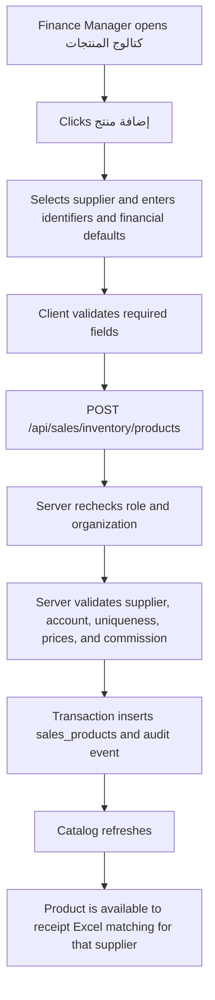
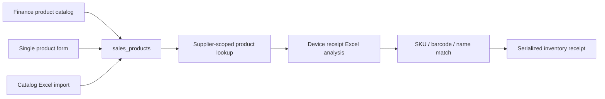

# Finance Manager Product Catalog — Full Implementation Blueprint

## 1. Executive decision

Add a dedicated **Products / كتالوج المنتجات** workspace for the Finance Manager under:

```text
/sales/inventory/products
```

The workspace will allow an authorized Finance Manager or Admin to:

- view and search the organization's product catalog;
- add one product manually;
- add many products by uploading an Excel workbook;
- preview and correct detected Excel data before saving;
- safely update existing products without silent overwrites;
- activate or deactivate products;
- define the supplier, SKU, barcode, model, selling price, cost, and commission defaults;
- see who created or changed each product;
- make created products immediately available to the existing device-receipt Excel workflow.

The new workspace must use the existing product inventory authorization boundary rather than granting Finance Managers broad access to the Sales module. This is the safest and smallest-permission design.

## 2. Why a dedicated inventory product catalog is required

The current application already has a general Sales products page at:

```text
/sales/products
```

However, its APIs use general Sales authorization. Adding `finance_manager` to that global authorization list would unintentionally expose other Sales endpoints and screens.

The product inventory module already has the correct authorization model:

- allowed management roles: `admin`, `finance_manager`;
- allowed route prefix: `/sales/inventory`;
- allowed API prefix: `/api/sales/inventory`;
- organization and feature access are already checked by `requireProductInventoryManagerAccess`.

Therefore, this implementation will reuse the same `sales_products` records while exposing a separate Finance-facing UI and API surface under the inventory namespace.

## 3. Goals

### 3.1 Functional goals

1. Add **كتالوج المنتجات** to the Finance Manager sidebar.
2. Allow creation and editing of one product through a form.
3. Allow creation and controlled updates of many products through Excel.
4. Detect Excel sheets, header rows, and supported Arabic or English column names automatically.
5. show a full preview before any database change.
6. Detect duplicates and conflicts using SKU, barcode, product name, and model.
7. Keep bulk imports atomic, idempotent, auditable, and tenant-safe.
8. Make active serialized products selectable and recognizable in the device receipt Excel flow.
9. Preserve the existing Sales Manager product-management experience.
10. Provide clear import history, errors, and downloadable rejected-row reports.

### 3.2 Non-goals

- Creating suppliers from this page. The Finance Manager selects an existing supplier/company.
- Giving the Finance Manager unrestricted access to `/sales/products` or all Sales APIs.
- Importing physical device serial numbers in the catalog workbook. Serials belong to receipt imports.
- Silently updating prices, commission, or identifiers when a row is ambiguous.
- Deleting products that are referenced by receipts, stock, invoices, or assignments.
- Using a JSON mapping editor. The system recognizes workbook columns automatically.

## 4. Roles and permissions

| Capability | Finance Manager | Admin | Sales Manager | Supervisor / Project Manager | Accountant / Other roles |
|---|---:|---:|---:|---:|---:|
| See inventory product sidebar item | Yes | Yes | No change | No | No |
| View inventory product catalog | Yes | Yes | Existing Sales route only | No | No |
| Add one inventory product | Yes | Yes | Existing Sales permissions | No | No |
| Upload product catalog workbook | Yes | Yes | No, unless separately approved | No | No |
| Update product inventory/commercial defaults | Yes | Yes | Existing Sales permissions | No | No |
| Activate/deactivate product | Yes | Yes | Existing Sales permissions | No | No |
| Hard-delete referenced product | No | No | No | No | No |
| View import audit/history | Yes | Yes | No | No | No |

Every API request must re-check the authenticated user, organization, active membership, enabled feature, and role. Hiding a sidebar item is not authorization.

## 5. User experience and navigation

### 5.1 Sidebar

Add this entry to the Finance Manager inventory operations group in `src/components/layout/Sidebar.tsx`:

```ts
{
  name: "كتالوج المنتجات",
  href: "/sales/inventory/products",
  icon: Boxes,
}
```

The link is shown to `finance_manager` and `admin` through the same role rules used by the other product-inventory operations. It must not be added to a shared array that exposes it to unrelated roles.

### 5.2 Page structure

Create:

```text
src/app/(app)/sales/inventory/products/page.tsx
```

Recommended page layout:

1. Header: **كتالوج المنتجات**.
2. Summary cards:
   - total products;
   - active serialized products;
   - inactive products;
   - products missing SKU/barcode;
   - last successful catalog import.
3. Primary actions:
   - **إضافة منتج**;
   - **رفع ملف Excel**;
   - **تحميل نموذج Excel**.
4. Filters:
   - search by name, SKU, barcode, or model;
   - supplier;
   - active/inactive;
   - complete/incomplete catalog data.
5. Product table with server-side pagination.
6. Import history section or tab.

### 5.3 Product table columns

- product name;
- supplier;
- SKU;
- barcode;
- model;
- sale price;
- default cost;
- commission;
- inventory tracking state;
- active/inactive state;
- last updated by and time;
- row actions: view, edit, activate/deactivate.

### 5.4 Manual add/edit drawer

Fields:

| Field | Requirement | Rule |
|---|---|---|
| Supplier | Required | Select from active organization companies; do not accept a browser-supplied arbitrary company ID |
| Product name | Required | Trimmed, 2–200 characters |
| SKU | Required unless barcode exists | Unique after normalization within the supplier |
| Barcode | Required unless SKU exists | Unique after normalization across the organization |
| Model | Optional | Trimmed; used as a secondary matching hint |
| Description | Optional | Plain text, length-limited |
| Unit | Required/defaulted | Default `جهاز` |
| Category | Optional/defaulted | Default `5G Router` for the first rollout if desired |
| Planned sale price | Required for sale-ready products | Decimal, greater than zero |
| Default unit cost | Optional | Decimal, zero or greater |
| Commission type | Optional | `none`, `flat`, or `percentage` |
| Commission value | Conditional | Zero or greater; percentage cannot exceed 100 |
| Revenue account | Optional/configurable | Select only an organization account from an allow-listed revenue-account query |
| Active | Default true | Inactive products cannot be selected by new receipt imports |
| Serialized inventory | Fixed true initially | Finance catalog products are device products |

For this Finance workflow, new products should default to:

```text
inventory_enabled = true
tracking_mode = serialized
is_active = true
inventory_version = 1
```

## 6. Manual product creation flow



The server returns normalized product data and a stable error code. Database uniqueness constraints remain the final protection against races.

## 7. Bulk product creation from Excel

### 7.1 User journey

1. Finance Manager opens **كتالوج المنتجات**.
2. Selects the supplier that owns the products.
3. Clicks **رفع ملف Excel**.
4. Uploads `.xlsx` or `.csv`; no JSON is shown or requested.
5. The system scans all sheets and detects the best header row and column mapping.
6. The system displays:
   - detected sheet and header row;
   - detected column names;
   - overall confidence;
   - counts for new, existing, invalid, duplicate, and ambiguous rows;
   - row-by-row preview and validation messages.
7. The Finance Manager reviews conflicts and explicitly chooses an allowed resolution.
8. The system commits the reviewed batch in one transaction.
9. The UI displays a result receipt and makes a rejected-row workbook downloadable if needed.
10. Successfully created or updated active serialized products become available in device receipt imports immediately.

### 7.2 Important scope distinction

The **catalog workbook** describes product types. It does not contain individual device serial numbers.

Example:

| product_name | sku | barcode | model | planned_sale_price | default_cost | commission_type | commission_value |
|---|---|---|---|---:|---:|---|---:|
| Router 5G Pro | RTR-5G-PRO | 6221234567890 | H155 | 5500 | 4200 | flat | 150 |

The separate **device receipt workbook** later contains one row per physical device, including serial number, unit cost, and receipt evidence.

## 8. Excel workbook contract

### 8.1 Supported file types and limits

- `.xlsx` and `.csv` initially;
- reject macro-enabled workbooks (`.xlsm`);
- maximum file size: 10 MB;
- maximum sheets scanned: 50;
- maximum columns per sheet: 200;
- maximum catalog data rows per import: 10,000;
- ignore hidden/system sheets only after recording them in analysis diagnostics;
- formulas must be read as cached values and never executed;
- values beginning with formula characters must be escaped in exported error reports.

### 8.2 Canonical catalog fields

| Canonical field | Required | Example Arabic aliases | Example English aliases |
|---|---:|---|---|
| `product_name` | Yes | اسم المنتج، المنتج، الصنف | product name, product, item name |
| `sku` | SKU or barcode | كود المنتج، كود الصنف، SKU | sku, product sku, item code |
| `barcode` | SKU or barcode | باركود، الباركود | barcode, ean, upc |
| `model` | No | الموديل، طراز | model, device model |
| `description` | No | الوصف، وصف المنتج | description, product description |
| `unit` | No | الوحدة، وحدة القياس | unit, uom |
| `category` | No | الفئة، التصنيف | category, product category |
| `planned_sale_price` | Yes for sale-ready | سعر البيع، سعر البيع المخطط | sale price, planned sale price |
| `default_cost` | No | التكلفة، تكلفة الوحدة | cost, unit cost, default cost |
| `commission_type` | No | نوع العمولة | commission type |
| `commission_value` | Conditional | قيمة العمولة، نسبة العمولة | commission value, commission amount |
| `revenue_account_code` | No | كود حساب الإيراد | revenue account code |
| `is_active` | No | نشط، الحالة | active, status |
| `notes` | No | ملاحظات | notes |

The selected supplier is a batch-level field outside the workbook. The server must not trust a supplier/company UUID supplied inside Excel.

### 8.3 Recognition process

Build a separate catalog recognizer instead of reusing receipt validation rules directly:

1. validate file signature, extension, size, and archive limits;
2. enumerate all sheets;
3. inspect a bounded row window for possible headers;
4. normalize Arabic and English headers;
5. score aliases and content types for each canonical field;
6. choose the highest-confidence sheet/header combination;
7. preserve leading zeros for SKU and barcode values;
8. parse localized numbers safely;
9. normalize status and commission values;
10. build a preview without database writes;
11. match preview rows against existing supplier products;
12. store an expiring immutable analysis snapshot.

If confidence is too low, the UI should show the detected columns and ask the user to select from controlled dropdowns. It must never expose or require JSON editing.

### 8.4 Required validation

Each row must satisfy:

- non-empty product name;
- SKU or barcode is present;
- normalized identifiers remain strings;
- sale price is a valid decimal and greater than zero for active products;
- default cost is empty or zero/greater;
- commission type is `none`, `flat`, or `percentage` after normalization;
- commission value agrees with commission type;
- percentage commission is between 0 and 100;
- revenue account code, when present, resolves to an allowed organization account;
- no duplicate SKU or barcode occurs inside the uploaded batch;
- the row does not contradict an existing SKU/barcode match.

## 9. Product matching and conflict rules

Matching must be deterministic and supplier-aware.

### 9.1 Matching order

1. **Exact normalized barcode** within the organization.
2. **Exact normalized SKU** within the selected supplier/company.
3. **Exact normalized name + model** within the supplier, as a review suggestion only.
4. Otherwise classify the row as a new product.

### 9.2 Row classifications

| Status | Meaning | Default action |
|---|---|---|
| `new` | No existing product match | Create |
| `existing_unchanged` | Match and all imported values are equal | Skip |
| `existing_update` | One exact identifier match with changed values | Require explicit update decision |
| `ambiguous` | Name/model suggests multiple products | Block until corrected |
| `identifier_conflict` | SKU and barcode resolve to different products | Block |
| `duplicate_in_file` | Duplicate identifier in the same workbook | Block both rows |
| `invalid` | Required or financial validation failed | Block |

### 9.3 Safe update rules

- Never use blind `UPSERT` based only on user input.
- Do not silently move an existing SKU to another supplier.
- Do not silently replace a barcode.
- For an existing row, display before/after values and require **Update existing product**.
- Include the product's `inventory_version` in the analysis and commit request.
- Update only when the current database version still equals the analyzed version.
- A changed version produces `PRODUCT_VERSION_CONFLICT` and requires re-analysis.
- Existing receipt, stock, invoice, and assignment snapshots must remain historically unchanged.

## 10. API design

All endpoints live under `/api/sales/inventory` and use `requireProductInventoryManagerAccess`.

### 10.1 Catalog endpoints

```text
GET    /api/sales/inventory/products
POST   /api/sales/inventory/products
GET    /api/sales/inventory/products/:productId
PATCH  /api/sales/inventory/products/:productId
POST   /api/sales/inventory/products/:productId/activate
POST   /api/sales/inventory/products/:productId/deactivate
GET    /api/sales/inventory/products/options
```

`GET /products` supports:

- `q`;
- `company_id`;
- `status`;
- `completeness`;
- cursor or page pagination;
- deterministic ordering.

The options endpoint returns only allowed active suppliers and revenue accounts. The browser never determines organization scope.

### 10.2 Import endpoints

```text
GET    /api/sales/inventory/products/imports
GET    /api/sales/inventory/products/imports/:analysisId
GET    /api/sales/inventory/products/imports/:analysisId/rejections.xlsx
GET    /api/sales/inventory/products/template.xlsx
POST   /api/sales/inventory/products/import/analyze
POST   /api/sales/inventory/products/import/:analysisId/commit
```

Analyze request:

```text
Content-Type: multipart/form-data
file: catalog.xlsx
company_id: selected supplier UUID
```

Commit request is JSON generated internally by the UI, not edited by the user:

```json
{
  "command_id": "client-generated UUID",
  "analysis_version": 1,
  "rows": [
    { "row_id": "...", "decision": "create" },
    {
      "row_id": "...",
      "decision": "update",
      "product_id": "...",
      "expected_inventory_version": 3
    }
  ]
}
```

### 10.3 Stable server error codes

- `PRODUCT_ACCESS_DENIED`
- `PRODUCT_SUPPLIER_NOT_FOUND`
- `PRODUCT_SKU_CONFLICT`
- `PRODUCT_BARCODE_CONFLICT`
- `PRODUCT_VERSION_CONFLICT`
- `PRODUCT_REFERENCED_CANNOT_DELETE`
- `CATALOG_FILE_UNSUPPORTED`
- `CATALOG_FILE_TOO_LARGE`
- `CATALOG_HEADER_NOT_RECOGNIZED`
- `CATALOG_ANALYSIS_EXPIRED`
- `CATALOG_ANALYSIS_CHANGED`
- `CATALOG_ROWS_INVALID`
- `CATALOG_COMMIT_IN_PROGRESS`
- `CATALOG_COMMAND_REUSED_WITH_DIFFERENT_PAYLOAD`

User-facing Arabic messages should be mapped from these codes, while logs retain the stable code.

## 11. Database changes

### 11.1 Reuse existing product storage

Continue using `sales_products` as the single source of truth. Do not create a second inventory product table.

Relevant existing fields include:

- `company_id`, `name`, `description`, `unit`, `category`, `price`;
- `sku`, `barcode`, `model`;
- `inventory_enabled`, `tracking_mode`, `default_cost`;
- `revenue_account_id`, `inventory_account_id`, `cogs_account_id`, `tax_rate_id`;
- `agent_commission_type`, `agent_commission_value`;
- `inventory_version`, `is_active`.

Preserve existing constraints and unique indexes, especially normalized SKU per supplier and barcode per organization.

### 11.2 New catalog analysis table

Create `product_catalog_import_analyses`:

```text
id uuid primary key
organization_id uuid not null
company_id uuid not null
created_by uuid not null
status text not null
original_filename text not null
file_sha256 text not null
selected_sheet text
header_row integer
mapping jsonb not null
confidence numeric
summary jsonb not null
analysis_version integer not null default 1
expires_at timestamptz not null
committed_at timestamptz
created_at timestamptz not null
updated_at timestamptz not null
```

Allowed statuses:

```text
analyzed, committing, committed, failed, expired
```

### 11.3 New catalog analysis rows table

Create `product_catalog_import_rows`:

```text
id uuid primary key
analysis_id uuid not null
organization_id uuid not null
source_sheet text not null
source_row integer not null
raw_values jsonb not null
normalized_values jsonb not null
classification text not null
errors jsonb not null default '[]'
warnings jsonb not null default '[]'
matched_product_id uuid
matched_inventory_version integer
suggested_changes jsonb
created_at timestamptz not null
```

Use relational rows rather than one unlimited JSON analysis document so previews can paginate and large imports remain bounded.

### 11.4 New idempotency command table

Create `product_catalog_import_commands`:

```text
id uuid primary key
organization_id uuid not null
analysis_id uuid not null
command_id uuid not null
requested_by uuid not null
request_hash text not null
status text not null
result jsonb
error_code text
created_at timestamptz not null
completed_at timestamptz
unique (organization_id, command_id)
```

### 11.5 Product audit table

Create `product_catalog_audit_log`:

```text
id uuid primary key
organization_id uuid not null
product_id uuid not null
company_id uuid not null
actor_user_id uuid not null
action text not null
source text not null
source_analysis_id uuid
before_values jsonb
after_values jsonb
created_at timestamptz not null
```

Actions: `create`, `update`, `activate`, `deactivate`.

Sources: `manual`, `catalog_excel`, `sales_product_ui`, `system`.

### 11.6 RLS and grants

- Browser sessions receive no direct write grants to catalog staging, command, or audit tables.
- Service-role server code performs validated mutations.
- RLS policies enforce `organization_id` for any authenticated read that is intentionally exposed.
- Add indexes for organization/company/status/created time and analysis row pagination.
- Foreign keys must prevent cross-organization references through server validation and, where practical, composite database constraints.

## 12. Atomic batch commit and idempotency

Implement a database RPC such as:

```text
commit_product_catalog_import_v1(...)
```

Transaction sequence:

1. authenticate and authorize before calling the RPC;
2. insert or lock the idempotency command using `organization_id + command_id`;
3. verify the request hash if the command already exists;
4. lock the analysis and confirm it is unexpired and uncommitted;
5. confirm analysis owner organization and selected supplier;
6. load every chosen row from the stored immutable analysis;
7. reject any row not marked safe for its requested decision;
8. re-resolve supplier, account, SKU, and barcode constraints;
9. lock matched products and verify `inventory_version`;
10. create or update every selected product;
11. increment `inventory_version` on each update;
12. insert product audit entries;
13. insert the appropriate business event/outbox records;
14. mark the analysis and command committed;
15. commit the transaction and return counts plus affected product IDs.

Initial rollout should use **all-or-nothing commit**. If any selected row becomes invalid between analysis and commit, nothing is written. This is easier to audit and prevents partially applied catalogs. A later version may support explicitly selected valid-only batches.

Repeating the same `command_id` and request payload returns the original result without creating duplicates. Reusing the same command ID with a different payload is rejected.

## 13. Connection to the existing receipt Excel workflow

The catalog and receipt processes connect through `sales_products`:



For a product to participate automatically in a new receipt import, it must be:

- in the same organization;
- assigned to the supplier selected for the receipt;
- active;
- `inventory_enabled = true`;
- `tracking_mode = 'serialized'`.

Receipt matching should use exact barcode first, exact supplier-scoped SKU second, and controlled name/model aliases only as review suggestions.

The receipt workbook must still provide its own transaction evidence, including serial number, actual unit cost, and planned sale price where the current receipt contract requires them. Catalog defaults can prefill or validate values, but must not silently replace financial values received with a shipment.

When a receipt price differs from the catalog default, the preview should show a warning rather than silently modifying the product catalog.

## 14. Frontend architecture

Recommended components:

```text
src/components/sales/inventory/products/
  ProductCatalogPage.tsx
  ProductCatalogSummary.tsx
  ProductCatalogFilters.tsx
  ProductCatalogTable.tsx
  ProductEditorDrawer.tsx
  ProductStatusDialog.tsx
  ProductCatalogImportDialog.tsx
  ProductCatalogImportPreview.tsx
  ProductCatalogImportRowsTable.tsx
  ProductCatalogImportSummary.tsx
  ProductCatalogImportHistory.tsx
```

Recommended client/server modules:

```text
src/lib/product-catalog/
  types.ts
  schemas.ts
  api.ts
  normalization.ts
  workbook-recognizer.ts
  row-validator.ts
  product-matcher.ts
  error-messages.ts
```

Reuse safe workbook-reading and automatic header-detection primitives from the receipt importer, but keep catalog field definitions and validation separate.

Frontend requirements:

- server-side pagination for product and preview tables;
- RTL Arabic layout;
- preserve filters in URL query parameters;
- disable duplicate commit clicks while a command is running;
- allow resume/reopen of an unexpired analysis;
- display exact source sheet and row for every error;
- show before/after values for updates;
- do not render raw JSON to the Finance Manager;
- do not claim success until the server transaction has committed.

## 15. Backend file plan

### 15.1 Modify existing files

- `src/components/layout/Sidebar.tsx`
  - add the Finance/Admin product catalog navigation item.
- `src/lib/server/product-inventory-auth.ts`
  - reuse or extend the inventory-manager guard only if a product-specific helper improves clarity.
- `src/lib/server/product-inventory-import.ts`
  - extract only genuinely shared secure workbook-reading helpers; do not merge catalog and receipt business rules.
- `src/lib/api.ts`
  - add typed Finance product catalog client functions if this remains the project's API client convention.

### 15.2 Add routes

```text
src/app/(app)/sales/inventory/products/page.tsx
src/app/api/sales/inventory/products/route.ts
src/app/api/sales/inventory/products/[productId]/route.ts
src/app/api/sales/inventory/products/[productId]/activate/route.ts
src/app/api/sales/inventory/products/[productId]/deactivate/route.ts
src/app/api/sales/inventory/products/options/route.ts
src/app/api/sales/inventory/products/template.xlsx/route.ts
src/app/api/sales/inventory/products/import/analyze/route.ts
src/app/api/sales/inventory/products/import/[analysisId]/route.ts
src/app/api/sales/inventory/products/import/[analysisId]/commit/route.ts
src/app/api/sales/inventory/products/import/[analysisId]/rejections.xlsx/route.ts
src/app/api/sales/inventory/products/imports/route.ts
```

Route naming may be adjusted to repository conventions, but every route must remain under `/api/sales/inventory`.

### 15.3 Add migration

Create the next numbered schema migration after the repository's current latest migration. It must include:

- analysis, row, command, and audit tables;
- constraints and indexes;
- RLS and grants;
- batch commit RPC;
- comments documenting security boundaries;
- migration verification queries or smoke tests.

## 16. Security controls

1. Authorize every endpoint using `requireProductInventoryManagerAccess`.
2. Derive organization and user IDs from the authenticated session, never from the request body.
3. Confirm the supplier belongs to the organization and is allowed for the workflow.
4. Confirm revenue accounts belong to the organization and are valid revenue accounts.
5. Validate MIME signature, extension, ZIP expansion, file size, row count, and cell limits.
6. Never execute workbook formulas or macros.
7. Store uploaded source files privately, with short retention and non-guessable keys.
8. Avoid storing raw sensitive spreadsheet values in application logs.
9. Escape spreadsheet formula injection in generated Excel/CSV reports.
10. Use parameterized queries and database constraints.
11. Rate-limit analyze and commit operations by user and organization.
12. Keep direct table writes unavailable to browser clients.
13. Record immutable audit entries with actor, source, and before/after data.
14. Test cross-tenant product, supplier, account, analysis, and command IDs.

## 17. Error recovery and lifecycle

### 17.1 Analysis lifecycle

- Analysis expires after 24 hours by default.
- A scheduled cleanup removes expired row data and source files according to retention policy.
- Committed summaries and audit records are retained longer for business traceability.
- Failed analysis may be retried with a new analysis ID.
- A failed commit keeps the analysis reviewable unless it expired.

### 17.2 Product lifecycle

- Products are deactivated rather than deleted.
- Deactivated products remain visible in historical receipts and audit records.
- Deactivation is blocked or clearly warned when operationally relevant pending stock exists, according to business rules.
- Reactivation rechecks identifier uniqueness and supplier validity.
- Identifier changes are audited and never rewrite historical document snapshots.

## 18. Observability

Record structured metrics and events for:

- catalog analyses started, succeeded, failed, and expired;
- workbook recognition confidence;
- row counts by classification;
- duplicate SKU/barcode conflicts;
- commit duration and result;
- idempotent retries;
- version conflicts;
- authorization failures;
- products created, updated, activated, and deactivated;
- subsequent receipt matching rate for catalog-created products.

Alert on:

- repeated commit failures;
- commands stuck in `committing`;
- cleanup backlog;
- an unusual spike in conflicts or authorization failures;
- receipt matching rate degradation after rollout.

## 19. Implementation phases and commit boundaries

Each phase must be independently testable. Commit and push `main` only after its tests pass and after checking that unrelated working-tree files are not staged.

### Phase 1 — Data foundation and server contracts

Deliverables:

- migration for analysis, row, command, and audit tables;
- constraints, indexes, RLS, grants, and batch commit RPC;
- TypeScript product catalog schemas and normalized types;
- inventory-manager authorization tests;
- single-product list/create/update/status APIs;
- supplier and revenue-account options API.

Verification:

- migration applies cleanly to a fresh database;
- database smoke tests cover uniqueness, tenant isolation, rollback, and idempotency;
- Finance Manager/Admin accepted; other roles rejected;
- existing Sales product APIs remain unchanged.

Suggested commit:

```text
feat(inventory): add finance product catalog foundation
```

### Phase 2 — Sidebar and manual catalog management

Deliverables:

- Finance Manager sidebar link;
- catalog page, filters, pagination, and summary cards;
- add/edit drawer;
- activate/deactivate flow;
- Arabic validation and server error mapping;
- product audit display.

Verification:

- role visibility tests;
- manual create/update/deactivate/reactivate E2E flow;
- duplicate SKU/barcode errors;
- Finance Manager cannot access unrelated Sales management endpoints;
- newly created serialized product appears in supplier-scoped receipt matching.

Suggested commit:

```text
feat(inventory): add finance product catalog workspace
```

### Phase 3 — Automatic catalog Excel analysis

Deliverables:

- downloadable Arabic/English template;
- secure multipart upload;
- all-sheet/header recognition;
- Arabic/English aliases and number/status normalization;
- database matching and row classifications;
- persisted paginated preview and expiring analysis;
- rejected-row workbook generator.

Verification:

- unit tests for aliases, normalization, leading zeros, formulas, blank rows, and duplicates;
- fixture workbooks with reordered columns, title rows, multiple sheets, Arabic headers, and English headers;
- limits and malformed-file tests;
- cross-tenant and supplier mismatch tests;
- analysis performs no product writes.

Suggested commit:

```text
feat(inventory): recognize product catalog workbooks
```

### Phase 4 — Bulk review and atomic commit UI

Deliverables:

- upload dialog and analysis progress;
- summary and row preview;
- before/after update comparison;
- controlled conflict decisions;
- atomic commit endpoint and progress/result UI;
- idempotent retry behavior;
- import history and downloadable errors.

Verification:

- import of 1, 100, and maximum supported rows;
- atomic rollback when any selected row becomes invalid;
- repeated identical command returns identical result;
- changed command payload with same ID is rejected;
- concurrent product edit creates a version conflict;
- no double-submit creates duplicate products.

Suggested commit:

```text
feat(inventory): add bulk product catalog imports
```

### Phase 5 — Receipt integration, hardening, and rollout

Deliverables:

- confirm receipt matching immediately uses new catalog products;
- surface catalog-default comparison warnings during receipt analysis;
- metrics, structured events, cleanup task, and stuck-command recovery;
- feature flag and organization-level rollout control;
- operational runbook and UAT evidence;
- performance and accessibility improvements.

Verification:

- end-to-end catalog-to-receipt scenario;
- load test at configured workbook limits;
- security/RLS regression suite;
- accessibility and RTL checks;
- existing Sales Manager and receipt workflows remain green;
- rollback drill through feature-flag disablement.

Suggested commit:

```text
chore(inventory): harden finance product catalog operations
```

## 20. Test matrix

### 20.1 Unit tests

- Arabic and English header aliases;
- header normalization and confidence scoring;
- barcode/SKU preservation as text;
- localized decimal parsing;
- commission validation;
- product matching precedence;
- conflicting SKU and barcode detection;
- duplicate rows inside one workbook;
- formula and output-injection handling;
- stable error-code mapping.

### 20.2 API tests

- Finance Manager and Admin success paths;
- every unauthorized role receives 403;
- unauthenticated request receives 401;
- cross-tenant IDs are rejected or not found;
- arbitrary supplier/account IDs are rejected;
- analyze endpoint never mutates `sales_products`;
- expired and already-committed analyses are rejected correctly;
- pagination/filter behavior remains deterministic.

### 20.3 Database tests

- unique normalized SKU within supplier;
- unique normalized barcode within organization;
- commission constraints;
- direct client mutation denied;
- batch transaction rolls back fully;
- idempotent command retry;
- optimistic concurrency with `inventory_version`;
- audit row produced for every mutation.

### 20.4 End-to-end scenarios

1. Finance Manager sees the sidebar item; an unauthorized user does not.
2. Finance Manager manually creates `Router 5G Pro` for Supplier A.
3. A receipt workbook for Supplier A identifies it by SKU.
4. The same SKU under Supplier A is rejected as duplicate.
5. An allowed SKU under Supplier B follows the supplier-scoped uniqueness rule.
6. Upload 100 new products and verify preview then commit.
7. Upload a mixed file containing new, update, duplicate, and invalid rows.
8. Barcode and SKU pointing to different existing products block the row.
9. A product edited after analysis triggers version conflict on commit.
10. Deactivated product is preserved historically and excluded from new receipt matching.
11. Repeating a commit request does not duplicate products.
12. Existing Sales Manager product workflows behave exactly as before.

## 21. Rollout and rollback

### 21.1 Rollout

1. Deploy additive migrations and server code with `finance_product_catalog_enabled = false`.
2. Run migration, authorization, and RLS smoke checks.
3. Enable for an internal test organization.
4. Import a representative 5G router catalog and complete UAT.
5. Confirm the imported products match in a receipt workbook.
6. Enable for the client organization.
7. Monitor analysis failures, conflicts, commit duration, and receipt matching for at least one business cycle.
8. Expand availability only after metrics remain healthy.

### 21.2 Rollback

- Disable the feature flag to hide the sidebar and block new catalog operations.
- Keep existing `sales_products`, receipts, and audit history intact.
- Do not drop additive tables during an incident.
- Allow in-flight commands to reach a terminal state or mark them failed through the runbook.
- The existing Sales Manager product page and device receipt flow continue operating.

## 22. Acceptance criteria

The feature is complete when:

- Finance Manager and Admin can see **كتالوج المنتجات** in the inventory sidebar;
- unauthorized roles cannot see or call the new feature;
- Finance can add and edit a single inventory product;
- Finance can upload an Excel file without writing or viewing JSON mappings;
- Arabic and English columns are detected automatically across supported sheets;
- the preview identifies new, update, duplicate, ambiguous, and invalid rows;
- no product is created or changed before explicit commit;
- ambiguous and conflicting rows cannot be silently committed;
- bulk commit is atomic, idempotent, and version-safe;
- every mutation has a tenant-scoped audit entry;
- active serialized catalog products become available to the correct supplier's receipt Excel analysis;
- receipt financial evidence is not silently replaced by catalog defaults;
- deactivated products remain visible in historical transactions;
- security, RLS, regression, and E2E tests pass;
- operational metrics, cleanup, and rollback controls are documented and verified.

## 23. Definition of done

For every implementation phase:

1. code is reviewed against this blueprint;
2. database migration and rollback implications are documented;
3. lint, type-check, unit, API, and relevant E2E tests pass;
4. Arabic RTL UX is manually verified;
5. authorization and cross-tenant tests pass;
6. no unrelated user files are included in the commit;
7. the phase is committed with a focused message and pushed to `main`;
8. the pushed commit hash and verification results are recorded in the implementation handoff.
