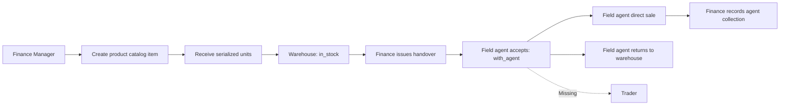
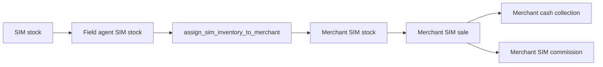
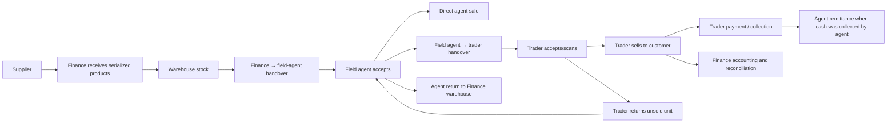
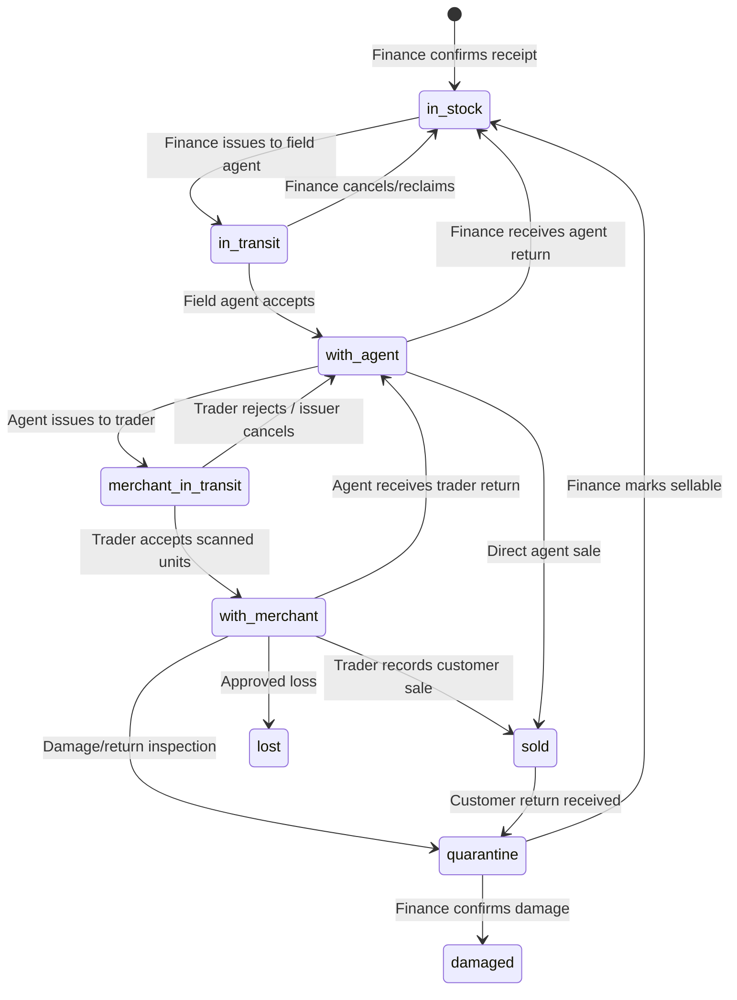

# Finance, On-Ground Agent, and Trader Product Flow — Implementation Blueprint

## 1. Executive conclusion

The reported problem is not a missing product dropdown or a small assignment bug. The system currently contains two different distribution chains:

1. A complete SIM chain: organization stock → field agent → trader/merchant → customer.
2. A router/product chain that stops at the field agent: Finance warehouse → field agent → customer.

There is no product custody, handover, sale, return, commission, collection, API, or trader UI for the field-agent-to-trader step. The only trader assignment dialog is explicitly a SIM dialog and calls the SIM assignment API.

There is also an authorization mismatch introduced when product inventory ownership moved to Finance:

- The sidebar and route guard still show `/sales/inventory` and `/sales/inventory/assignments` to `Onground_Agent_Manager`.
- The server authorization permits those product-management APIs only for `admin` and `finance_manager`.
- The latest database command function also permits warehouse-to-agent product handovers only for `admin` and `finance_manager`.

Therefore, giving the on-ground manager access to the existing Finance screen is not the correct fix. The correct design is:

- Finance owns catalog, receiving, cost, pricing, warehouse stock, finance approvals, and warehouse-to-agent custody.
- The field agent accepts their product custody and can hand accepted units to traders assigned to that agent.
- The on-ground agent manager monitors the network and may initiate exceptional/on-behalf-of transfers only under an explicit control.
- The trader accepts the handover, views their own product stock, sells to customers, requests replenishment, returns products, and submits payments.
- Finance receives complete trader stock, sale, receivable, collection, commission, and accounting visibility without exposing cost data to traders.

This blueprint keeps the existing SIM flow unchanged and adds an additive serialized-product trader flow.

---

## 2. Terminology and identity contract

The current UI mixes several terms that are not equivalent. The implementation must use these definitions consistently:

| Business term | System identity | Meaning |
|---|---|---|
| Finance Manager / مدير المالية | `finance_manager` | Owns product catalog, receiving, commercial controls, warehouse custody, accounting, and final approvals. |
| On-ground Agent Manager / مدير المندوبين | `onground_agent_manager` | Manages field agents and traders operationally. This is not a physical product holder by default. |
| Field Agent / المندوب الميداني | `field_agent` plus a linked `field_agents` row | Accepts physical product custody from Finance and distributes to owned traders or sells directly. |
| Trader / Merchant / التاجر | `merchant` plus a `merchants` row | Receives products from its owning field agent and sells them to the end customer. The database currently calls this entity `merchant`; the Arabic UI can continue to display “التاجر”. |
| Project Manager / Supervisor | operational assignment `OGPM` / `OGSV1` | Employee-custody recipients used for project/location accountability. They are not automatically field agents or traders. |

### Required terminology decision

Use `merchant` in database and API identifiers for compatibility, and `التاجر` in user-facing Arabic text. Use “on-ground manager” only for `onground_agent_manager`, and “field agent” for the person who owns trader relationships and physical agent custody.

### OGPM / OGSV1 boundary

The current operational assignment has a `can_sell` flag, but no employee-custody sale command consumes it. Until a separate employee-sale workflow is implemented, the UI must not imply that this flag enables selling. If an OGPM or OGSV1 user also acts as a field agent, identity provisioning must create and link an active `field_agents` row explicitly; the system must never infer this from job title alone.

---

## 3. Current as-built flow

### 3.1 Serialized product flow



What exists:

- Product catalog and automatic Excel import.
- Finance receiving and serialized unit creation.
- Finance-to-field-agent handover and agent signature.
- Field-agent direct sale, price exception, return, balance, and collection.
- Finance accounting for receipt, direct agent sale, collection, loss, and agent commission.
- Separate employee custody for OGPM/OGSV1 and a return workflow.

What does not exist:

- Product assignment from field agent to trader.
- Trader acceptance or product stock.
- Trader product sale.
- Trader product requests or replenishment.
- Trader product collections, receivables, or product commission.
- Trader product returns, damage, loss, or customer-sale reversal.

### 3.2 Existing trader flow



The current trader pages, types, schemas, and APIs are SIM-specific:

- `AgentMerchantsScreen` labels the action “تسليم شرائح لتاجر”.
- `AssignToMerchantDialog` loads `SimUnit[]` and calls `/api/sales/merchants/sims/preview` and `/api/sales/merchants/sims/assign`.
- `assign_sim_inventory_to_merchant` locks and updates `sim_units` only.
- `MerchantScreens` displays SIM stock, SIM sales, SIM requests, and SIM balance.
- Merchant commissions reference `sim_unit_id` and optional `sim_package_id`.

The product inventory is intentionally separate and cannot be assigned by those commands.

---

## 4. Evidence and root causes

| Priority | Finding | Evidence in the current implementation | Impact |
|---|---|---|---|
| P0 | No product-to-trader domain model | `product_inventory_units` has `current_agent_id` but no `current_merchant_id`; product statuses do not include `with_merchant`. | A product cannot legally or atomically be placed in trader custody. |
| P0 | No product-to-trader command | Product commerce actions are limited to handover issue/accept, agent return, direct sale, void, price override, and agent collection. | There is no API that can make the requested assignment. |
| P0 | Trader UI is SIM-only | `AgentMerchantsScreen` and `MerchantScreens` use SIM services and SIM types exclusively. | The user can only deliver SIMs, not router products. |
| P0 | Route authorization contradicts server/database authorization | `canAccessPath` and the sidebar allow `Onground_Agent_Manager` product inventory, while `productInventoryHandoverRoles` and schema v142 allow only Admin/Finance for warehouse-to-agent handover. | The page is visible but its API returns 403 or fails to load. |
| P0 | No trader product sale or accounting | `agent_product_sales` requires an active `field_agent`; accounting reads `agent_product_sale_lines`. | Trader sales cannot update stock, receivables, revenue, VAT, COGS, margin, or commissions. |
| P1 | No channel-specific commercial terms | Product terms contain one agent commission rule. | Direct-agent and trader-chain commissions cannot both be represented safely. |
| P1 | No trader product settlement ledger | Merchant cash collections are built for the SIM flow and product collections are agent-level. | Product balances would mix SIM and router debt or be impossible to reconcile. |
| P1 | No trader product return/loss flow | Current product returns cover agent/employee custody, not merchant custody. | A product can become operationally stranded after trader assignment. |
| P1 | Dead `can_sell` capability | OGPM/OGSV1 assignments expose `can_sell`, but no employee sale path checks it. | The UI promises a capability the backend does not implement. |
| P1 | No single physical-holder invariant | Product units support warehouse, agent, and employee fields through separate additions, but not one canonical holder contract. | Adding merchant custody naively could create contradictory ownership columns. |
| P1 | Weak access-contract test coverage | Tests confirm middleware permits the on-ground manager path but do not confirm that API and SQL permissions agree. | UI/API/DB authorization can drift unnoticed. |
| P2 | Trader screens perform N+1 loading | Collections, commissions, and SIMs are fetched once per merchant. | Performance degrades as the trader network grows. |
| P2 | Product setup data is loaded once per screen | Receipt/product selection pages can remain stale after a product is created in another tab. | Users see empty or outdated dropdowns without a reason or refresh. |
| P2 | Catch-all merchant API is too broad | A large `[[...segments]]` handler mixes identity, SIMs, sales, requests, collections, packages, and analytics. | Adding product commerce there increases regression and authorization risk. |
| P2 | Terminology is inconsistent | Trader, merchant, on-ground manager, field agent, project manager, and supervisor are used as if interchangeable. | Requirements, permissions, and accountability become ambiguous. |

---

## 5. Target operating model

### 5.1 Recommended business flow



### 5.2 Recommended settlement model

Use a custody/consignment-style `sale_proceeds` model for the first release:

- Warehouse-to-agent and agent-to-trader handovers are custody movements, not revenue.
- Revenue, VAT, COGS, receivable, and commissions are recognized when the trader records an end-customer sale.
- The trader owes the gross confirmed sale proceeds unless Finance explicitly enables commission netting.
- Trader and chain-agent commissions accrue separately and are not silently deducted from receivables.
- Cash received by the field agent from a trader reduces trader receivable and increases the field agent’s cash-in-hand/control balance.
- The field agent’s later remittance to Finance clears that control balance.
- Bank/card/electronic trader payments require Finance confirmation and clear directly to the configured bank/clearing account.

Do not implement wholesale-at-handover without a separate accounting sign-off; it changes revenue timing, VAT timing, return ownership, and commission treatment.

---

## 6. Role and capability matrix

| Capability | Finance Manager | On-ground Manager | Field Agent | Trader | Admin |
|---|---:|---:|---:|---:|---:|
| Create/edit product catalog and cost | Yes | No | No | No | Yes |
| Receive supplier stock | Yes | No | No | No | Yes |
| Set price bands and commission policy | Yes | Read approved retail policy only | Read own policy | Read own retail policy | Yes |
| Issue warehouse-to-agent handover | Yes | No | No | No | Yes |
| Accept warehouse-to-agent handover | No | No | Own only | No | Support override only |
| View all field/trader product custody | Yes | Yes, without cost/margin | Own chain only | Own only | Yes |
| Issue agent-to-trader handover | No by default | Optional controlled on-behalf-of action | Own accepted stock to own active traders | No | Yes |
| Accept agent-to-trader handover | No | No | No | Own only | Support override only |
| Direct product sale | No | No | Own `with_agent` units | No | Support correction only |
| Trader product sale | No | No | No | Own `with_merchant` units | Support correction only |
| Request a price exception | No | Recommendation only | Own direct sale | Own trader sale | No |
| Approve price exception | Yes | No | No | No | Yes |
| Record trader cash collection | No | Monitor | Own traders | Submit payment evidence | Yes |
| Confirm bank/electronic collection | Yes | No | No | No | Yes |
| Confirm physical cash received from trader | Monitor | Optional oversight | Own traders | No | Yes |
| Record agent remittance to Finance | Yes | No | Submit evidence | No | Yes |
| Initiate unsold product return | No | On behalf with reason | Own chain | Own stock | Yes |
| Approve damaged/lost disposition | Yes | Recommend | Report | Report | Yes |
| View cost, margin, accounting entries | Yes | No | No | No | Yes |

### Authorization principle

Do not authorize by route visibility alone. Every operation must have the same capability contract in all four layers:

1. Sidebar/page guard.
2. API authorization helper.
3. Atomic database command authorization.
4. RLS/read-model scope.

---

## 7. Product custody state machine

### 7.1 Unit states

Add two explicit states:

- `merchant_in_transit`: field agent issued a trader handover; trader has not accepted it.
- `with_merchant`: trader accepted physical custody.



### 7.2 Holder/accountability rule

For a unit in merchant custody:

- `current_agent_id` remains the accountable upstream agent.
- `current_merchant_id` is the physical trader holder.
- `current_trader_handover_id` identifies the accepted trader handover.
- Direct agent sale commands must continue to require `status = 'with_agent'`.
- Trader sale commands must require `status = 'with_merchant'`, matching merchant and upstream agent.

Database constraints and atomic commands must prevent a unit from being in warehouse, employee, and merchant custody simultaneously.

### 7.3 Handover status

Trader handovers should use:

- `draft`
- `issued`
- `partially_accepted`
- `accepted`
- `rejected`
- `cancelled`
- `completed`

Line statuses should use:

- `pending`
- `accepted`
- `rejected_missing`
- `rejected_damaged`
- `sold`
- `returned`
- `cancelled`

Partial acceptance is important because the workflow is serialized and physical discrepancies must not force users to accept missing units.

---

## 8. Database blueprint

All changes must be additive and begin after `schema_v155_product_catalog_operations`.

### 8.1 Organization settings

Extend `product_inventory_commerce_settings` with:

- `product_trader_distribution_enabled boolean default false`
- `require_trader_handover_acknowledgment boolean default true`
- `require_trader_signature boolean default true`
- `allow_onground_manager_on_behalf_transfer boolean default false`
- `merchant_product_settlement_model text default 'sale_proceeds'`
- `net_product_commission_at_settlement boolean default false`
- `max_trader_handover_units integer default 100`
- `trader_handover_expiry_hours integer default 48`
- `require_trader_sale_customer_reference boolean default true`

Keep the feature disabled until UAT and accounting sign-off are complete.

### 8.2 Product commercial defaults

Extend catalog and receipt commercial terms with channel-aware fields:

- `merchant_sales_enabled`
- `trader_commission_type/value/base`
- `agent_chain_commission_type/value/base`
- `direct_agent_commission_type/value/base` or map the existing agent commission into this explicit channel
- `commission_settlement_mode`

Snapshot the approved terms onto:

1. `product_inventory_units` at receipt confirmation.
2. Finance-to-agent handover lines.
3. Agent-to-trader handover lines.
4. Trader sale lines.

Never calculate a historical trader sale from the current mutable product catalog.

### 8.3 Product unit custody fields

Add to `product_inventory_units`:

- `current_merchant_id uuid references merchants(id)`
- `current_trader_handover_id uuid`
- `merchant_assigned_at timestamptz`
- `sold_by_merchant_id uuid references merchants(id)`
- `custody_version integer default 1`

Extend the status constraint with `merchant_in_transit` and `with_merchant`.

Add indexes for:

- `(organization_id, current_merchant_id, status)`
- `(organization_id, current_agent_id, current_merchant_id, status)`
- `(organization_id, current_trader_handover_id)`

Add a deferred validation trigger that checks:

- merchant belongs to the same organization;
- merchant’s `agent_id` equals the unit’s accountable `current_agent_id`;
- only allowed holder columns are populated for each unit state;
- sold units have a sale reference and no current physical holder;
- suspended identities cannot receive new custody.

### 8.4 Trader product handovers

Create `product_trader_handovers`:

```text
id, organization_id, handover_no, source_agent_id, merchant_id,
status, require_acknowledgment, expires_at, issued_by, issued_at,
accepted_by, accepted_at, rejected_by, rejected_at, rejection_reason,
notes, version, created_at, updated_at
```

Create `product_trader_handover_lines`:

```text
id, organization_id, handover_id, unit_id, product_id,
serial_snapshot, product_name_snapshot, planned_sale_price_snapshot,
minimum_sale_price_snapshot, maximum_sale_price_snapshot, currency,
trader_commission_rule_snapshot, agent_chain_commission_rule_snapshot,
commercial_terms_revision_snapshot, line_status,
accepted_condition, acceptance_note, accepted_at, closed_at,
created_at, updated_at
```

Constraints:

- unique `(handover_id, unit_id)`;
- one open trader handover per unit;
- source agent and merchant must match;
- all lines must be `with_agent` and physically held by the source agent when issued;
- an issued line is locked until accepted, rejected, cancelled, or expired.

### 8.5 Trader stock requests

Create `merchant_product_requests`:

```text
id, organization_id, merchant_id, agent_id, product_id, requested_quantity,
approved_quantity, fulfilled_quantity, priority, notes,
status, reviewed_by, reviewed_at, review_note,
version, created_at, updated_at
```

Statuses:

`pending`, `approved`, `partially_fulfilled`, `fulfilled`, `rejected`, `cancelled`.

A request does not mutate stock. Fulfillment creates a serialized trader handover and links its lines back to the request.

### 8.6 Trader product sales

Create `merchant_product_sales` rather than overloading `agent_product_sales`:

```text
id, organization_id, sale_no, merchant_id, agent_id, sale_date,
customer_name, customer_phone, customer_reference, payment_method,
subtotal, discount, vat_amount, total_amount, status,
accounting_status, created_by, voided_by, voided_at, void_reason,
return_disposition, version, created_at, updated_at
```

Create `merchant_product_sale_lines`:

```text
id, organization_id, sale_id, unit_id, trader_handover_id,
finance_agent_handover_id, product_id, serial_snapshot,
product_name_snapshot, unit_cost_snapshot, planned/min/max price snapshots,
actual_sale_price, net_amount, vat_rate, vat_amount, total_amount,
gross_profit, currency, trader_commission_rule_snapshot,
trader_commission_amount, agent_chain_commission_rule_snapshot,
agent_chain_commission_amount, price_override_request_id, created_at
```

Create a read-only `product_sales_unified` view that unions direct-agent and merchant product sales for Finance reporting without rewriting historical direct-agent rows.

### 8.7 Price exceptions

Extend `product_price_override_requests` with:

- `seller_type: agent | merchant`
- `merchant_id nullable`
- `trader_handover_id nullable`
- `requested_by_user_id`
- `operational_recommendation_by nullable`
- `operational_recommendation nullable`

Finance/Admin remains the final approver. A trader request is valid only for a unit currently held by that trader.

### 8.8 Product collections and allocations

Do not mix router balances into SIM `merchant_cash_collections`.

Create `merchant_product_collections`:

```text
id, organization_id, collection_no, merchant_id, agent_id,
amount, payment_method, reference, payment_proof_file_id,
collection_date, status, confirmation_owner,
submitted_by, confirmed_by, confirmed_at, rejected_by,
rejection_reason, accounting_status, version, created_at, updated_at
```

Create `merchant_product_collection_allocations`:

```text
id, organization_id, collection_id, sale_id, allocated_amount,
allocation_method, created_at
```

Create `agent_product_remittance_allocations` to link the existing Finance receipt from an agent to confirmed cash collected from traders.

Allocation rules:

- total allocation cannot exceed collection amount;
- sale allocation cannot exceed open sale balance;
- organization, merchant, and agent must match;
- reversal must reverse allocations atomically;
- FIFO may be offered as a preview, but the committed allocation is persisted.

### 8.9 Trader commissions

Create:

- `product_trader_commissions`
- `product_agent_chain_commissions`
- settlement tables linked to accounting journal entries

Each accrual must reference the exact merchant product sale line and immutable commission snapshot. Reversing a sale must reverse both commission accruals before the unit becomes sellable again.

### 8.10 Returns, damage, and loss

Extend the product return workflow with holder type `merchant` and add references to merchant, source agent, trader handover, and merchant sale.

Required cases:

1. Unsold trader return to field agent.
2. Field-agent return to Finance warehouse.
3. Customer return after trader sale.
4. Damaged unit reported by trader.
5. Lost unit reported by trader or agent.
6. Emergency Finance recovery when an agent/trader is suspended.

Every physical receipt must record scanned serial, condition, photos when required, receiver, timestamp, and disposition.

### 8.11 Command and audit model

Create `product_trader_commands` with:

- organization-scoped idempotency key;
- action and payload hash;
- actor identity and request ID;
- `processing`, `completed`, and `failed` terminal handling;
- entity/result snapshot;
- stale-command recovery.

Atomic actions:

- `trader_handover_issue`
- `trader_handover_accept`
- `trader_handover_reject`
- `trader_handover_cancel`
- `trader_request_create/review/cancel`
- `trader_sale`
- `trader_sale_void`
- `trader_collection_submit/confirm/reject/reverse`
- `trader_return_issue/receive`
- `trader_loss_report/review`

Each successful command must write the business row, unit movement, audit log, business event, and outbox row in the same transaction.

---

## 9. API blueprint

Use dedicated, typed routes. Do not add product commerce to the existing large merchant catch-all route.

### 9.1 Finance/Admin APIs

- `GET /api/sales/inventory/trader-network`
- `GET /api/sales/inventory/trader-network/[merchantId]`
- `GET /api/sales/inventory/trader-price-overrides`
- `POST /api/sales/inventory/trader-price-overrides/[requestId]/review`
- `GET /api/sales/inventory/trader-collections`
- `POST /api/sales/inventory/trader-collections/[collectionId]/confirm`
- `POST /api/sales/inventory/trader-collections/[collectionId]/reject`
- `POST /api/sales/inventory/trader-sales/[saleId]/void`
- `POST /api/sales/inventory/trader-recovery`

Finance responses may contain cost and margin. On-ground operational responses must use a separate projection that excludes them.

### 9.2 On-ground manager APIs

- `GET /api/sales/trader-products/overview`
- `GET /api/sales/trader-products/agents/[agentId]`
- `GET /api/sales/trader-products/merchants/[merchantId]`
- `POST /api/sales/trader-products/handovers/preview`
- `POST /api/sales/trader-products/handovers` only when the on-behalf feature is enabled
- `POST /api/sales/trader-products/returns/[requestId]/recommend`

These endpoints expose quantity, serial, retail policy, status, and operational exceptions—not cost, gross profit, journal IDs, or Finance-only notes.

### 9.3 Field-agent APIs

- `GET /api/sales/inventory/me/trader-products`
- `POST /api/sales/inventory/trader-handovers/preview`
- `POST /api/sales/inventory/trader-handovers`
- `POST /api/sales/inventory/trader-handovers/[handoverId]/cancel`
- `GET /api/sales/inventory/merchant-product-requests`
- `POST /api/sales/inventory/merchant-product-requests/[requestId]/review`
- `POST /api/sales/inventory/trader-returns/[returnId]/receive`
- `POST /api/sales/inventory/trader-collections/[collectionId]/confirm-cash`

The agent may act only on active merchants whose `agent_id` matches the agent’s active `field_agents` row.

### 9.4 Trader self-service APIs

- `GET /api/merchant/products/dashboard`
- `GET /api/merchant/products/stock`
- `GET /api/merchant/products/handovers`
- `POST /api/merchant/products/handovers/[handoverId]/accept`
- `POST /api/merchant/products/handovers/[handoverId]/reject`
- `GET /api/merchant/products/requests`
- `POST /api/merchant/products/requests`
- `POST /api/merchant/products/requests/[requestId]/cancel`
- `POST /api/merchant/products/sales`
- `POST /api/merchant/products/price-overrides`
- `POST /api/merchant/products/returns`
- `POST /api/merchant/products/collections`

Trader APIs must derive merchant identity from the authenticated user. They must never accept a client-provided merchant ID for self-service mutations.

### 9.5 API error contract

Return stable machine-readable codes in addition to Arabic messages:

- `PRODUCT_NOT_IN_AGENT_CUSTODY`
- `PRODUCT_NOT_IN_MERCHANT_CUSTODY`
- `MERCHANT_NOT_OWNED_BY_AGENT`
- `MERCHANT_SUSPENDED`
- `AGENT_SUSPENDED`
- `HANDOVER_VERSION_CONFLICT`
- `HANDOVER_EXPIRED`
- `SERIAL_ALREADY_RESERVED`
- `PRICE_OVERRIDE_REQUIRED`
- `COLLECTION_ALLOCATION_CONFLICT`
- `FEATURE_DISABLED`

The UI should show the exact reason a unit or trader is unavailable instead of displaying an empty selector.

---

## 10. UI/UX blueprint

### 10.1 Finance Manager

Add to the product inventory sidebar:

- **شبكة توزيع المنتجات** `/sales/inventory/trader-network`
- **أرصدة التجار** `/sales/inventory/trader-balances`
- **تحصيلات التجار** `/sales/inventory/trader-collections`
- **استثناءات أسعار التجار** `/sales/inventory/trader-price-overrides`

Finance dashboard cards:

- warehouse units;
- units with agents;
- units in transit to traders;
- units with traders;
- direct-agent sales;
- trader sales;
- trader outstanding;
- agent cash in hand;
- unallocated collections;
- failed accounting/outbox operations.

Finance should drill from sale → trader → agent → handover → serial → receipt → supplier → journal.

### 10.2 On-ground Agent Manager

Remove or hide the Finance-only warehouse assignment link for this role. Replace it with:

- **توزيع المنتجات للتجار**
- agent/trader custody overview;
- pending acceptance aging;
- requests awaiting fulfillment;
- exceptions for suspended agents/traders;
- return and loss recommendations;
- optional “issue on behalf” action with source agent confirmation and audit reason.

This screen must not reveal unit cost, margin, accounting accounts, or Finance notes.

### 10.3 Field Agent

Enhance `/agent/merchants` with clear tabs:

- **الشرائح**
- **المنتجات**
- **الطلبات**
- **التحصيلات**

Product handover flow:

1. Select an owned active trader.
2. Scan serial/barcode or select product group and quantity.
3. Preview exact serialized units and price/commission snapshot.
4. Show blockers per unit.
5. Issue handover with command ID and optional note/photo.
6. Show pending trader acceptance and expiry.

The “available” count must include only accepted `with_agent` units, never warehouse, employee, pending, merchant-held, sold, damaged, or returned units.

### 10.4 Trader kiosk

Add navigation:

- `/merchant/products`
- `/merchant/products/receive`
- `/merchant/products/sell`
- `/merchant/products/requests`
- `/merchant/products/returns`
- `/merchant/product-balance`

Trader screens:

- pending handovers with serial scan and line-by-line acceptance;
- current stock grouped by product with serial drill-down;
- sale screen that scans a serial and preloads approved price policy;
- price exception request when outside policy;
- replenishment request by product and quantity;
- return request with photos and condition;
- balance showing product sales, confirmed payments, pending payments, commissions, and outstanding separately from SIM balances.

Trader must never see unit cost, gross profit, supplier invoice, or other traders’ data.

### 10.5 Empty-state and freshness improvements

Every product selector must show one of these states:

- no accepted products in agent custody;
- no products enabled for trader sale;
- selected trader is inactive;
- products are pending handover acceptance;
- products are already held by another trader;
- catalog/stock data failed to load;
- refresh required after a concurrent change.

Add explicit refresh buttons and revalidate data after product creation, handover, acceptance, sale, return, or collection. Do not rely only on a one-time page mount request.

---

## 11. Accounting blueprint

### 11.1 Custody movements

No journal entry for:

- Finance warehouse → field agent;
- field agent → trader;
- unsold trader → field agent return;
- field agent → Finance warehouse return.

These movements must still affect serialized custody and reconciliation reports.

### 11.2 Trader product sale

For organization-owned inventory, the recommended sale posting is:

- Debit merchant receivable or configured settlement clearing for total gross.
- Credit product revenue for net amount.
- Credit output VAT.
- Debit COGS.
- Credit product inventory.
- Debit trader commission expense / credit trader commission payable when enabled.
- Debit agent-chain commission expense / credit agent commission payable when enabled.

### 11.3 Trader collection

Cash collected by field agent:

- Debit agent cash-in-hand/control.
- Credit merchant receivable.

Bank/card/electronic confirmed by Finance:

- Debit bank or payment clearing.
- Credit merchant receivable.

Agent remittance to Finance:

- Debit cash/bank.
- Credit agent cash-in-hand/control.

### 11.4 Reversal

Voiding a trader sale must atomically:

- reverse revenue/VAT/COGS posting;
- reverse trader and chain-agent commission accruals;
- reverse or reopen collection allocations;
- move the serialized unit to `with_merchant`, `quarantine`, or `damaged` according to approved disposition;
- preserve immutable sale and audit history.

### 11.5 Finance settings

Add mappings for:

- merchant product receivable;
- agent cash-in-hand/control;
- trader commission expense and payable;
- agent-chain commission expense and payable;
- payment clearing;
- merchant product returns/allowances if separately reported.

Accounting posting remains outbox-driven, idempotent, retryable, and visible in the Finance exception queue.

---

## 12. Notifications and audit events

Required event topics:

- `product_inventory.trader_handover_issued`
- `product_inventory.trader_handover_partially_accepted`
- `product_inventory.trader_handover_accepted`
- `product_inventory.trader_handover_rejected`
- `product_inventory.trader_handover_expired`
- `product_inventory.merchant_product_requested`
- `product_inventory.merchant_product_request_reviewed`
- `product_inventory.trader_sale_recorded`
- `product_inventory.trader_sale_voided`
- `product_inventory.trader_price_override_requested`
- `product_inventory.trader_price_override_reviewed`
- `product_inventory.trader_collection_submitted`
- `product_inventory.trader_collection_confirmed`
- `product_inventory.trader_collection_rejected`
- `product_inventory.trader_return_requested`
- `product_inventory.trader_return_received`
- `product_inventory.trader_loss_reported`
- `product_inventory.trader_accounting_failed`

Notification routing:

- Trader: new handover, request decision, price decision, collection decision, return decision.
- Field agent: trader acceptance/rejection, replenishment request, sale, submitted payment, return/loss.
- On-ground manager: aged handover, repeated discrepancy, suspended identity with stock, overdue request.
- Finance: price override, non-cash collection, sale/accounting failure, negative margin exception, loss/damage, unreconciled balance.

Audit metadata must include request ID, command ID, organization, actor role, agent, merchant, unit, serial, before/after state, source and destination holder, price snapshot, and reason where applicable.

---

## 13. Security and integrity controls

1. All mutating functions are service-role-only and validate the real actor from `org_members`.
2. Tenant scope is checked on every referenced unit, agent, merchant, product, handover, sale, request, collection, and file.
3. Trader identity is resolved from `auth.uid()`; self-service payloads cannot choose a merchant.
4. Field agent may mutate only merchants assigned to their active agent row.
5. On-ground manager receives operational projections without Finance-sensitive fields.
6. Every command uses idempotency key plus canonical payload hash.
7. Unit rows are locked in deterministic order before handover, acceptance, sale, return, or loss.
8. Version checks protect handovers, sales, requests, overrides, and collections.
9. Serial identifiers are unique and never editable after receipt confirmation.
10. Suspended agents/traders cannot receive or sell new stock; return/recovery remains available.
11. Price checks use immutable handover snapshots and approved exceptions.
12. Downloaded CSVs neutralize spreadsheet formulas.
13. Cost/margin fields are omitted—not merely hidden—from non-Finance API responses.
14. RLS policies are tested for cross-tenant, cross-agent, and cross-trader access.
15. Stale issued handovers expire safely back to `with_agent` only if no line was accepted.

---

## 14. Operational edge cases

| Scenario | Required behavior |
|---|---|
| Product created after a page was opened | Refresh/revalidate options and show a specific stale-data message. |
| Product exists but no serialized stock was received | Show catalog product but disable assignment with “لا يوجد مخزون مستلم”. |
| Unit is still awaiting field-agent acceptance | It cannot be assigned to a trader. |
| Trader belongs to another agent | Reject at API and database command layers. |
| Trader is reassigned while holding stock | Block reassignment until custody is zero, or run an audited atomic chain reassignment. |
| Agent is suspended while traders hold stock | Freeze new transfers/sales per policy and open a recovery case for On-ground Manager and Finance. |
| Trader accepts only some serials | Accepted lines become `with_merchant`; missing/damaged lines remain discrepancy lines and return to agent custody only after confirmation. |
| Two users assign the same unit | One atomic command succeeds; the other gets a version/state conflict with no partial update. |
| Sale is below minimum or below cost | Require a Finance-approved override; do not let operational roles approve it. |
| Trader submits more money than outstanding | Reject or hold explicitly as unapplied credit; never silently over-allocate. |
| Collection is reversed after accounting | Reverse allocation and journal atomically through an idempotent command. |
| Customer returns a sold router | Preserve original sale, reverse through a formal return/void workflow, and inspect the physical unit. |
| Trader loses a unit | Freeze the unit as loss-pending, collect evidence, and require Finance disposition/accounting approval. |

---

## 15. Reporting and observability

### 15.1 Reconciliation reports

Provide a unit-level reconciliation that proves every active serial is exactly one of:

- warehouse stock;
- Finance-to-agent transit;
- field-agent custody;
- agent-to-trader transit;
- trader custody;
- employee custody;
- sold;
- return pending;
- quarantine/damaged/lost.

Provide balances by:

- supplier and product;
- warehouse;
- agent;
- trader;
- project/city where relevant;
- custody age;
- sale channel;
- outstanding receivable;
- collection allocation;
- commission status;
- accounting posting status.

### 15.2 Health endpoint additions

Add to `/api/internal/product-inventory`:

- stale trader commands;
- expired/unresolved handovers;
- merchant-held units without a valid active chain;
- units with contradictory holder fields;
- sales without accounting posting;
- unallocated or overallocated collections;
- negative/open merchant balances;
- failed commission accruals;
- returns awaiting physical receipt;
- oldest exception and affected organization.

### 15.3 Performance

Replace per-merchant N+1 requests with bounded aggregate read models:

- one trader network summary API;
- paginated stock/sales/collection endpoints;
- server-side grouped counts;
- indexes aligned to agent, merchant, state, and date filters.

---

## 16. Testing strategy

### 16.1 Unit tests

- role/capability matrix;
- handover and sale schemas;
- state-transition validator;
- price and commission calculation;
- settlement allocation;
- reversal calculation;
- redacted response projections;
- Arabic error mapping.

### 16.2 Database integration tests

- Finance-to-agent-to-trader happy path;
- line-level partial acceptance;
- concurrent assignment conflict;
- idempotent retry and idempotency-key misuse;
- cross-tenant rejection;
- cross-agent merchant rejection;
- suspended identity behavior;
- direct agent and trader sale isolation;
- sale price override approval and single use;
- sale/commission/collection reversal;
- holder invariant across every transition;
- stale command and handover recovery;
- event/outbox/audit creation in the same transaction.

### 16.3 Authorization contract tests

For every route, assert the same answer at:

- `canAccessPath`;
- sidebar visibility;
- API helper;
- SQL command actor validation;
- RLS read scope.

This test would have caught the current on-ground-manager route/API contradiction.

### 16.4 End-to-end UAT

1. Finance creates an enabled router product.
2. Finance receives serials and confirms warehouse stock.
3. Finance assigns units to a field agent.
4. Field agent signs and accepts.
5. Field agent assigns selected serials to an owned trader.
6. Trader partially accepts by scanning serials.
7. Rejected/missing lines return to agent visibility.
8. Trader sells one accepted unit within policy.
9. Finance sees sale, VAT, COGS, margin, receivable, and two commission accruals.
10. Trader submits cash and bank-transfer payments.
11. Agent confirms cash; Finance confirms bank transfer.
12. Agent remits collected cash to Finance.
13. Trader returns an unsold unit to the agent.
14. Agent returns it to Finance warehouse.
15. Repeat with price exception, customer return, damage, loss, suspension, concurrency, and retry cases.

---

## 17. Phased implementation plan

Each phase should be committed and pushed to `main` only after its exit criteria pass.

### Phase 1 — Repair role and terminology contracts

Deliverables:

- Add centralized product-distribution capabilities.
- Align sidebar, route guard, API helpers, SQL actor checks, and RLS.
- Remove Finance-only assignment UI from on-ground manager navigation.
- Add an on-ground operational placeholder route behind the feature flag.
- Disable or label the dead OGPM/OGSV1 `can_sell` flag until supported.
- Add authorization parity tests.

Exit criteria:

- No role sees an action its API/database rejects.
- Finance ownership of warehouse receipt and warehouse-to-agent handover remains intact.
- Existing SIM flow passes unchanged.

Suggested commit: `fix(inventory): align product distribution access contracts`

### Phase 2 — Trader product custody foundation

Deliverables:

- Add feature settings, product channel terms, merchant custody fields, state constraints, indexes, commands, handover tables, RLS, audit, events, and stale recovery.
- Build typed server services and response projections.
- Add migration and disposable PostgreSQL/RLS tests.

Exit criteria:

- An accepted field-agent unit can move atomically to an owned trader and back.
- Concurrent and cross-agent transfers fail without partial mutation.
- Feature remains off by default.

Suggested commit: `feat(inventory): add serialized trader product custody`

### Phase 3 — Field-agent and trader handover UX

Deliverables:

- Product tab in field-agent trader screen.
- Serial scan/select, preview, issue, cancel, and acceptance-aging UI.
- Trader product receive screen with partial acceptance, signature, notes, and discrepancies.
- Refresh and diagnostic empty states.
- Product request/replenishment workflow.

Exit criteria:

- Field agent can issue only accepted own custody to an owned active trader.
- Trader sees and accepts only their own handovers.
- Every UI mutation uses a stable command ID and reloads authoritative state.

Suggested commit: `feat(inventory): add agent trader product handovers`

### Phase 4 — Trader product sale and price controls

Deliverables:

- Merchant sale tables and atomic command.
- Trader sale kiosk and stock dashboard.
- Channel-specific price/commission snapshots.
- Merchant price exception request and Finance review.
- Unified direct-agent/trader sale reporting.

Exit criteria:

- A trader can sell only an accepted own serial.
- Price rules and approved overrides are enforced in SQL.
- Direct agent sales remain unchanged.

Suggested commit: `feat(inventory): add trader product sales`

### Phase 5 — Collections, balances, commissions, and accounting

Deliverables:

- Product-specific trader collections and sale allocations.
- Cash confirmation and agent-remittance chain.
- Trader and chain-agent commission accrual/settlement.
- Accounting mappings, posting worker handlers, reversal, retry, and Finance exception UI.
- Separate SIM and product balances plus an optional combined summary.

Exit criteria:

- Trader receivable, confirmed collection, unallocated amount, agent cash control, and Finance remittance reconcile exactly.
- Every journal balances and retries idempotently.
- Commission is never double-counted or silently netted.

Suggested commit: `feat(accounting): post trader product commerce`

### Phase 6 — Returns, losses, recovery, and operational oversight

Deliverables:

- Unsold return, customer return, damage, loss, and suspended-chain recovery.
- On-ground network dashboard with non-Finance projection.
- Finance trader network, balances, exceptions, and serial drill-down.
- Notifications and aging alerts.

Exit criteria:

- No trader-held unit can become stranded.
- Physical and financial reversal paths are complete.
- Cost and margin remain Finance-only.

Suggested commit: `feat(inventory): complete trader return and recovery flows`

### Phase 7 — Hardening, UAT, and rollout

Deliverables:

- Full role/RLS/concurrency/accounting test matrix.
- Health metrics and alert thresholds.
- Backfill validation and reconciliation scripts.
- UAT runbook, rollback switch, support diagnostics, and sign-off record.

Exit criteria:

- All acceptance criteria in this blueprint pass.
- One pilot agent/trader chain completes handover, sale, payment, remittance, return, and reversal.
- Finance signs off reconciliation and accounting.

Suggested commit: `chore(inventory): harden trader product distribution`

---

## 18. Migration and rollout strategy

1. Deploy additive schema and read paths with `product_trader_distribution_enabled = false`.
2. Backfill new custody fields as null and validate existing unit holder states.
3. Correct navigation/authorization mismatch before enabling new mutations.
4. Configure channel terms and Finance accounting mappings.
5. Enable one internal organization or test tenant.
6. Pilot one Finance user, one field agent, and one trader with a small set of router serials.
7. Reconcile physical units, sales, collections, commissions, and journal entries daily for one business cycle.
8. Enable the client organization in stages by agent or region.
9. Monitor stale handovers, holder contradictions, failed postings, and unallocated cash.
10. Roll back by disabling the feature flag; preserve all rows and use additive forward fixes rather than dropping migrations.

No production data should be migrated from SIM tables into product tables. Existing direct-agent product sales and SIM trader commerce remain valid historical flows.

---

## 19. Definition of done

The feature is complete only when all of the following are true:

1. Finance can create and receive a product and assign serialized units to a field agent.
2. Field agent must accept before distributing or selling.
3. Field agent can assign accepted units to an owned active trader.
4. Trader must accept scanned serials before they appear as sellable.
5. On-ground manager can monitor the full operational chain without seeing Finance-sensitive data.
6. Trader can sell only their own `with_merchant` serials.
7. Direct-agent and trader sales use separate seller identities but appear in unified Finance reporting.
8. Price bands, overrides, VAT, COGS, margin, trader commission, and chain-agent commission are snapshot-driven and auditable.
9. Trader payments are product-specific, allocated, confirmable, reversible, and reconcilable through agent remittance or direct bank receipt.
10. Unsold returns, customer returns, damage, loss, suspension, and emergency recovery have safe terminal paths.
11. UI, middleware, API, SQL command, and RLS permissions agree for every role.
12. Every mutation is atomic, idempotent, tenant-scoped, version-checked, audited, and emits a durable event.
13. Finance can trace any router serial from supplier receipt through every holder to sale/return and journal entry.
14. Existing SIM and direct-agent product flows pass regression tests unchanged.
15. The feature can be disabled without deleting or corrupting historical records.

---

## 20. Immediate recommendation

Do not patch the current “تسليم شرائح لتاجر” dialog to accept product IDs, and do not give the on-ground manager Finance-level warehouse permissions. Those shortcuts would bypass serialized custody, price snapshots, returns, commissions, and accounting.

The first implementation action should be Phase 1 authorization cleanup, followed by the additive trader custody foundation. That resolves the visible contradiction immediately and creates the safe base required for the requested product assignment flow.
