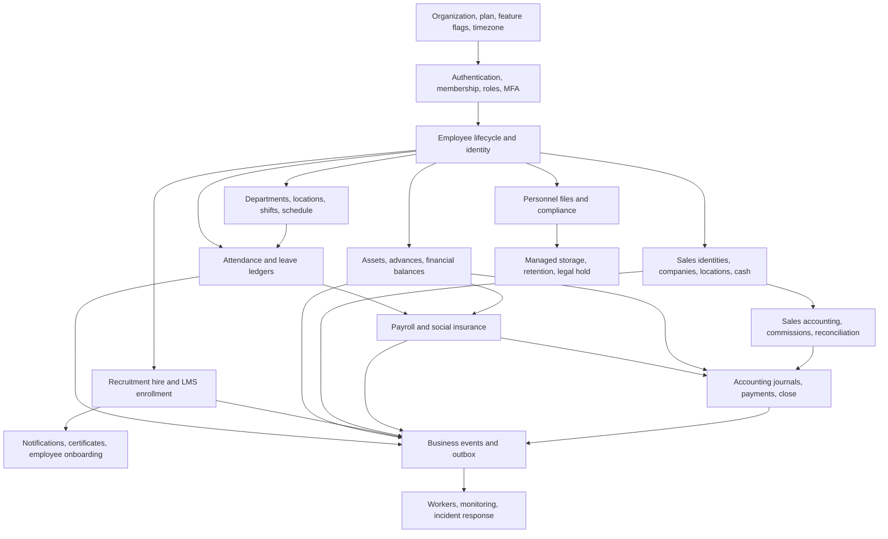

# HRMS Pre-Launch Audit and Remediation Plan

Audit date: 2026-07-19  
Repository: Tatwir Talent HRMS  
Scope: application, API, authorization, database/RLS, migrations, workflows, files, workers, security, operations, governance, and launch evidence  
Current decision: **CODE-READY CANDIDATE / PRODUCTION NO-GO UNTIL ENVIRONMENT AND BUSINESS GATES PASS**

## 1. Executive conclusion

The original scan correctly identified that the repository was not launch-ready. The remediation program has now closed the known code-level P0/P1 launch gaps: ordered migrations, tenant/auth hardening, authoritative time, atomic employee/leave/payroll/accounting/sales/recruitment/LMS/task/asset workflows, private file controls, durable outbox jobs, MFA/recovery, rate limiting, CSP, and removal of the visible schedule-builder placeholder. The final residual passes also moved SIM inventory import/assignment, merchant handover, accounting master data, promoter configuration, and monthly EOSB accrual behind replay-safe database commands; made production readiness fail closed on operational secrets and the exact migration checksum; hardened worker failure correlation; and enforced LMS rich-text/URL sanitization on both write and render.

The code must not yet be called production-live or given an unconditional GO. This workspace has no authenticated staging/production access and therefore cannot prove deployed secrets, email/scanner integrations, scheduler configuration, production migration status, backup restore, monitoring/on-call, accessibility/UAT, legal retention approval, financial reconciliation sign-off, or final business approval. Those are launch blockers, not optional follow-up work.

## 2. Verification snapshot

| Check | Latest result | Evidence boundary |
|---|---|---|
| Ordered migration manifest | PASS — 112 ordered migrations; head `schema_v110_atomic_eosb_accrual` | Local repository |
| Fresh migration + RLS/integrity/concurrency proofs | PASS on disposable PostgreSQL 16 | Local integration environment |
| TypeScript typecheck | PASS inside full CI | Local repository |
| Strict ESLint | PASS with zero warnings inside full CI | Local repository |
| Launch security/readiness contract | PASS — 51 executable repository checks | Local repository |
| Unit and domain tests | PASS — 23 unit/security tests plus SIM generation/parser/commission suites | Local repository |
| Accounting policy verification | PASS — all 22 control checks | Local repository and disposable database proofs |
| Production dependency audit | PASS — `npm audit --omit=dev --audit-level=high` found 0 vulnerabilities | Local dependency lockfile |
| Optimized production build | PASS — Next.js 15.5.20 compiled and generated all routes | Local build environment |
| Full `npm run verify:ci` | PASS on 2026-07-19 after the final readiness/security residual remediation | Local working tree; repeat on frozen release commit in CI |
| Staging migration/status | NOT RUN | No staging credentials supplied |
| Production migration/status | NOT RUN | No production credentials supplied |
| Deployed runtime/security/UAT | NOT RUN | No deployed environment supplied |
| Backup/restore and operational drill | NOT RUN | Requires operations infrastructure |

The authoritative evidence register is `docs/LAUNCH_EVIDENCE.md`. Never replace an environment row with “pass” using local test output. The full local pipeline completed with exit code 0; it still must be repeated in CI on the frozen release commit.

## 3. Module dependency map

The launch sequence must follow these dependencies. For example, payroll cannot be accepted before employee lifecycle, attendance, leave, salary/social-insurance configuration, business time, and accounting integration have passed together.

## 4. Cross-module invariants now enforced

- Every tenant workflow resolves one active organization membership and fails closed on suspended organizations/accounts, inconsistent plans, or disabled modules.
- Browser users do not receive the service-role key. Sensitive writes use tenant-scoped server commands and database authorization.
- Organization timezone/business date is authoritative for attendance, leave, schedule, payroll, sales, and lifecycle effective dates.
- Critical commands use idempotency keys, input hashes, row locks, optimistic versions where applicable, immutable history, business events, operational audit, and outbox rows in one transaction.
- Employee onboarding/identity/offboarding preserves a historical employee record and closes lifecycle-linked access/assignments.
- Posted payroll/accounting/sales/financial records are adjusted or reversed; they are not silently overwritten.
- Private attachments use managed metadata, signature/MIME/size checks, production fail-closed malware scanning, signed authorization, legal hold, and retryable retention.
- Notifications caused by critical workflows are derived from durable events and deduplicated by source event/user.
- Public candidate submission is rate-limited, validated, tenant/posting-scoped, replay-safe, and privately stores managed files.

## 5. Remediation ledger

### P0 — launch-blocking code defects

| ID | Finding | Resolution | Status |
|---|---|---|---|
| P0-01 | No authoritative ordered migration path | Canonical manifest, checksum ledger, advisory lock, dry-run/status/fresh/adoption safeguards, destructive reset isolation | Resolved in code |
| P0-02 | Tenant/RLS/service-role scope gaps | Central tenant context, fail-closed feature/plan checks, expanded RLS and server command authorization, disposable RLS tests | Resolved in code |
| P0-03 | Browser-driven/multi-step employee writes | Atomic lifecycle, identity, HR structure, employee master, sales team, finance team, and platform-user commands | Resolved in code |
| P0-04 | Attendance/location/time ambiguity | Authoritative check-in/out commands, business timezone/date, location/shift checks, overlap/open-session controls | Resolved in code |
| P0-05 | Leave balance/request inconsistency | Ledger-backed balance refresh/adjustment, atomic submission/review/cancel/reversal/escalation notifications | Resolved in code |
| P0-06 | Payroll preview/non-authoritative state | Versioned payroll commands, signed formula specification, GOSI configuration, adjustments, transitions, payslips, payment/accounting linkage | Resolved in code |
| P0-07 | Accounting partial writes/unbalanced posting | Atomic journals/documents/payments/budgets/periods/master data, balance checks, source uniqueness, reversal/reconciliation controls, atomic monthly EOSB journal plus employee accrual ledger | Resolved in code |
| P0-08 | Sales inventory/cash/log/accounting drift | Atomic SIM commerce/import/box import/agent and merchant assignment, immutable sales-log revisions, carrier import verification, identity/team/cash commands, accounting outbox integration | Resolved in code |
| P0-09 | Recruitment offer/hire race and public application risk | Versioned transitions/offers/interviews/hire, atomic candidate application, accepted-offer gate, employee onboarding link | Resolved in code |
| P0-10 | Critical events/notifications could be lost or duplicated | Business event registry, claimed outbox, retry/dead-letter state, per-recipient notification idempotency, protected worker | Resolved in code |

### P1 — required launch hardening

| ID | Finding | Resolution | Status |
|---|---|---|---|
| P1-01 | Inconsistent API authorization/error correlation | Central tenant context, request IDs, rate limits, capability/role/feature checks on launch-critical APIs | Resolved in code |
| P1-02 | Recruitment state and ownership gaps | Atomic stage/offer/interview/hire and tenant ownership validation | Resolved in code |
| P1-03 | LMS ownership/concurrency/partial workflows | Course/instructor scope, atomic lesson/quiz/certificate, atomic assignment/rubric/review/completion, replay proofs, historical rubric items, server/render rich-text sanitization and safe external URLs | Resolved in code |
| P1-04 | Chat pagination/unread/upload/retention gaps | Cursor pages, atomic send/read/inbox, moderation, private managed uploads, cleanup and retention settings | Resolved in code |
| P1-05 | Task transition/message/attachment drift | Atomic versioned task management and transitions, scoped messages, private managed attachments | Resolved in code |
| P1-06 | Asset custody/accounting gaps | Versioned custody/acknowledgment/status commands, depreciation and capitalization events | Resolved in code |
| P1-07 | Compliance alerts depended on requests | Protected scheduled compliance job with dedupe and outbox | Resolved in code |
| P1-08 | Uploads were not uniformly private/scanned | Central inspection, production fail-closed scanner, managed files, signed access, retryable retention | Resolved in code |
| P1-09 | Service-role relationships could cross tenants | Database validation and focused cross-tenant/RLS tests on critical commands | Resolved in code |
| P1-10 | Silent/unbounded critical processing | Bounded worker batches, bounded chat/report queries, explicit dependency errors on critical paths | Resolved in code; staging load test required |
| P1-11 | Recovery/MFA/rate-limit/security audit gaps | Recovery email/reset policy, AAL/MFA settings, API rate-limit ledger, security audit evidence | Resolved in code; provider test required |
| P1-12 | Weak security headers/CSP | Per-request CSP nonce and production security headers | Resolved in code; deployed header test required |
| P1-13 | Missing health/observability baseline | Health/readiness endpoints, exact migration-head/checksum proof, strict production configuration validation, request IDs including worker failures, operational audits, worker health and runbook signals | Resolved in code; monitoring hookup required |
| P1-14 | No durable asynchronous processing | Claimed retryable outbox with dead-letter handling and protected worker endpoint | Resolved in code; scheduler required |
| P1-15 | Visible incomplete/demo surfaces | Schedule builder placeholder/component removed; README mock claims removed; demo login stays opt-in/local | Resolved in code |
| P1-16 | Missing operational/environment documentation | `.env.example`, migration guide, operations runbook, launch evidence register | Resolved in repository; operators must execute |
| P1-17 | Missing data governance/retention approval | Governance and retention policy template plus legal hold/retention controls | Technical portion resolved; approvals open |
| P1-18 | Missing UAT/accessibility evidence | Role/cross-module/operations/accessibility checklist created | Evidence open |
| P1-19 | Promoter and accounting configuration used service-role row writes without command receipts | Versioned, tenant-validated accounting and promoter configuration commands with audit/event/outbox evidence | Resolved in code |
| P1-20 | Automatic accounting retries could allocate a new command or ignore source linkage errors | Stable command IDs, checked asset/advance linkage, retry-safe sales/SIM reversal linkage, and explicit partial-settlement response | Resolved in code |

## 6. Database remediation sequence delivered

The canonical manifest includes the historical baseline/migrations plus launch migrations v55–v110. The launch sequence covers:

1. foundations, tenant/business time, events/outbox/audit, storage and lifecycle;
2. authoritative attendance and atomic leave/balance workflows;
3. employee lifecycle, identity, payroll, accounting, advances and accounting controls;
4. SIM commerce, sales-log events, carrier import/reporting verification;
5. recruitment/LMS integrity, chat, tasks, assets, personnel, compliance and retention;
6. leave submission/notification integrity, private scanned uploads and financial balances;
7. API rate limiting/security, atomic schedule, candidate submission and HR structure;
8. atomic sales identity/cash/team, deduction policies, employee master and finance team;
9. atomic LMS assignment/rubric/review and platform organization-user control;
10. durable accounting journal/master/community events, sales-log edit resolution, sales-accounting linking and organization lifecycle;
11. atomic promoter leads/configuration, sales prompts, attendance alerts, identity reconciliation, and SIM inventory/merchant handover;
12. atomic monthly EOSB accrual with the journal, per-employee ledger, audit and durable journal event in one transaction.

`db/migrations.manifest.json` is the only allowed order. Applied migrations are checksum-verified and must never be edited in a deployed environment; corrections roll forward in a new migration.

### Residual write-path review

The final scan reviewed the remaining direct Supabase writes after the command migrations. None is an unresolved launch-critical multi-write workflow:

- notification read state and HR profile edits are isolated single-row mutations;
- sales products, packages, dealer codes, targets, dashboard configuration, recruitment templates/postings and LMS authoring records use tenant-scoped single-statement CRUD; one-statement batch upserts remain transactionally atomic in PostgreSQL;
- carrier import staging is an intentional bounded two-phase import whose publish/rematch steps are database commands;
- business-event/outbox/notification writes are worker infrastructure with idempotency or unique delivery keys;
- task, chat, personnel, balance, merchant-photo and LMS uploads remove newly uploaded objects when their database command fails, with retention cleanup as a second safety net;
- critical payroll, accounting, leave, attendance, lifecycle, recruitment transition/hire, task transition, LMS completion, asset custody, sales cash/log/SIM, organization, and identity operations are command-owned and covered by rollback/replay/isolation tests.

This classification does not replace staging UAT. It establishes that the remaining repository writes are not the partial cross-module workflows identified by the original audit.

## 7. Remaining production launch plan

These steps are still mandatory and must be executed in order.

### Gate A — release baseline

- [ ] Select and freeze the release commit.
- [ ] Run `npm ci` and `npm run verify:ci` on that exact commit in CI.
- [ ] Archive dependency audit, build output, test output, and migration-manifest checksums.
- [ ] Review the final diff for secrets, demo data, destructive switches, and unintended user changes.

### Gate B — infrastructure and secrets

- [ ] Create isolated staging/production Supabase projects, storage, email provider, malware scanner, monitoring, scheduler, and secret-manager entries.
- [ ] Set every required `.env.example` value; keep destructive/adoption/demo flags disabled.
- [ ] Configure DNS/HTTPS, environment separation, log redaction, least-privilege operator access, key rotation owners, and incident contacts.

### Gate C — staging database and integrations

- [ ] Back up staging; run migration dry-run/status/apply and archive `schema_migrations` evidence.
- [ ] Run `verify:accounting`, `verify:lms`, RLS/tenant tests, and production-like load/concurrency tests.
- [ ] Prove email invitation/recovery, malware scanner clean/infected/outage behavior, signed private files, and all three scheduled workers.
- [ ] Confirm deployed health/readiness/security headers and alert routing.

### Gate D — UAT and reconciliation

- [ ] Execute every role and cross-module journey in `docs/UAT_CHECKLIST.md` with separate tenant accounts.
- [ ] Reconcile employee lifecycle, attendance, leave, payroll/GOSI, journals/payments/assets/advances, sales cash/commissions, recruitment and LMS.
- [ ] Complete keyboard/screen-reader/contrast/zoom/RTL/responsive testing and accept/document any non-blocking exception.
- [ ] Obtain HR, Payroll, Finance, Sales Ops, Recruitment, Learning, Security and Product sign-off.

### Gate E — governance and resilience

- [ ] Legal/HR/Finance approve the retention matrix, privacy notices, data-subject request process and legal-hold workflow.
- [ ] Restore a current backup in isolation; record achieved RPO/RTO and reconciliation.
- [ ] Rehearse application rollback/corrective migration, outbox replay, worker dead letter, scanner/provider outage and incident escalation.
- [ ] Complete privileged-access review and MFA evidence.

### Gate F — production change and GO decision

- [ ] Name release owner, database operator, rollback owner, on-call owner and incident commander.
- [ ] Record production backup/restore point, migration status, approved window and stakeholder communication.
- [ ] Apply migrations once, deploy the tested commit, run smoke/readiness/tenant checks, and observe the heightened monitoring window.
- [ ] Final approvers explicitly choose GO/CONDITIONAL GO/NO-GO in the launch evidence pack.

## 8. Automatic NO-GO conditions

Launch remains NO-GO if any of the following is true:

- full CI, fresh migration, tenant/RLS, or critical workflow tests fail;
- staging has checksum drift, unknown schema state, or an unrehearsed destructive/adoption operation;
- health/readiness, email recovery, malware scanning, private storage, outbox/compliance/retention workers, or monitoring is not operational;
- tenant isolation, privileged access/MFA, payroll/accounting balance, or restore reconciliation fails;
- a critical UAT/accessibility defect is open without approved mitigation;
- legal retention/privacy approval, backup/restore evidence, on-call/incident ownership, or required business sign-off is missing;
- the production commit/schema differs from the signed staging evidence.

## 9. Final sign-off record

| Sign-off | Name | Decision | Date | Evidence |
|---|---|---|---|---|
| Engineering |  |  |  |  |
| Security/Privacy |  |  |  |  |
| HR Operations |  |  |  |  |
| Payroll |  |  |  |  |
| Finance |  |  |  |  |
| Sales Operations |  |  |  |  |
| Recruitment/Learning |  |  |  |  |
| Product |  |  |  |  |
| Operations/On-call |  |  |  |  |

Final launch decision: **NO-GO until Gates A–F are evidenced and signed.**
