# Virgin Product Receiving, Serialized Inventory, Agent Sales, and Accounting Blueprint

**Project:** Tatwir Talent HRMS
**Status:** Implementation blueprint
**Prepared against repository state:** 28 July 2026
**Primary company for v1:** Virgin Mobile KSA
**Recommended next migration number:** `schema_v122_*` if no migration is added first

---

## 1. Executive outcome

This feature will let a designated receiver record physical products delivered by Virgin through any of three intake methods:

1. Product/label photos with OCR and barcode extraction.
2. An Excel or CSV workbook.
3. Manual entry, including barcode/serial scanning and multiline paste.

The receiver reviews the extracted data before anything enters live stock. The system matches each item to the existing product catalog, detects duplicate serial numbers, and groups units of the same product. Every group requires:

- Product name/catalog match.
- Count, calculated from the accepted serial-number rows.
- A unique serial number for every unit.
- Unit acquisition cost.
- Planned/default selling price.
- Currency and tax treatment.
- Supporting delivery images/documents.

After confirmation, every physical unit becomes individually traceable in stock. Managers can assign units to on-ground agents, agents can record actual sales, and Finance automatically receives:

- Quantity and cost value still in the warehouse.
- Quantity and cost value held by every agent.
- Planned retail value and expected margin.
- Actual selling price per unit and per agent.
- Revenue, VAT, cost of goods sold, inventory reduction, receivables, collections, and gross profit.
- Posting/reconciliation status and links back to the source receipt, unit, agent, and sale.

This should be implemented as a **general serialized product inventory module**. It should reuse the existing Virgin company, sales product catalog, field-agent identities, command/idempotency design, private uploads, outbox worker, and accounting posting engine. It should not put non-SIM products into `sim_units` or `sim_sales`.

---

## 2. Repository fit and current gaps

### Existing capabilities to reuse

| Existing capability | Reuse in this feature |
|---|---|
| `sales_companies` | Virgin supplier/company identity |
| `sales_products` | Canonical product catalog and existing revenue-account mapping |
| `field_agents` | On-ground agents who receive and sell stock |
| SIM box OCR (`tesseract.js` + ZXing) | Browser-side OCR/barcode extraction pattern |
| `read-excel-file` | Workbook parsing |
| `inspectUpload` and private Supabase storage | Secure image/workbook handling |
| `execute_sim_inventory_command` | Pattern for atomic, replay-safe inventory commands |
| `business_events` + `event_outbox` | Durable event-driven accounting and notifications |
| Accounting journal/posting engine | Inventory receipt, sale, COGS, collection, and reversal entries |
| Legal entities, books, branches, dimensions | Correct accounting scope for inventory transactions |
| `operational_audit_logs` | User/action audit trail |

### Gaps that must be filled

The existing `sales_products` table is a catalog, not inventory. It has a single selling price and revenue account, but no SKU uniqueness, aliases, serial tracking, warehouse, purchase cost, receipt, stock movement, COGS account, or inventory account.

The existing `sim_units` and `sim_sales` flows are intentionally SIM-specific. They should remain unchanged for SIM distribution.

The current SIM sale auto-posting records receivable/revenue and commissions, but it does not provide the complete serialized product accounting required here: receipt valuation, inventory asset value, cost of goods sold, margin, agent product custody, and product-level valuation.

The current roles do not include a receiver-only role. The safest design adds a dedicated `inventory_receiver` role while allowing Admin, Sales Manager, and On-ground Agent Manager to perform the same receiving work.

---

## 3. Core design decisions

### 3.1 Recommended default decisions

| Decision | Recommended v1 behavior |
|---|---|
| Product ownership | Treat confirmed deliveries as company-owned purchased stock unless the receipt is explicitly marked consignment |
| Inventory tracking | Serialized/specific identification: one database unit per physical serial number |
| Product master | Extend `sales_products`; do not create a disconnected second catalog |
| Grouping | Group by canonical product plus model, commercial prices, currency, tax, condition, and receipt |
| Quantity | Derived from valid distinct serial numbers; never trusted as an independent final count |
| Acquisition cost | Required per group before confirmation |
| Planned selling price | Required per group before confirmation |
| Actual sale price | Snapshotted when the agent sells; defaulted from the unit/group price |
| Agent price override | Allowed only within a configured tolerance; larger changes require manager approval |
| Valuation method | Specific identification using the receipt-line cost snapshotted onto each serialized unit |
| Receipt confirmation | Receiver confirms physical data; Finance receives a pending accounting item by default |
| Accounting posting | Sales can auto-post; receipt posting should default to Finance review unless explicitly enabled |
| Assignment | Custody transfer only; no revenue or COGS journal at assignment |
| Duplicate serials | Hard block by default; no silent skipping |
| Photo extraction | OCR/barcode suggestions only; receiver review is mandatory |
| SIM stock | Remains in the existing SIM module |

### 3.2 Business decision that materially changes accounting

Before development begins, the client must confirm whether Virgin deliveries are:

- **Purchased inventory:** the firm owns the products and owes Virgin; use Inventory/AP or Inventory/GRNI accounting.
- **Consignment inventory:** Virgin retains ownership until sale; keep stock in a separately identified consignment ledger and do not recognize company-owned inventory/AP at receipt.
- **Mixed:** the receiver must select ownership type on every receipt.

The blueprint supports mixed ownership. The recommended default is `purchased`, but confirmation must not be assumed during implementation.

### 3.3 Cost and price definitions

The UI must not use one ambiguous field called “price.” It must show:

- **Unit acquisition cost:** the firm’s inventory cost, excluding recoverable VAT.
- **VAT amount/rate:** separate and based on the supplier document.
- **Total landed cost:** optional later enhancement for freight/fees allocation.
- **Planned selling price:** default customer price, with a clear VAT-inclusive flag.
- **Actual selling price:** amount charged by the agent at sale.
- **Expected margin:** planned net selling price minus unit acquisition cost.
- **Actual gross profit:** actual net selling price minus the snapshotted unit cost.

### 3.4 Agent commission decision

The current system already calculates commissions for SIM sales, so product sales should not invent an incompatible convention. Before implementation, confirm whether agents earn:

- No separate commission because their compensation is handled elsewhere.
- A percentage of net selling price.
- A fixed amount per product/unit.
- A product-specific rule with the field agent's profile rate as fallback.

If commission is enabled, store the rule on the product, snapshot its calculated amount on the sale line, accrue Commission Expense/Commission Payable at sale, and use the existing Finance settlement pattern. Do not silently subtract commission from the agent receivable unless the client's settlement policy explicitly requires netting.

---

## 4. Personas and permissions

### Inventory Receiver

- Create and edit draft receipts.
- Upload/capture product photos.
- Upload Excel/CSV.
- Enter products and serials manually.
- Review OCR/import candidates.
- Match unknown text to catalog products.
- Enter acquisition cost and planned selling price for every group.
- Submit/confirm a physically reconciled receipt.
- Cannot assign stock to agents, alter accounting settings, post journals, or change confirmed costs.

### On-ground Agent Manager / Sales Manager / Admin

- All receiver capabilities.
- Create/approve catalog products and aliases.
- Confirm exceptional zero-cost or below-cost groups.
- Assign/recall stock.
- Approve price overrides.
- Record loss/damage and approve inventory adjustments.
- Void/return sales according to permissions.

### Field Agent

- See only assigned serialized products.
- Acknowledge receipt of a handover when this control is enabled.
- Scan or select a unit and record a sale.
- Request more stock.
- Return unsold units.
- See expected amount, collected amount, outstanding amount, and own sales/margin rules.

### Finance Manager

- View all receipt, stock, agent custody, sales, cost, margin, and reconciliation information.
- Configure inventory, COGS, revenue, VAT, GRNI, AP, receivable, shrinkage, and price-variance accounts.
- Review/post receipt accounting.
- Repair failed auto-posts and reverse posted transactions.
- Approve accounting-sensitive adjustments.

### Accountant

- View the same operational finance feed.
- Prepare/review vendor document matching and pending receipt accounting.
- Review sales, COGS, agent receivables, and collections.
- Cannot change confirmed physical stock or high-risk accounting configuration.

### Finance Viewer

- Read-only access to inventory valuation and financial reports.

### Recommended authorization helpers

- `can_receive_product_inventory()`
- `can_manage_product_inventory()`
- `can_sell_assigned_products()`
- `can_view_product_inventory_finance()`
- `can_post_product_inventory_finance()`

All helpers must be tenant-scoped. UI visibility is for usability only; APIs, RPCs, RLS, and workers must enforce the same capabilities.

---

## 5. End-to-end operating flow

```mermaid
flowchart LR
  A["Virgin delivery arrives"] --> B["Receiver creates draft receipt"]
  B --> C{"Input method"}
  C --> D["Photos / camera"]
  C --> E["Excel / CSV"]
  C --> F["Manual entry / scanner"]
  D --> G["OCR + barcode candidates"]
  E --> H["Workbook row validation"]
  F --> I["Manual candidate rows"]
  G --> J["Product matching + duplicate checks"]
  H --> J
  I --> J
  J --> K["Group by canonical product and commercial terms"]
  K --> L["Receiver enters cost and planned sale price"]
  L --> M["Reconcile count = valid unique serials"]
  M --> N["Confirm receipt atomically"]
  N --> O["Serialized units enter warehouse stock"]
  N --> P["Finance receipt feed / accounting event"]
  O --> Q["Manager assigns units to agent"]
  Q --> R["Agent acknowledges custody"]
  R --> S["Agent records actual sale"]
  S --> T["Revenue + VAT + COGS + inventory accounting"]
  S --> U["Agent receivable / collection tracking"]
```



### 5.1 Receipt header

The receiver starts with:

- Virgin/supplier.
- Legal entity, branch, and destination warehouse.
- Receipt date and time.
- Virgin delivery note/order/invoice reference.
- Ownership type: purchased or consignment.
- Supplier invoice received: yes/no.
- Currency.
- Default VAT treatment.
- Notes.
- Optional delivery-note/invoice image.

### 5.2 Intake mode

The receiver can mix methods inside one draft. For example, import an Excel sheet, take photos for five missing serials, and correct one line manually. Every candidate retains its source.

### 5.3 Review and product matching

Each extracted/imported row is displayed with:

- Source image or workbook row.
- Raw detected product name.
- Suggested canonical product.
- Model/SKU/barcode.
- Raw and normalized serial.
- Confidence.
- Duplicate/missing/invalid warnings.
- Receiver corrections.

Unmatched products do not enter stock. The receiver must select an existing catalog product or submit a new product for manager approval.

### 5.4 Automatic grouping

After matching, candidates are grouped. Each group shows:

- Canonical product name and SKU.
- Product/model image.
- Unit count.
- Serial completeness.
- Unit acquisition cost.
- Total inventory cost.
- Planned unit selling price.
- Expected sales value.
- Expected gross margin and percentage.
- VAT flags.
- Duplicate/error count.

The group count is recalculated whenever a serial is added, removed, marked duplicate, or moved to a different product.

### 5.5 Receipt confirmation

Confirmation is permitted only when:

- Every accepted row has a canonical product.
- Every unit has a valid distinct serial.
- No accepted serial already exists anywhere in the organization.
- Each group has unit cost, planned selling price, currency, and tax treatment.
- Declared quantity equals the accepted serial count.
- Receipt legal entity, branch, warehouse, supplier, and ownership type are valid.
- The receiver explicitly accepts warnings.

The database command creates the confirmed receipt, receipt lines, serialized units, initial movements, audit record, business event, and outbox event in one transaction.

### 5.6 Assignment to an agent

The manager selects:

- Agent.
- Explicit serials, scanned serials, or quantity by product.
- Handover date.
- Price policy, if different from the unit default.
- Notes and optional handover proof.

The command locks the selected units and checks that they are still available. A recommended two-step handover is:

1. `issued` / unit status `in_transit`.
2. Agent scans or accepts the handover / unit status `with_agent`.

An organization setting may allow immediate assignment for the first release, but the movement history must still be append-only.

### 5.7 Agent sale

The agent:

1. Scans or selects a serial in their own custody.
2. Confirms product and planned price.
3. Enters actual selling price.
4. Enters payment method and customer reference/details required by the client.
5. Submits the sale.

The sale command must lock the unit, verify ownership and status, snapshot cost/price/tax/account rules, mark the unit sold, create the sale, update the agent balance source data, and emit the accounting event atomically.

### 5.8 Returns, voids, loss, and damage

- **Unsold agent return:** restores warehouse stock; no revenue/COGS journal.
- **Sale void/customer return and sellable product:** reverse sale journal and restore the exact unit at its original cost.
- **Damaged customer return:** reverse revenue as applicable, then move unit to quarantine/damaged; Finance posts the appropriate loss when approved.
- **Lost/damaged in custody:** requires manager reason/evidence and posts Inventory Shrinkage/Loss against Inventory.
- Confirmed receipt costs and historical sale snapshots are never edited in place. Corrections use reversal/adjustment commands.

---

## 6. Photo extraction design

### 6.1 Extraction pipeline

The existing SIM-box implementation provides a good baseline. Product intake needs a more general pipeline:

1. Capture/upload one or more images.
2. Validate magic bytes, MIME type, size, and tenant-scoped path.
3. Correct orientation and optionally crop/raise contrast in the browser.
4. Try barcode/QR extraction with ZXing.
5. Run OCR with Tesseract (`eng`; add `ara` only if real labels require it).
6. Parse label keywords such as `Product`, `Model`, `SKU`, `S/N`, `Serial`, `IMEI`, and `Barcode`.
7. Match product candidates against catalog names, SKUs, barcodes, and alias records.
8. Normalize serial candidates and check duplicates.
9. Return candidates, confidence, raw OCR, warnings, and source image references.
10. Require receiver review.

### 6.2 Optional vision extraction

Tesseract and ZXing are free and private in the browser, but arbitrary product photos may not have a predictable label layout. Design an extraction adapter:

```ts
interface ProductExtractionProvider {
  extract(input: ProductImageInput): Promise<ProductExtractionResult>;
}
```

Implement `LocalOcrProductExtractionProvider` first. A server-side vision provider can be added behind an organization feature flag without changing receipt APIs or stored extraction schema.

No external AI call should be introduced without client approval for data processing, cost, retention, and region.

### 6.3 Confidence rules

- Barcode/QR exact match: high confidence.
- Strong SKU plus serial label match: high confidence.
- Product-name fuzzy match with a strong serial: medium confidence.
- Fuzzy name only or ambiguous serial: low confidence.

Suggested UI thresholds:

- `>= 0.90`: green, still reviewable.
- `0.70–0.89`: amber, explicit receiver confirmation.
- `< 0.70`: unresolved; product selection or serial correction required.

Confidence never bypasses duplicate, pricing, or reconciliation validation.

### 6.4 Product alias learning

Add aliases such as label abbreviations or OCR variants:

- `Virgin MiFi 4G`
- `VIRGIN MIFI`
- `VM-KSA-MIFI-4G`

When a manager confirms a corrected match, the UI may offer “save this label as an alias.” Do not automatically learn from receiver corrections without approval.

### 6.5 Photo evidence

Keep:

- The original private image.
- Extraction engine and version.
- Raw OCR/barcode text.
- Candidate bounding boxes when available.
- Final corrected values.
- Actor and timestamps.

Use signed URLs for authorized viewing. Integrate with managed-file retention instead of exposing permanent public URLs.

---

## 7. Excel/CSV import contract

### 7.1 Recommended template

Use one row per serialized unit. Provide a downloadable template with these columns:

| Column | Required | Notes |
|---|---:|---|
| `supplier_code` | No | Defaults to Virgin for v1 |
| `receipt_reference` | No | Must agree with header when supplied |
| `product_sku` | Preferred | Exact catalog match |
| `product_name` | Yes when SKU absent | Used for matching |
| `model` | No | Helps disambiguate |
| `serial_number` | Yes | One physical unit per row |
| `barcode` | No | Product or unit barcode |
| `unit_cost` | Yes unless filled at group review | Decimal, non-negative |
| `planned_sale_price` | Yes unless filled at group review | Decimal, non-negative |
| `currency` | No | Defaults to receipt currency/SAR |
| `tax_code` | No | Defaults from receipt |
| `condition` | No | Defaults to `new` |
| `notes` | No | Row note |

### 7.2 Workbook behavior

- Accept `.xlsx` and `.csv`; reject macro-enabled workbooks.
- Use `read-excel-file`, already installed.
- Apply a 10 MB default and a configurable row limit.
- Normalize headers and allow documented Arabic/English aliases.
- Preserve row numbers for error reporting.
- Treat serials as strings so leading zeros are preserved.
- Preview before committing.
- Show valid, warning, invalid, duplicate, and unmatched counts.
- Allow export of an error workbook containing original rows plus error messages.
- Group valid rows using the same grouping engine as photos and manual entry.
- Do not partly confirm a file without an explicit manager-approved “exclude invalid rows” action recorded in the audit trail.

---

## 8. Manual entry design

The manual form supports:

- Selecting/creating a product group.
- Entering unit cost and planned selling price once for the group.
- Entering serials one at a time.
- Camera barcode scanning.
- Pasting newline/comma-separated serials.
- Optional expected count for reconciliation.
- Attaching a photo to the group or individual serial.
- Live duplicate checks.

For serialized v1 products, the displayed count is the number of valid distinct serials. If the receiver enters an expected count, confirmation is blocked until it matches.

---

## 9. Grouping and matching rules

### 9.1 Normalization

Store both raw and normalized values.

- Product-name normalization: Unicode normalize, lowercase, trim, collapse whitespace, remove safe punctuation, normalize Arabic letter variants when Arabic is enabled.
- SKU normalization: uppercase, trim, preserve meaningful hyphens.
- Serial normalization: uppercase, trim, remove label prefixes and whitespace. Do not remove all punctuation globally unless a product-specific rule says it is insignificant.

### 9.2 Match order

1. Exact product barcode.
2. Exact SKU within Virgin.
3. Exact approved product alias.
4. Exact normalized product name/model.
5. Weighted fuzzy name/model match.
6. Unresolved.

### 9.3 Group key

Use:

```text
organization
+ receipt
+ canonical product
+ model/variant
+ ownership type
+ condition
+ unit acquisition cost
+ planned selling price
+ currency
+ VAT treatment
```

Two rows with the same product but different acquisition costs must remain separate receipt lines. This protects exact cost valuation and margin reporting.

### 9.4 Duplicate rules

Check duplicates:

- Within the current photo/file/manual candidate set.
- Across other draft receipts, shown as a warning/reservation conflict.
- Across all confirmed units, regardless of current status.
- Against legacy SIM serial/ICCID only if a shared identifier namespace is explicitly required.

Use a partial unique index for confirmed product units and an atomic confirmation command so two concurrent receipts cannot confirm the same serial.

---

## 10. Proposed data model

### 10.1 Extend `sales_products`

Keep `price` as the existing default selling price for compatibility.

Add:

| Column | Purpose |
|---|---|
| `sku` | Supplier/internal stock-keeping unit |
| `barcode` | Primary catalog barcode |
| `model` | Model/variant |
| `tracking_mode` | `none` or `serialized`; v1 receipts require `serialized` |
| `inventory_enabled` | Whether product participates in physical stock |
| `default_cost` | Informational default; never overwrites receipt cost |
| `inventory_account_id` | Product-specific override |
| `cogs_account_id` | Product-specific override |
| `tax_rate_id` | Default VAT rule |
| `agent_commission_type/value` | Optional product-sale commission rule |
| `version` | Optimistic concurrency |

Add partial unique indexes for `(organization_id, company_id, sku)` and barcode when non-null.

### 10.2 `product_inventory_aliases`

Approved name/SKU/barcode aliases for OCR/import matching:

`id, organization_id, product_id, alias_type, alias_value, normalized_value, source, is_approved, approved_by, timestamps`

### 10.3 `inventory_warehouses`

`id, organization_id, legal_entity_id, branch_id, location_id, code, name_ar, name_en, is_default, is_active, version, timestamps`

### 10.4 `product_receipts`

Header/audit row:

`id, organization_id, receipt_no, supplier_company_id, accounting_vendor_id, legal_entity_id, branch_id, warehouse_id, ownership_type, receipt_date, delivery_note_no, supplier_invoice_no, invoice_received, currency, default_tax_rate_id, source_methods[], status, physical_total_cost, expected_sales_value, accounting_status, journal ids, version, created/submitted/confirmed/cancelled actors and timestamps`

Recommended statuses:

`draft`, `needs_review`, `ready_to_confirm`, `confirmed`, `cancelled`, `failed`

### 10.5 `product_receipt_sources`

One row per photo/workbook/manual source:

`id, organization_id, receipt_id, source_type, storage_path, original_name, mime_type, size_bytes, extraction_provider, extraction_version, extraction_status, raw_extraction, confidence, error_message, uploaded_by, timestamps`

### 10.6 `product_receipt_candidates`

Editable draft rows before confirmation:

`id, organization_id, receipt_id, source_id, source_row_or_region, raw_product_name, suggested_product_id, final_product_id, model, raw_serial, normalized_serial, barcode, unit_cost, planned_sale_price, currency, tax_rate_id, condition, confidence, resolution_status, validation_errors, reviewed_by, timestamps`

Candidates are staging data. Live stock is created only by the confirmation command.

### 10.7 `product_receipt_lines`

Confirmed group snapshots:

`id, organization_id, receipt_id, product_id, line_no, product_name_snapshot, sku_snapshot, model_snapshot, ownership_type, condition, quantity, unit_cost, tax_rate, vat_amount, total_cost, planned_unit_sale_price, expected_sales_value, expected_margin, currency, inventory_account_id, cogs_account_id, revenue_account_id, timestamps`

### 10.8 `product_inventory_units`

One row per physical serialized item:

`id, organization_id, product_id, receipt_id, receipt_line_id, warehouse_id, raw_serial_number, normalized_serial_number, unit_barcode, condition, ownership_type, status, unit_cost_snapshot, planned_sale_price_snapshot, currency, current_agent_id, current_handover_id, assigned_at, sold_at, sold_by_agent_id, current_sale_id, version, created_at, updated_at`

Recommended statuses:

`in_stock`, `reserved`, `in_transit`, `with_agent`, `sold`, `returned`, `quarantine`, `damaged`, `lost`

### 10.9 `product_inventory_movements`

Append-only unit movement audit:

`id, organization_id, unit_id, movement_type, from_warehouse_id, to_warehouse_id, from_agent_id, to_agent_id, receipt_id, handover_id, sale_id, reason, performed_by, movement_at, metadata`

Movement types:

`receipt`, `reserve`, `handover_issued`, `handover_accepted`, `agent_return`, `sale`, `sale_void`, `customer_return`, `quarantine`, `damage`, `loss`, `adjustment`

### 10.10 `product_handovers` and `product_handover_lines`

Header:

`id, organization_id, handover_no, warehouse_id, agent_id, status, issued_by, issued_at, accepted_by, accepted_at, proof_path, notes, version`

Lines link each unit and snapshot planned selling price/policy.

### 10.11 `agent_product_sales`

`id, organization_id, sale_no, agent_id, customer fields/reference, sale_date, subtotal, discount, vat_amount, total_amount, payment_method, status, accounting_status, journal/reversal ids, version, created/voided actors and timestamps`

### 10.12 `agent_product_sale_lines`

`id, organization_id, sale_id, unit_id, product_id, serial_snapshot, product_name_snapshot, unit_cost_snapshot, planned_sale_price_snapshot, actual_sale_price, discount, net_amount, vat_amount, total_amount, gross_profit, commission_rule_snapshot, agent_commission_amount, inventory_account_id, cogs_account_id, revenue_account_id`

The cost and account snapshots make historical accounting stable even when the product catalog changes.

### 10.13 `agent_product_collections`

Track money remitted by agents:

`id, organization_id, agent_id, amount, method, reference, collection_date, status, accounting_status, journal id, proof_path, version, actors and timestamps`

### 10.14 `product_inventory_commands`

Replay-safe command table:

`id, organization_id, idempotency_key, action, entity_id, payload_hash, status, result, actor_user_id, request_id, timestamps`

Actions include:

`receipt_confirm`, `receipt_cancel`, `handover_issue`, `handover_accept`, `agent_return`, `sale`, `sale_void`, `customer_return`, `damage`, `loss`, `collection_post`

---

## 11. Database invariants and atomic commands

Implement service-role-only RPCs called after server authorization:

- `confirm_product_receipt(...)`
- `execute_product_inventory_command(...)`
- `record_agent_product_sale(...)`
- `void_agent_product_sale(...)`
- `post_agent_product_collection(...)`

Every command must:

1. Validate the actor’s current organization membership and role.
2. Validate every referenced record belongs to the same organization.
3. Insert/load an idempotency command using payload hash.
4. Lock affected receipt, unit, agent, handover, and sale rows in deterministic order.
5. Recheck status/version and serial uniqueness.
6. Mutate business rows.
7. Append inventory movements.
8. Append operational audit.
9. Append a versioned business event and outbox row.
10. Complete the command with a stable result.

Required invariants:

- A confirmed serialized unit has exactly one product, receipt line, cost, planned selling price, and normalized serial.
- A serial cannot be confirmed twice in one organization.
- A unit can have only one active custody owner.
- Only `in_stock` units can be issued from the warehouse.
- Only the assigned active agent can sell a `with_agent` unit.
- A unit can have only one active sale.
- Sold cost is copied from the unit; the client cannot submit COGS.
- Confirmed receipt lines and active sale lines are immutable.
- Every status change has an append-only movement.
- Every financial source has one active accounting posting and at most one reversal chain.
- Cross-tenant IDs fail before mutation.

---

## 12. Accounting design

### 12.1 New accounting configuration

Add to `accounting_settings`:

- `default_inventory_asset_id`
- `default_cogs_expense_id`
- `default_inventory_grni_id`
- `default_inventory_shrinkage_id`
- `default_agent_receivable_id`
- `default_price_variance_id` if needed
- `auto_post_inventory_receipts`
- `auto_post_product_sales`
- `require_inventory_receipt_finance_approval`

Product-level accounts override defaults. Legal entity, book, branch, product line, warehouse/location, and agent dimensions should be attached where configured.

Recommended default accounts:

- Inventory Asset.
- Goods Received Not Invoiced.
- Accounts Payable.
- Input VAT Receivable.
- Sales Revenue.
- Output VAT Payable.
- Cost of Goods Sold.
- Agent Receivable.
- Inventory Shrinkage/Loss.

Extend the account `control_type` constraint with `inventory` if inventory control-account behavior will be enforced.

### 12.2 Receipt accounting: purchased, invoice received

For net cost `1,000` and recoverable VAT `150`:

```text
DR Inventory Asset                 1,000
DR Input VAT Receivable              150
  CR Accounts Payable - Virgin              1,150
```

### 12.3 Receipt accounting: delivery before invoice

```text
DR Inventory Asset                 1,000
  CR Goods Received Not Invoiced             1,000
```

When Finance matches the supplier invoice, clear GRNI to AP and recognize eligible input VAT according to the final invoice.

### 12.4 Consignment receipt

No company-owned Inventory/AP entry at physical receipt. Units remain fully tracked with `ownership_type = consignment` and excluded from owned-inventory valuation. The sale accounting must follow the signed Virgin arrangement, such as commission revenue or a supplier payable. This flow must be finalized with the accountant before implementation.

### 12.5 Assignment to agent

No general-ledger entry. This is an internal custody/location movement. Reports reclassify operational ownership from warehouse to the selected agent while retaining the same inventory cost.

### 12.6 Agent sale

Example: actual VAT-inclusive price `230`, net revenue `200`, output VAT `30`, unit cost `120`.

```text
DR Agent Receivable / Cash           230
  CR Product Sales Revenue                     200
  CR Output VAT Payable                         30

DR Cost of Goods Sold                120
  CR Inventory Asset                           120
```

Revenue, VAT, COGS, and inventory should be posted in one balanced journal source or an explicitly linked journal pair.

If the configured agent commission is `15`, add:

```text
DR Agent Commission Expense          15
  CR Agent Commission Payable                  15
```

Commission settlement follows the existing idempotent settlement-batch approach. It is a separate liability from the gross agent receivable unless an approved offset transaction nets the two.

### 12.7 Agent collection

```text
DR Cash / Bank                       230
  CR Agent Receivable                          230
```

The operational agent balance is calculated from active sales less confirmed collections/refunds, not from planned prices of unsold custody stock.

### 12.8 Sale void/customer return

Reverse the exact original revenue, VAT, COGS, and inventory amounts. If the unit is not sellable, restore it to quarantine and record impairment/write-off through an approved follow-up command.

### 12.9 Damage or loss

```text
DR Inventory Shrinkage / Loss        120
  CR Inventory Asset                           120
```

### 12.10 Posting workflow

- Receipt confirmation emits `product_inventory.receipt_confirmed`.
- The worker creates a pending-approval journal by default or posts automatically if Finance enables the setting.
- Sale recording emits `product_inventory.sale_recorded` and auto-posts by default.
- Collection emits `product_inventory.collection_posted`.
- Voids/losses emit reversal/adjustment events.
- Failures set `accounting_status = failed`, preserve the business transaction, retry through outbox, and appear in a Finance exception queue.

No API request should make an unprotected sequence of stock updates followed by accounting writes. Business state and outbox event are committed together; accounting is idempotent and retryable.

---

## 13. Accountant-facing information

Add `/accounting/inventory` with:

### Summary cards

- Owned units in warehouse.
- Owned units with agents.
- Consignment units.
- Inventory cost value.
- Planned retail value.
- Expected gross margin.
- Current-period sales revenue.
- Current-period COGS.
- Current-period gross profit.
- Agent receivable outstanding.
- Agent commission payable when product commissions are enabled.
- GRNI/AP pending match.
- Failed/unposted accounting events.

### Tables and drill-down

- Stock valuation by product, receipt, warehouse, condition, and agent.
- Receipt ledger with cost, VAT, vendor, document, and accounting status.
- Agent custody report with serials, cost exposure, expected retail value, and aging.
- Sales/margin report by agent, product, serial, date, and price variance.
- Movement audit from receipt to final sale/return/loss.
- Posting reconciliation with source transaction and journal links.
- Stock aging and slow-moving products.
- Duplicate/extraction exception report.

Finance sees operational data immediately after receipt confirmation even if the journal is waiting for approval.

---

## 14. UI and routes

Keep the current `/sales/stock` SIM screen stable. Add a distinct product inventory section first; a later navigation hub can combine both.

### Manager/receiver routes

| Route | Screen |
|---|---|
| `/sales/inventory` | Product stock dashboard |
| `/sales/inventory/receipts` | Receipt list |
| `/sales/inventory/receipts/new` | Intake wizard |
| `/sales/inventory/receipts/[id]` | Source images, groups, serials, reconciliation, accounting status |
| `/sales/inventory/assignments` | Issue/accept/recall handovers |
| `/sales/inventory/movements` | Serialized movement audit |
| `/sales/inventory/exceptions` | Duplicate, missing price/serial, failed extraction, stock/accounting mismatch |

### Field-agent routes

| Route | Screen |
|---|---|
| `/agent/products` | Products currently in custody |
| `/agent/products/receive` | Acknowledge handovers |
| `/agent/products/sell` | Scan/select serial and record sale |
| `/agent/products/returns` | Return unsold products |
| `/agent/product-balance` | Sales, collections, outstanding, and custody values |

### Finance route

| Route | Screen |
|---|---|
| `/accounting/inventory` | Valuation, receipt accounting, COGS, margin, agent receivables, and exceptions |

### Receiving wizard

1. **Delivery details**
2. **Choose Photo, Excel, or Manual**
3. **Review extracted/imported units**
4. **Review grouped products and enter mandatory prices**
5. **Reconcile and confirm**

The final screen must prominently show:

- Total products/groups.
- Total distinct units.
- Total acquisition cost.
- Planned sales value.
- Expected margin.
- Duplicate/invalid/unmatched counts.
- Ownership type.
- Accounting consequence.

---

## 15. API blueprint

Use a separate route module instead of enlarging the existing SIM `[[...segments]]` route.

### Catalog and matching

- `GET /api/sales/inventory/catalog`
- `POST /api/sales/inventory/catalog/match`
- `POST /api/sales/inventory/catalog/aliases`

### Receipts

- `GET/POST /api/sales/inventory/receipts`
- `GET/PATCH /api/sales/inventory/receipts/[receiptId]`
- `POST /api/sales/inventory/receipts/[receiptId]/photo-preview`
- `POST /api/sales/inventory/receipts/[receiptId]/excel-preview`
- `POST /api/sales/inventory/receipts/[receiptId]/candidates`
- `PATCH /api/sales/inventory/receipts/[receiptId]/candidates/[candidateId]`
- `POST /api/sales/inventory/receipts/[receiptId]/regroup`
- `POST /api/sales/inventory/receipts/[receiptId]/confirm`
- `POST /api/sales/inventory/receipts/[receiptId]/cancel`

### Stock and handovers

- `GET /api/sales/inventory/stock`
- `GET /api/sales/inventory/stock/overview`
- `GET /api/sales/inventory/units/[unitId]`
- `POST /api/sales/inventory/handovers/preview`
- `POST /api/sales/inventory/handovers`
- `POST /api/sales/inventory/handovers/[id]/accept`
- `POST /api/sales/inventory/returns`
- `GET /api/sales/inventory/movements`

### Agent sales and money

- `GET/POST /api/sales/inventory/agent-sales`
- `POST /api/sales/inventory/agent-sales/[saleId]/void`
- `GET/POST /api/sales/inventory/agent-collections`
- `GET /api/sales/inventory/me/dashboard`

### Finance read model

- `GET /api/accounting/inventory/overview`
- `GET /api/accounting/inventory/valuation`
- `GET /api/accounting/inventory/receipts`
- `GET /api/accounting/inventory/agent-custody`
- `GET /api/accounting/inventory/margins`
- `GET /api/accounting/inventory/reconciliation`
- `POST /api/accounting/inventory/[sourceType]/[sourceId]/retry-posting`

All mutations require a UUID idempotency key. Large previews should use bounded pagination and response sizes.

---

## 16. Events and notifications

Add versioned topics and handlers:

- `product_inventory.receipt_confirmed`
- `product_inventory.receipt_cancelled`
- `product_inventory.handover_issued`
- `product_inventory.handover_accepted`
- `product_inventory.agent_returned`
- `product_inventory.sale_recorded`
- `product_inventory.sale_voided`
- `product_inventory.collection_posted`
- `product_inventory.loss_recorded`
- `product_inventory.damage_recorded`
- `product_inventory.accounting_failed`

Notification examples:

- Agent: new handover awaiting acceptance.
- Manager: agent rejected or only partially accepted a handover.
- Finance: receipt ready for accounting review.
- Finance: product sale posted or accounting failed.
- Manager and Finance: loss/damage awaiting approval.

Update `scripts/verify-outbox-topics.mjs` expectations through literal topics and worker handlers so CI fails if any database-produced topic lacks a handler.

---

## 17. Security, privacy, and audit

- Use a private `product-inventory-receipts` bucket.
- Store paths as `orgs/{orgId}/sales/product-inventory/...`.
- Validate file content using magic bytes, not the browser MIME alone.
- Do not allow public receipt or serial-label images.
- Serve short-lived signed URLs only after tenant/role authorization.
- Rate-limit OCR preview, workbook preview, confirmation, assignment, sale, and retry endpoints.
- Escape spreadsheet cells on error exports to avoid formula injection.
- Preserve leading-zero serials as strings.
- Do not log raw images or whole Excel rows in server logs.
- Apply retention rules to draft/unconfirmed uploads and retain confirmed evidence according to the client’s accounting/audit policy.
- Record actor, request ID, source IP metadata where available, old/new status, reason, and command ID.
- Treat cost and margin as finance-sensitive: agents see only what the business approves, while receivers see the prices required for their receipts.
- Never expose one organization’s product, serial, receipt, agent, vendor, warehouse, legal entity, or journal through submitted foreign IDs.

---

## 18. Proposed repository changes

### Database

- `db/schema_v122_product_inventory_foundation.sql`
- `db/schema_v123_atomic_product_receiving.sql`
- `db/schema_v124_product_inventory_agent_commerce.sql`
- `db/schema_v125_product_inventory_accounting.sql`
- `db/migrations.manifest.json`
- `src/lib/schema-version.json`
- `src/types/database.ts`

Use the actual next numbers at implementation time.

### Types and validation

- `src/types/product-inventory.ts`
- Update `src/types/index.ts`
- `src/lib/product-inventory/schemas.ts`
- `src/lib/product-inventory/normalization.ts`
- `src/lib/product-inventory/grouping.ts`
- `src/lib/product-inventory/local-ocr.ts`
- `src/lib/product-inventory/excel-import.ts`
- `src/lib/product-inventory/pricing.ts`

### Server and services

- `src/lib/server/product-inventory-auth.ts`
- `src/lib/server/product-inventory-files.ts`
- `src/lib/services/product-inventory.ts`
- Update `src/lib/server/tenant-context.ts`
- Update employee/admin user role validation and provisioning services
- `src/app/api/sales/inventory/...`
- `src/app/api/accounting/inventory/...`
- Extend `src/lib/accounting/auto-posting.ts`
- Extend `src/lib/server/outbox-worker.ts`

### UI

- `src/components/product-inventory/ReceivingWizard.tsx`
- `src/components/product-inventory/ExtractionReview.tsx`
- `src/components/product-inventory/ProductGroupPricing.tsx`
- `src/components/product-inventory/ProductStockScreens.tsx`
- `src/components/product-inventory/AgentProductScreens.tsx`
- `src/components/accounting/InventoryAccountingScreen.tsx`
- New pages listed in section 14
- Update `src/components/layout/Sidebar.tsx`
- Update `src/components/layout/Header.tsx`
- Update `src/lib/rbac.ts`
- Update `src/providers/RoleProvider.tsx`
- Update employee/user create and edit role selectors

### Verification and documentation

- `tests/product-inventory-grouping.test.ts`
- `tests/product-inventory-excel.test.ts`
- `tests/product-inventory-pricing.test.ts`
- Extend `scripts/test-database-migrations.mjs`
- Extend `scripts/verify-outbox-topics.mjs`
- Add `scripts/verify-product-inventory.mjs`
- Update `documentations/api.md`
- Update `documentations/database.md`
- Update `documentations/modules.md`
- Update `documentations/frontend.md`
- Update `documentations/authentication.md`
- Update `docs/ROLE_CAPABILITY_MATRIX.md`
- Update `docs/UAT_CHECKLIST.md`

---

## 19. Delivery phases

### Phase 0 — Confirm business rules and collect samples

- Confirm purchased versus consignment ownership.
- Obtain representative product photos, labels, barcodes, serial formats, delivery notes, and Excel files.
- Confirm whether acquisition costs include VAT.
- Confirm fixed/negotiable agent selling prices and override limits.
- Confirm the product-sale commission rule and whether commissions are settled gross or net against agent receivables.
- Confirm customer fields and payment methods required at sale.
- Confirm who may confirm physical receipts and who approves finance posting.
- Confirm agent handover acknowledgment and return policy.

**Exit:** signed field dictionary, accounting examples, sample extraction set, and role matrix.

### Phase 1 — Inventory foundation and manual receipt

- Extend product catalog.
- Add receiver role/capabilities.
- Add warehouses, receipts, lines, units, movements, and commands.
- Build manual serialized intake and mandatory group pricing.
- Build stock list, receipt drill-down, and Finance operational read access.

**Exit:** a manually entered, priced, confirmed receipt creates traceable warehouse stock.

### Phase 2 — Excel/CSV receiving

- Add template download.
- Add parser, header/row validation, preview, error export, duplicate detection, and grouping.
- Reuse the Phase 1 confirmation command.

**Exit:** a valid workbook and equivalent manual entry produce identical receipt/stock records.

### Phase 3 — Photo extraction

- Generalize local OCR/barcode extraction.
- Add product aliases, confidence, source image linkage, review UI, and mobile capture.
- Measure accuracy against the client sample set.

**Exit:** product name and serial candidates can be corrected, grouped, priced, and confirmed without losing source evidence.

### Phase 4 — Agent custody and sales

- Add handovers, optional agent acknowledgment, agent product kiosk, returns, sale, void, and collection.
- Add concurrency protection and price override controls.

**Exit:** each unit can move from warehouse to one agent to one active sale with a complete audit trail.

### Phase 5 — Full accounting automation

- Add settings and default accounts.
- Add receipt/GRNI/AP, sale/revenue/VAT/COGS, collections, loss, and reversal posting.
- Add optional product-agent commission accrual and settlement using the existing Finance pattern.
- Add Finance inventory dashboard, valuation, margin, agent receivable, and reconciliation views.
- Add retry/dead-letter handling and notifications.

**Exit:** Finance can reconcile stock units and values to journal entries without re-entering operational data.

### Phase 6 — Hardening, migration verification, and UAT

- Tenant, role, upload, idempotency, row-lock, and performance tests.
- Outbox/accounting failure drills.
- Arabic/RTL and mobile QA.
- UAT using real Virgin delivery samples.
- Controlled pilot with one receiver, one warehouse, and a small agent group.

**Exit:** UAT sign-off, support runbook, rollback/reversal procedures, and production monitoring.

---

## 20. Test plan

### Unit tests

- Product, SKU, and serial normalization.
- Exact/alias/fuzzy product matching.
- Grouping splits on cost, selling price, currency, VAT, condition, and ownership.
- Count always equals valid unique serials.
- VAT-inclusive/exclusive price calculations.
- Expected and actual margin.
- Excel headers, leading-zero serials, invalid rows, and formula-like cells.
- OCR label parsing from agreed sample text.

### Database/integration tests

- Duplicate serial in one receipt.
- Duplicate serial across receipts.
- Two concurrent confirmations of the same serial: exactly one succeeds.
- Two concurrent assignments/sales of one unit: exactly one succeeds.
- Cross-tenant product, warehouse, agent, vendor, receipt, unit, and journal IDs.
- Suspended receiver/agent.
- Receipt confirmation rollback after injected movement/event failure.
- Sale rollback after injected accounting-event failure.
- Idempotent replay returns the same result.
- Payload reuse with the same command ID fails.
- Sale void restores the exact unit and cost.
- Assignment creates no accounting journal.
- Receipt, sale, collection, and loss entries balance.
- Enabled product commission accrual and settlement are linked, balanced, and not double-counted against receivables.
- Consignment units are excluded from owned valuation.

### UI/UAT scenarios

- Photo only.
- Excel only.
- Manual only.
- Mixed sources in one receipt.
- Unknown product resolved to catalog.
- Duplicate serial highlighted with source link.
- Group count changes after removing an invalid candidate.
- Missing cost or planned price blocks confirmation.
- Manager assigns explicit serials and quantity-by-product.
- Agent accepts, sells, returns, and views balance.
- Finance drills from valuation to receipt image and from journal to sale/unit.
- Failed posting appears in exceptions and succeeds on idempotent retry.

### Performance targets

- Preview and validate at least 10,000 workbook rows without committing partial stock.
- Paginate unit and movement lists.
- Use indexed filters for organization/status/product/serial/agent/date.
- Keep assignment/sale commands bounded; large handovers should be chunked at a documented maximum.
- Run OCR off the React main interaction path and show per-image progress.

---

## 21. Acceptance criteria

The feature is accepted when:

1. A receiver can use photo extraction, Excel/CSV, or manual entry in the same receipt.
2. The system suggests product names and serials from supported photos and always allows review/correction.
3. Valid rows are matched to canonical products and grouped automatically.
4. Each serialized unit has one unique serial and linked source evidence.
5. Each group requires acquisition cost and planned selling price before confirmation.
6. Confirmed group count equals the number of valid distinct serials.
7. Confirming a receipt atomically creates stock and movement history.
8. A manager can assign exact products to an active on-ground agent.
9. An agent can sell only a unit currently assigned to them.
10. Assignment is treated as custody, not revenue.
11. The sale snapshots actual price, unit cost, tax, product, agent, serial, and accounting rules.
12. Finance automatically sees warehouse stock, agent stock, total cost, planned retail, actual sales, COGS, gross profit, receivables, and collections.
13. Purchased receipt, sale, collection, void, and loss accounting produce balanced, traceable, idempotent journals.
14. Consignment stock is clearly separated from company-owned inventory.
15. Cross-tenant access, duplicate serials, double assignment, and double sale are blocked.
16. Every confirmed change has audit, movement, business-event, and source-document traceability.
17. Existing SIM inventory and sales flows continue to pass their tests unchanged.

---

## 22. Risks and mitigations

| Risk | Mitigation |
|---|---|
| Product photos do not contain readable labels | Require sample-set validation; combine crop guidance, OCR, barcode, aliases, and manual correction |
| OCR falsely reads a serial | Never auto-confirm; normalize, validate format, show image next to value, and enforce duplicate checks |
| Same product arrives at different costs | Keep separate receipt lines and unit cost snapshots |
| Receiver enters the wrong cost | Finance review, variance warnings, locked confirmed records, and reversal/adjustment workflow |
| Consignment treated as owned inventory | Mandatory ownership field and separate valuation/accounting logic |
| Agent sells a product twice | Row lock, unit version, one-active-sale index, and atomic sale command |
| Operational sale and generic sales log double-count | Treat agent product sale as the authoritative source; include it in unified reports without duplicating `sales_logs` |
| Accounting worker fails | Durable outbox retries, failed status, Finance exception queue, and idempotent retry |
| Large Excel/photo batch degrades browser | Bounded rows/images, worker-based processing, pagination, and staged preview |
| Cost/margin exposed to agents | Separate response DTOs and server/RLS authorization, not UI hiding alone |

---

## 23. Recommended first-release boundary

The first production release should include:

- Virgin only.
- Purchased and consignment ownership flag.
- Serialized new products only.
- One default warehouse, while retaining a warehouse-ready schema.
- Manual, Excel, and local OCR/barcode intake.
- Mandatory receiver review.
- Agent custody, sale, return, and collection.
- Specific-identification cost.
- Receipt, revenue, VAT, COGS, inventory, agent receivable, collection, and reversal accounting.
- Finance valuation/margin/reconciliation.

Defer until after stable production use:

- Non-serialized bulk inventory and weighted-average/FIFO valuation.
- Purchase orders and three-way matching beyond delivery/invoice references.
- Landed-cost allocation.
- Multi-stage warehouse picking.
- Offline-first mobile sync.
- External AI vision extraction.
- Direct integration with Virgin’s ERP/API.

This boundary delivers the requested business outcome while preserving a clean path to a broader ERP inventory module.
